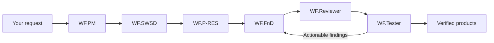

# WorkForce

WorkForce turns an ordinary project request into saved, reviewable products using **WF.PM + five engineering roles**. VS Code Local owns the native model/tool loop; WorkForce manages request identity, scoped assignments, independent review/testing and saved evidence. Its V-model panel observes the same native work.

The source repository remains [NeoTech-vietnam/NeoMind](https://github.com/NeoTech-vietnam/NeoMind). Earlier releases and history remain available. This **native-core** source pairs runtime **0.3.0-alpha.1** with VS Code extension **0.13.0**. Use matching published assets and their validation report from [GitHub releases](https://github.com/NeoTech-vietnam/NeoMind/releases).



| Agent | Responsibility | Model selection |
| --- | --- | --- |
| WF.PM | Intake, reuse discovery, planning, coordination and delivery | Native chat picker |
| WF.SWSD | Requirements, acceptance criteria and verification strategy | Native inheritance or role preference |
| WF.P-RES | Architecture, interfaces, module design and applicability | Native inheritance or role preference |
| WF.FnD | Implementation, reusable tools and product repair | Native inheritance or role preference |
| WF.Reviewer | Independent specification, design and code review | Native inheritance or role preference |
| WF.Tester | Independent checks, oracles, execution and evidence | Native inheritance or role preference |

Use the models already available in VS Code, including your existing custom endpoint/9router provider. No particular alias, catalog file, OpenCode engine or Model Bridge connection is required. **M7's new native REA provider and embedded managed gateway are deferred from this release.** Their source and research are retained; the existing optional REA plug-in remains available when explicitly configured. An alias does not prove its actual upstream model.

## Install the matching runtime and extension

Use the Windows x64 or Linux x64 portable runtime and matching WorkForce VSIX from one GitHub release. The runtime contains production dependencies; **Node.js 24.x or 26+ is a prerequisite**. It contains no OpenCode engine or managed gateway archive, and does not prepare M7 during installation or a request.

Extract the runtime outside your project. Initialize or update the exact project with its CLI:

```powershell
node D:\tools\WorkForce\workforce\dist\cli.js init --project D:\workspace\MyProject --name MyProject --platforms codex,copilot --local
```

Install the matching VSIX, then set the VS Code **User** setting `workforce.bridge.runtimePath` to that extracted `workforce` directory. Open your trusted project and run **WorkForce: Open Local WF.PM**. Use **WorkForce: Open V-model** to monitor saved stages and products. No legacy workspace connection probe is used.

Choose the installed `WF.PM` profile in Local chat and select your native model. Choose **Allow all** there if desired; native consent, Workspace Trust and organization policy remain effective. Global security settings are unchanged.

Write the requirement in your own words in Local chat. WF.PM prepares one plan and the backend delegates native specialists, retains their results, and runs the committed checks. Closing the V-model view does not cancel work. Closing VS Code cancels owned execution and retains results for reconciliation. Compatibility MCP in other clients provides status/reuse discovery; it does not replace editor-owned dispatch.

For an existing NeoMind project, stop the previous owner and use the migration/update instructions in [release installation](docs/install-release.md). Storage readers preserve historical identities and receipts. Local initialization and updates add exclusions to `.git/info/exclude`, preserve existing entries and leave `.gitignore` untouched.

## Universe and products

Universe displays an original V-model diagram for the selected request: requirements and design on the left, coding at the bottom, and unit/integration/system/acceptance checks on the right. WF.PM coordinates the request; WF.Reviewer has its own milestone. Colors and motion reflect saved backend stage state rather than configured agents or historical communication records.

The request list keeps products, criteria, findings and records together. Draft, partially verified and accepted products remain distinct. Product links are rechecked against the selected request and physical project containment before opening. Continue the same unfinished request through the native control tool rather than creating a replacement.

A pending question asks for genuine missing user information. Backend/tool/provider incidents remain WorkForce's responsibility and preserve existing artifacts; they are not relabeled as missing user input or accepted completion. The [implementation contract](docs/plans/2026-10-28-workforce-final-plan.md) defines the complete delivery and validation obligations.

## Reuse and existing integrations

- **Reusable tools:** SQLite/FTS5 locates prior work, then qualification checks task family, parameters, versions, environment, scope and permission. A suitable procedure reuses its tools and independent verifier; a partial match plans only the necessary difference. Similarity alone cannot approve execution.
- **Cornell notes:** requested learning outputs use the research, practice and separate-answer format. Existing destination settings are preserved, including `00_note/NeoMind` where the project already selected it.
- **Plug-in controls:** REA, CodeGraph, Context7 and Playwright retain pinned installation and MCP connection controls for Codex and Copilot. Configuration is distinct from successful client invocation. [Plug-ins](docs/plugins.md).
- **Focus Space:** the existing countdown, calendar, weather, YouTube and original ambient sound remain accessible. Ambient sound continues when returning to Universe; YouTube follows its visible-player restrictions. [Focus Space](docs/focus-space.md).
- **Model controls:** native model inventory supplies role preferences; omitted preferences inherit the parent. Changes apply to new invocations while active work retains its selected configuration. Credentials stay out of the webview and reports.

## Source development and candidate validation

```sh
npm ci
npm run engine:bootstrap
npm test
npm run runtime:package
npm run extension:package
npm run package:smoke
```

`engine:bootstrap` prepares historical development regression fixtures only; the native product does not include them. `runtime:package` creates a platform runtime under `artifacts/workforce-v0.3.0-alpha.1/`. Package smoke checks the installed CLI, profiles, local exclusions, read-only status/reuse MCP and edit-preserving updates outside the checkout. It verifies deferred M7 activation/archive are absent. `release:artifacts` builds candidates and checksums without publishing them.

A push to `codex/workforce-vscode-native` uses the Windows/Ubuntu CI regression matrix, then builds and extracts the platform runtime and matching VSIX. Candidate assets, checksums and package-smoke reports are retained as CI artifacts. CI does not publish a GitHub release automatically.

`npm test` builds first, then runs the complete `test/*.test.mjs` suite with at most two test files at once. Local and CI validation share this command. The scheduling budget bounds competing native guardian and ACL subprocesses without changing their deadlines or removing cases. Hosted validation must pass with this budget before a candidate is accepted.

Windows and Ubuntu CI establish core/package portability. Linux desktop support requires an actual Linux VS Code acceptance run. Unit tests, fixture UI screenshots and packaging smoke do not establish that a complete user request succeeded in Copilot Local, Codex or the installed panel. Publication remains gated by those real client journeys on the packaged candidate.

The implementation supports V-model/ASPICE engineering traceability. It does not claim a formal ASPICE certification merely from having agents, gates or reports.
