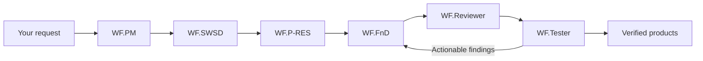

# WorkForce

WorkForce turns an ordinary project request into saved, reviewable products using **WF.PM + five engineering agents**. Copilot Local, Codex and WorkForce Universe share one request runtime. The runtime manages identity, scope, agent sessions and engineering state; models provide professional content through bound tools.

The source repository remains [NeoTech-vietnam/NeoMind](https://github.com/NeoTech-vietnam/NeoMind). Earlier NeoMind releases and their history remain available. The WorkForce candidate is runtime **0.2.0-alpha.1** with VS Code extension **0.12.0**; a built candidate is not release acceptance.



| Agent | Responsibility | Default alias |
| --- | --- | --- |
| WF.PM | Intake, reuse discovery, planning, coordination and delivery | `top-models` |
| WF.SWSD | Requirements, acceptance criteria and verification strategy | `top-models` |
| WF.P-RES | Architecture, interfaces, module design and applicability | `top-models` |
| WF.FnD | Implementation, reusable tools and product repair | `worker-models`, escalated when needed |
| WF.Reviewer | Independent specification, design and code review | `top-models` |
| WF.Tester | Independent checks, oracles, execution and evidence | `top-models` |

WorkForce uses the pinned **OpenCode 1.19.4 engine and SDK** for worker model/tool loops. Your configured 9router endpoint supplies `top-models` and `worker-models`. WorkForce owns the engineering contract and scoped gateway. It does not silently fall back to the older NeoMind model loop. An alias does not prove the upstream model behind your router.

## Install the matching runtime and extension

Use the Windows x64 or Linux x64 portable runtime from the matching GitHub release and its WorkForce VSIX. The portable runtime contains production dependencies, its pinned platform engine and the locked engine bootstrap. **Node.js 24.x or a supported newer version is a prerequisite.** No package download is deferred to the first engineering request.

Extract the runtime outside your project. Initialize or update the exact project with its CLI:

```powershell
node D:\tools\WorkForce\workforce\dist\cli.js init --project D:\workspace\MyProject --name MyProject --platforms codex,copilot --local
```

Install the matching VSIX, then set the VS Code **User** setting `workforce.bridge.runtimePath` to that extracted `workforce` directory. Open your project, run **WorkForce: Open Universe**, and **Connect WorkForce**. Setup checks distinguish configuration from a cached successful model/tool capability probe.

Choose **Open Local WF.PM** for Copilot Local. WorkForce uses the installed `WF.PM` profile, preserves the model picker and sets the workspace's `chat.permissions.default` to `autoApprove` where VS Code permits it. Platform consent, Trust and organization policy are respected; global approval settings are unchanged.

Write the requirement in your own words in chat or Universe. WorkForce accepts it once and returns its saved identity. The runtime owns the subsequent implementation, independent review/testing and recovery. Closing chat does not abandon accepted work while VS Code stays open. Closing VS Code stops its owned execution and preserves checkpoints for reconciliation after reopening.

For an existing NeoMind project, stop the previous owner and use the migration/update instructions in [release installation](docs/install-release.md). Storage readers preserve historical identities and receipts. Local initialization and updates add exclusions to `.git/info/exclude`, preserve existing entries and leave `.gitignore` untouched.

## Universe and products

Universe displays an original V-model diagram for the selected request: requirements and design on the left, coding at the bottom, and unit/integration/system/acceptance checks on the right. WF.PM coordinates the request; WF.Reviewer has its own milestone. Colors and motion reflect saved backend stage state rather than configured agents or historical communication records.

The request list keeps each request's products, criteria, findings and records together. Useful draft outputs are accessible before all checks finish. Draft, partially verified and accepted products remain distinct. Product links are rechecked against the selected request and physical project containment before opening. Pause, resume and cancel always target that saved request.

A pending question asks for genuine missing user information. Backend/tool/provider incidents remain WorkForce's responsibility and preserve existing artifacts; they are not relabeled as missing user input or accepted completion. The [implementation contract](docs/plans/2026-10-28-workforce-final-plan.md) defines the complete delivery and validation obligations.

## Reuse and existing integrations

- **Reusable tools:** SQLite/FTS5 locates prior work, then qualification checks task family, parameters, versions, environment, scope and permission. A suitable procedure reuses its tools and independent verifier; a partial match plans only the necessary difference. Similarity alone cannot approve execution.
- **Cornell notes:** requested learning outputs use the research, practice and separate-answer format. Existing destination settings are preserved, including `00_note/NeoMind` where the project already selected it.
- **Plug-in controls:** REA, CodeGraph, Context7 and Playwright retain pinned installation and MCP connection controls for Codex and Copilot. Configuration is distinct from successful client invocation. [Plug-ins](docs/plugins.md).
- **Focus Space:** the existing countdown, calendar, weather, YouTube and original ambient sound remain accessible. Ambient sound continues when returning to Universe; YouTube follows its visible-player restrictions. [Focus Space](docs/focus-space.md).
- **Model controls:** each of the six roles keeps its configured alias/provider. Changes apply to new invocations while active work retains its pinned configuration. Credentials stay out of the webview and reports.

## Source development and candidate validation

```sh
npm ci
npm run engine:bootstrap
npm test
npm run runtime:package
npm run extension:package
npm run package:smoke
```

`engine:bootstrap` installs the locked build prerequisite before any model request. `runtime:package` creates a self-contained platform runtime under `artifacts/workforce-v0.2.0-alpha.1/`; it must run natively on the target platform. The package smoke checks the installed CLI, engine, profiles, local exclusions, request-only MCP surface and edit-preserving updates without inference. `release:artifacts` builds local candidate assets and checksums; it does not publish them.

A push to `codex/workforce-vmodel` reuses the normal Windows/Ubuntu CI regression matrix, then builds and extracts that platform's portable runtime and matching VSIX. Candidate assets, checksums and package-smoke reports are retained as CI artifacts. This path works before the optional manual candidate workflow reaches the default branch. CI never publishes a GitHub release automatically.

`npm test` builds first, then runs the complete `test/*.test.mjs` suite with at most two test files at once. Local and CI validation share this command. The scheduling budget bounds competing native guardian and ACL subprocesses without changing their deadlines or removing cases. Hosted validation must pass with this budget before a candidate is accepted.

Windows and Ubuntu CI establish core/package portability. Linux desktop support requires an actual Linux VS Code acceptance run. Unit tests, fixture UI screenshots and packaging smoke do not establish that a complete user request succeeded in Copilot Local, Codex or the installed panel. Publication remains gated by those real client journeys on the packaged candidate.

The implementation supports V-model/ASPICE engineering traceability. It does not claim a formal ASPICE certification merely from having agents, gates or reports.
