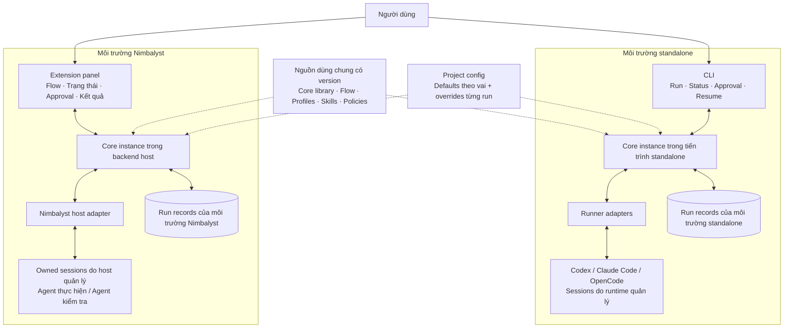
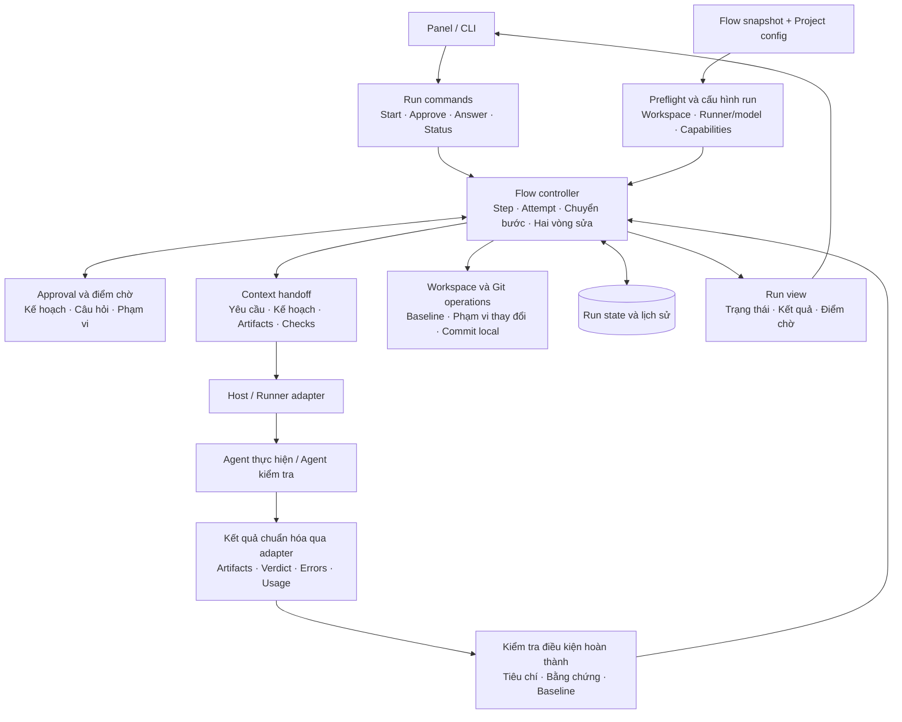
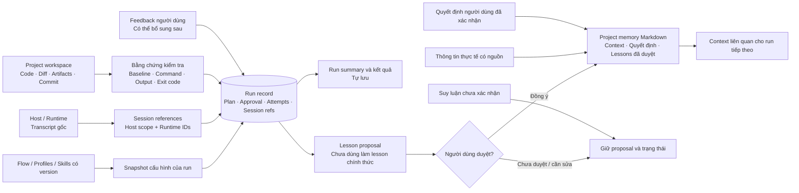
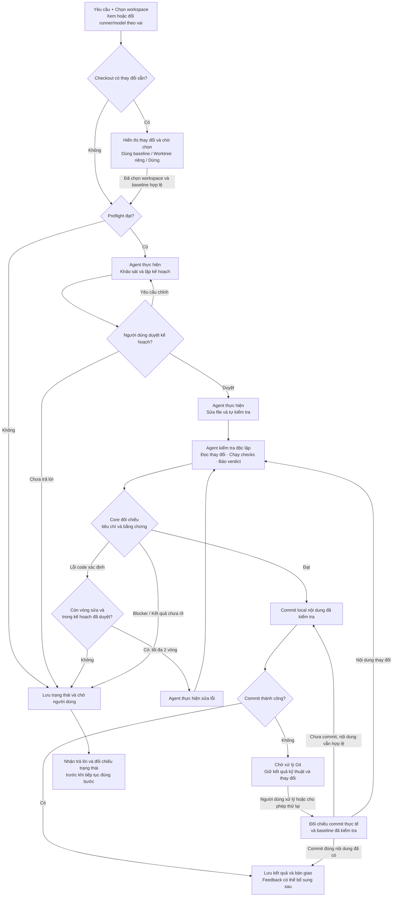
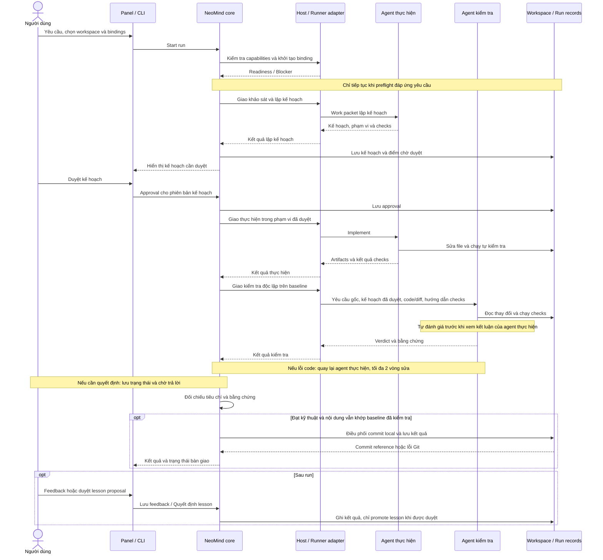
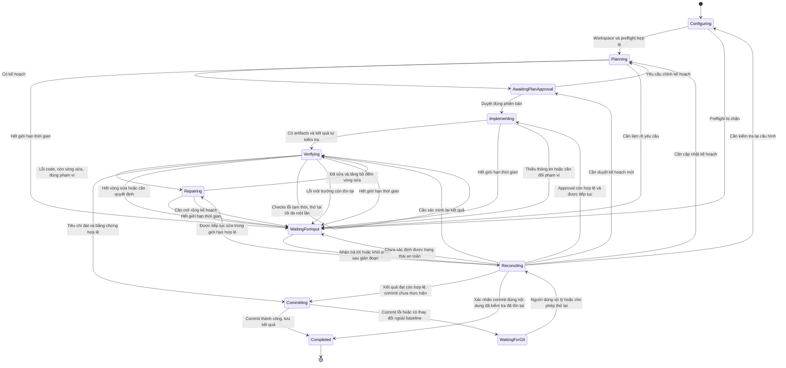

# Adaptive Agent Flow: kiến trúc đã thống nhất và thiết kế chi tiết đề xuất

**Nguồn thiết kế hiện tại:** [Thiết kế tổng hợp v1](design-v1.md) hợp nhất các quyết định và tự hoàn thiện contracts/defaults theo yêu cầu mới nhất. Đọc bản đó để triển khai; tài liệu này giữ sơ đồ và diễn tiến thiết kế trước đó. Người dùng đã yêu cầu bắt đầu implementation trong chat GPT-6.1 Terra sau khi hoàn thiện thiết kế.

**Cập nhật thiết kế:** [12 quyết định v1 của người dùng](v1-design-decisions.md) được ưu tiên cho các điểm đã chốt thêm: duyệt kế hoạch trước sửa file, hai vai agent, hai vòng sửa, defaults runner/model theo project, chọn workspace mỗi run, tự commit local và lessons cần duyệt. Các API/schema bên dưới vẫn là đề xuất.

**Mở rộng mới:** [Cấu hình nhiều flow và editor kéo thả](flow-configuration-design.md): tạo/sửa/xóa/đổi tên flow, bindings agent/model/reasoning, nhánh song song và nhiều reviewer đã được chọn vào phạm vi thiết kế phiên bản đầu. Flow code mặc định bên dưới là mẫu khởi đầu; semantics concurrency và tổng hợp review đang thảo luận.

Các policy F1–F4 đã được chốt trong tài liệu đó: workspace theo flow; mọi reviewer bắt buộc phải đạt; nhánh độc lập mặc định tiếp tục khi nhánh khác bị chặn; giới hạn sửa cả cấp run và từng vòng trong graph. Các sơ đồ tuyến tính ở mục 10 mô tả flow Dev mặc định; trạng thái tổng hợp run song song cần đặc tả riêng.

Ngày: 28/10/2026. Nhánh: `hieu/adaptive-agent-flow`.

Tài liệu này cập nhật các quyết định từ [thảo luận sản phẩm](product-direction.md) và [bộ câu hỏi thiết kế v1](v1-design-decisions.md). Ranh giới kiến trúc và hành vi v1 đã được chốt ở mức mô tả; cách chia module, schema, interface và trạng thái kỹ thuật dưới đây là đề xuất để thiết kế tiếp. Chưa có implementation trên nhánh này.

## 1. Các quyết định nền tảng

1. NeoMind điều phối công việc qua các agent runtime có sẵn, tận dụng tools và context management của chúng.
2. Hai môi trường Nimbalyst và standalone hoạt động độc lập; không dựa vào khả năng nhìn thấy/chia sẻ session giữa hai bên.
3. Cùng một định nghĩa flow, agents, skills và logic chuyển bước dùng được ở cả hai môi trường.
4. Người dùng Run rồi theo dõi; core tự tiến hành các bước hợp lệ và chờ người dùng khi có điều kiện cần can thiệp.
5. Mặc định worker không tự spawn subagent/session con. Core quyết định phân chia công việc.
6. Flow mặc định phục vụ **phát triển tính năng / sửa lỗi code**, có visualization trong Nimbalyst. Người dùng đã chọn phạm vi thiết kế v1 gồm quản lý nhiều flow, editor kéo thả, nhánh song song và nhiều reviewer. Selector tự động và nhiều level chưa được chốt.
7. Memory và feedback dùng Markdown trước; SQLite được nghiên cứu sau với migration và nguồn chuẩn rõ ràng.

## 2. Các khái niệm phải tách biệt

| Khái niệm | Ý nghĩa |
| --- | --- |
| Flow definition | Bản thiết kế có version, các bước, dependency, đầu ra, điều kiện chuyển và giới hạn |
| Run | Một lần thực thi flow đã chọn, trong đúng một môi trường |
| Step / attempt | Công việc logic và một lần thực hiện của nó; retry tạo attempt mới có lịch sử |
| Agent profile | Vai trò, instructions, skills, hooks áp dụng và quyền mong muốn |
| Runner | Công cụ thực thi agent: Codex, Claude Code, OpenCode; khác với model |
| Session binding | Liên kết attempt với session của host/runtime; có thể dùng session mới hoặc tiếp tục khi được cho phép |
| Model/provider | Backend model và nhà cung cấp được runner hỗ trợ, có cấu hình và auth phù hợp |
| Monitor | Hiển thị trạng thái và gửi lệnh điều khiển; không phải nơi duy nhất giữ scheduler/run state |

Một model Claude qua API thuần không tương đương Claude Code runtime. Một flow step cũng không tự động tương đương một subagent native. Các session có context riêng vẫn có thể sửa cùng file; isolation về context không bảo đảm isolation của filesystem.

## 3. Cấu trúc logic

### 3.1. Hai môi trường thực thi

Hai môi trường nạp cùng thư viện core và định nghĩa flow, nhưng mỗi môi trường sở hữu run, session bindings và vòng đời của mình. Sơ đồ thể hiện cách triển khai dự kiến, chưa xác nhận API host đã chạy được.

Mũi tên nét đứt biểu thị phụ thuộc code/config; mũi tên hai chiều biểu thị gửi lệnh và nhận trạng thái/kết quả. Không có đường đồng bộ session hoặc di chuyển live run giữa hai môi trường. Chưa yêu cầu daemon/server NeoMind riêng cho phiên bản đầu.

Trong Nimbalyst, dùng session API của host; không khởi chạy thêm SDK bên ngoài để thay thế các session host đã quản lý. Bên ngoài Nimbalyst, adapters điều khiển SDK/runtime trực tiếp. Không yêu cầu cross-host session discovery hay live run migration.

### 3.2. Các trách nhiệm bên trong core

Các khối dưới đây là cách chia trách nhiệm đề xuất trong cùng core, chưa yêu cầu tách thành services hoặc processes. Core điều phối cả hai vai; worker không gọi trực tiếp để tạo worker khác.

Agent kiểm tra đề xuất verdict có bằng chứng; core đối chiếu điều kiện của run trước khi chuyển bước. Chi tiết thuật toán acceptance, enforcement của approval và công cụ thực hiện Git còn cần đặc tả. Lệnh chạy checks có thể ghi artifacts; phải phân biệt tác động này với quyền sửa code.

### 3.3. Dữ liệu, memory và nguồn chuẩn

Run records thuộc môi trường chạy; project memory độc lập với lựa chọn Nimbalyst hay CLI, là nguồn dùng chung của project. Cách chia sẻ giữa worktrees, ghi đồng thời và freshness cần đặc tả. Sơ đồ là phân chia dữ liệu logic, chưa chốt đường dẫn lưu hoặc schema.

NeoMind lưu references và bằng chứng cần thiết, không mặc định sao chép transcript thành memory. Schema structured run state độc lập với quyết định Markdown-first cho memory. SQLite vẫn là hướng nghiên cứu sau; không có hai nguồn cùng được phép cập nhật mà thiếu quy tắc đồng bộ.

## 4. Ranh giới core và adapter

Core sở hữu flow snapshot, dependencies, trạng thái run/attempt, điều kiện chuyển bước, output handoff, repair limits và yêu cầu can thiệp. Agents không được tự đánh dấu accepted chỉ bằng một câu trả lời.

Adapter sở hữu giao tiếp runtime, ánh xạ IDs, khởi tạo/tiếp tục session, prompt delivery, events/results và quan sát capabilities. Hợp đồng logic đề xuất:

| Operation | Trách nhiệm |
| --- | --- |
| `capabilities` / preflight | Kiểm tra auth readiness, model/runner khả dụng, cancellation, resume, delegation enforcement và usage telemetry |
| `createSession` | Tạo session theo profile, working directory và runner/model bindings; trả session reference có host scope |
| `send` | Gửi work packet; phân biệt được chấp nhận gửi với đã hoàn thành |
| `observe` / `getResult` | Thu trạng thái, events và kết quả; phân biệt error, waiting, interrupted và completed |
| `cancel` | Yêu cầu hủy khi được hỗ trợ và xác nhận kết quả; không suy ra rollback |
| `resume` / reconcile | Tiếp tục hoặc đối chiếu run/session đã lưu theo capability; không mặc định tạo session mới |

Đây là contract đề xuất, chưa phải API triển khai. Capability không hỗ trợ phải được công bố hoặc làm preflight thất bại nếu bắt buộc; không fallback âm thầm sang provider/model khác. CLI/skills có thể cung cấp entrypoint để yêu cầu chạy flow; hướng dẫn bằng văn bản không thay thế core.

## 5. Lựa chọn SDK/runtime cho standalone

| Runner | Hướng tích hợp | Bằng chứng và trạng thái |
| --- | --- | --- |
| Codex | Ưu tiên thử `@openai/codex-sdk`; App Server là lựa chọn khi cần tương tác sâu hơn | SDK TypeScript bọc `codex exec`, stream JSONL; có start/resume threads, events và structured output. Chưa quyết định transport cuối cùng qua thử nghiệm |
| Claude Code | `@anthropic-ai/claude-agent-sdk` | Nimbalyst dùng SDK cho agent provider; không đồng nhất với chat API thuần. Chưa chạy thử inference SDK ở đây |
| OpenCode | `@opencode-ai/sdk` + OpenCode server | API client điều khiển session qua HTTP và events SSE; có thể start server hoặc nối server có sẵn. Cần pin API version và kiểm chứng session isolation |
| Antigravity | **Tạm hoãn**, ngoài phạm vi triển khai hiện tại theo quyết định người dùng 28/10/2026 | SDK/CLI đã được khảo sát nhưng auth SDK qua API key/Google Cloud không phù hợp ngân sách hiện tại. Giữ [report xác minh](antigravity-research.md) làm tham khảo; không tiếp tục cài/test adapter |

Auth là trách nhiệm runtime/provider tương ứng. SDK không đồng nghĩa bắt buộc API key, cũng không mặc định bảo đảm hỗ trợ mọi account/subscription. Reuse cơ chế đăng nhập được runtime hỗ trợ; không copy credentials giữa hosts.

Ràng buộc ngân sách hiện tại: ưu tiên account/subscription đã có, không yêu cầu mua API key để đạt workflow v1. Codex, Claude Code và OpenCode chỉ được xác nhận phù hợp sau khi kiểm chứng đường auth thực tế; đặc biệt OpenCode không tự cung cấp quyền truy cập miễn phí tới mọi model/provider. Không tự fallback sang API có tính phí khi account route không hoạt động.

OpenCode server có thể quản lý nhiều session. Cần xác định lifecycle và ownership của server do adapter tạo; không dừng server do người dùng hoặc ứng dụng khác sở hữu. Cách cấp phát server/process là implementation detail, không phải semantics của flow.

## 6. Delegation mặc định tắt

Policy mong muốn: `delegation: disabled` cho mọi worker session, bao gồm native subagent và tools tạo session con. Việc thêm session phải đi qua quyết định core và hiện trên graph/run history.

Adapter báo mức thực thi: chặn bằng tool/runtime policy đã kiểm chứng; chỉ nhắc bằng instructions; hoặc không hỗ trợ. Không trình bày instructions-only là đã chặn chắc chắn. Khi một flow yêu cầu cưỡng chế mà adapter không đáp ứng, chặn preflight hoặc chờ người dùng quyết định rõ.

Không cần quan sát mọi chi tiết nội bộ để phiên bản đầu chạy được, nhưng không bỏ qua delegation đã phát hiện. Chi phí thấp hơn là giả thuyết cần đo; tắt subagent không tự chứng minh tiết kiệm trên mọi task.

## 7. Kết quả, context handoff và độ tin cậy

Runtime hoàn tất một turn/session không đồng nghĩa step đạt yêu cầu. Core cần đánh giá artifacts, kết quả check và output contract. Các nhãn báo lỗi phải được đọc theo semantics từng adapter; [probe CLI](cli-invocation-probe.md) đã cho thấy Claude có thể trả `subtype: success` đồng thời `is_error: true`.

Work packet nên chỉ chứa mục tiêu, context liên quan, phạm vi, đầu ra và cách kiểm tra. Bàn giao qua artifacts/tham chiếu và bản tóm tắt có nguồn, không mặc định copy toàn bộ transcript. Model-generated structured JSON giúp đọc output nhưng không tự chứng minh nội dung đúng.

Run liên kết flow version, profile/skill version, attempt/session reference, runner/model yêu cầu và quan sát được, code/artifact baseline, checks, feedback. Sau crash hoặc timeout, đối chiếu trước khi retry; kết quả chưa rõ không được đổi thành failed-no-effect hay tự chạy lại thao tác có tác dụng phụ.

Nếu dùng chung project memory/files từ nhiều môi trường, cần giới hạn concurrent writes, kiểm tra phiên bản/hash và giải quyết xung đột. Default flow nên bắt đầu tuần tự; concurrency và workspace isolation cụ thể còn cần thiết kế.

Nếu người dùng hoặc công cụ khác sửa code lúc run chờ, core đối chiếu với kế hoạch. Thay đổi còn trong phạm vi được cập nhật baseline và kiểm tra lại phần bị ảnh hưởng; vượt phạm vi phải chờ duyệt lại. Cập nhật baseline không có nghĩa mọi thay đổi bên ngoài được đưa vào commit của run, và không tự reset hai vòng sửa.

Lỗi checks có vẻ tạm thời do môi trường/dịch vụ được tự thử lại tối đa một lần, sau đó lưu bằng chứng và chờ người dùng; lần này không trừ vào hai vòng sửa code. Trường hợp chưa xác định lỗi code hay môi trường phải giữ kết quả chưa rõ, không tự sửa code để làm checks xanh. Phạm vi bộ đếm thử lại cần đặc tả để tránh retry vô hạn; retry chỉ khi biết lần chạy trước đã kết thúc và thao tác phù hợp để chạy lại.

Giới hạn thời gian mặc định theo project được hiển thị và cho đổi đầu run; hết giới hạn thì lưu trạng thái và chờ người dùng. Chỉ tính thời gian xử lý tự động; toàn run chờ người dùng thì ngừng đếm, còn nhánh đang chạy thì vẫn tính. Giá trị mặc định, cách tính thời gian xếp hàng và xác nhận runtime đã dừng còn cần đặc tả. Hết thời gian không đồng nghĩa thao tác đang chạy chưa có tác dụng; resume phải reconcile.

## 8. Nimbalyst visualization và giới hạn host

Panel dùng API host/backend để hiển thị run, step, trạng thái chờ, session transcript, artifacts và feedback. Các lệnh UI gọi core, không tự chỉnh trạng thái run hoặc tạo session bỏ qua core. Liên kết vào task/Kanban cần xác minh API thay vì viết trực tiếp database nội bộ.

SDK session đã đọc có `create`, `sendPrompt`, `getStatus`, `getResult`, `listOwned`, `getUsage`, `onSettled`. API backend chỉ quản lý sessions thuộc extension trong workspace tương ứng. Không mặc định tiếp quản session người dùng đã tạo ngoài extension.

Đóng panel không kết thúc run. Đóng project/Nimbalyst có thể kết thúc host module; chưa hứa chạy nền sau khi đóng ứng dụng. `onSettled` khi module ngừng hoạt động không được replay; startup phải reconcile với sessions/run state đã lưu. Standalone không phụ thuộc VS Code/Nimbalyst mở.

Theo lựa chọn khôi phục F21, startup tự đối chiếu session, code và trạng thái đã lưu, hiển thị kết quả rồi chờ người dùng bấm Tiếp tục trước khi giao thêm việc. Nếu runtime cũ còn chạy thì phải hiển thị đúng; chờ xác nhận tiếp tục không đồng nghĩa công việc cũ đã dừng. Xem [vòng đời và recovery](flow-configuration-design.md#khôi-phục-sau-khi-đóng-hoặc-crash).

## 9. Memory, feedback và hướng adaptive

Markdown là bước đầu cho project context, quyết định, lessons, run summaries và feedback. Trạng thái run cần cấu trúc/version rõ ràng; định dạng lưu chính xác chưa chốt. Transcript native vẫn thuộc runtime/host; NeoMind không coi transcript là project memory mặc định.

Core được tự cập nhật context thực tế có nguồn. Quyết định chỉ ghi khi người dùng đã xác nhận trong trao đổi; suy luận chưa xác nhận giữ dạng đề xuất. Lessons phải được duyệt trước khi trở thành memory dùng chung. Các quy tắc này giống nhau trong Nimbalyst và standalone.

Feedback người dùng là đầu vào đánh giá chính đã được yêu cầu, đi kèm kết quả checks và telemetry có thể quan sát. Chi phí không được báo cáo phải là unknown/unavailable; giá trị 0 do provider không cung cấp không có nghĩa là miễn phí. Không so sánh token giữa providers khi semantics chưa chuẩn hóa.

Thiếu telemetry token/chi phí không chặn run v1: vẫn áp dụng giới hạn thời gian và số vòng sửa; UI hiển thị các trường không đo được. Không quảng bá giới hạn token/chi phí cứng khi adapter chưa cung cấp đủ dữ liệu để thực thi.

Các hướng sau phiên bản đầu: nhiều flow có version, level/presets, selector theo loại task/rủi ro/ngân sách; editor kéo thả; benchmark và cải thiện thông qua phiên bản ứng viên có đánh giá và rollback. Chưa cam kết chất lượng tăng theo level hoặc theo số lần chạy.

## 10. Default flow v1 đã chốt và thiết kế chuyển trạng thái

Nhóm công việc là phát triển tính năng / sửa lỗi code; pilot đã chọn loại task thêm tính năng nhỏ. Hành vi dưới đây bám theo [12 quyết định v1](v1-design-decisions.md). Tên trạng thái, hợp đồng dữ liệu và cơ chế recovery là đề xuất.

### 10.1. Luồng nghiệp vụ và vòng sửa

Nút chờ lưu cả nguyên nhân và bước cần quay lại. Kế hoạch duyệt gồm mục tiêu, phạm vi, cách thực hiện, tiêu chí hoàn thành và checks, trình bày ngắn gọn và cho mở thêm chi tiết. Đổi mục tiêu, hành vi sản phẩm, mở rộng phạm vi hoặc phát sinh thao tác rủi ro mới cần duyệt lại; chi tiết kỹ thuật trong phạm vi được tự điều chỉnh.

Cạnh từ câu trả lời không trỏ cố định về bước thực hiện: nếu kế hoạch thay đổi thì phải duyệt lại; nếu runtime có kết quả chưa rõ thì reconcile trước. Sau lần verification đầu, cho phép tối đa hai vòng sửa và kiểm tra lại trong phạm vi được duyệt. Hết giới hạn không tự tạo run mới để tiếp tục sửa. Nếu nội dung thay đổi trong lúc chờ Git, cần kiểm tra lại; cách tính vòng cho thay đổi do người dùng và trường hợp cần duyệt lại kế hoạch còn phải đặc tả.

### 10.2. Tương tác giữa người dùng, core và hai vai agent

`Workspace / Run records` gộp hai nơi lưu vào một cột để dễ đọc; không hàm ý cùng schema hoặc storage backend. Agent chỉ truy cập workspace theo quyền được cấp; core sở hữu run state và approval. Sơ đồ mô tả đường thành công, các nhánh lỗi ở mục 10.1 và 10.3. Verifier ở session độc lập với agent thực hiện và giữ cùng session qua các lần kiểm tra trong một run; chỉ tạo mới khi không thể tiếp tục session cũ. Khi phải tạo mới, cần bàn giao cả các lỗi đã báo và kết quả xác minh, giữ lịch sử session bindings.

### 10.3. Trạng thái run đề xuất

Đây là mô hình đề xuất, chưa phải enum/API. `AwaitingPlanApproval` và `WaitingForInput` đều giữ trạng thái chờ; không tự timeout thành đồng ý. Mọi đường resume phải kiểm tra approval, baseline, session status và bộ đếm sửa; câu trả lời không tự reset giới hạn hai vòng. Hành vi Tạm dừng/Hủy được cập nhật ở [vòng đời flow linh hoạt](flow-configuration-design.md#10-tạm-dừng-hủy-và-thời-gian-xử-lý); lỗi lưu trữ và host shutdown cần đặc tả thêm.

`Completed` trong sơ đồ là kết thúc toàn bộ quy trình bao gồm commit thành công. Mốc đạt kỹ thuật nằm trước `Committing` và không phụ thuộc feedback. Nếu commit lỗi, run ở `WaitingForGit`, giữ kết quả kỹ thuật đã đạt và thay đổi. Người dùng xử lý hoặc cho phép thử lại rồi tiếp tục hoàn tất. Reconcile phải tra commit thực tế trước khi thử lại để tránh commit trùng; nếu baseline thay đổi, không dùng lại bằng chứng cũ để commit nội dung chưa kiểm tra.

| Bước | Nội dung và đầu ra đề xuất |
| --- | --- |
| Khảo sát/lập kế hoạch | Đọc code, xác định phạm vi, tiêu chí hoàn thành và checks; luôn chờ người dùng duyệt trước khi sửa file |
| Thực hiện | Code/docs trong phạm vi, kiểm tra ban đầu và bàn giao artifacts cùng kết quả thật |
| Kiểm tra độc lập | Agent khác đọc yêu cầu và thay đổi, chạy checks phù hợp và trả verdict có bằng chứng; không tự sửa code |
| Sửa và kiểm tra lại | Agent thực hiện sửa trong kế hoạch được duyệt, tối đa hai vòng; agent kiểm tra xác minh lại |
| Tổng hợp | Điều phối commit local sau khi kiểm tra đạt, lưu kết quả và giới hạn; feedback sau run, lessons cần duyệt |

Không đặt thêm Reviewer như một session bắt buộc trước khi có nhu cầu/rủi ro cụ thể. Kế hoạch luôn cần duyệt; các bước thực hiện và vòng sửa trong phạm vi đã duyệt tự tiếp tục. Feedback có thể bổ sung sau khi run hoàn tất; kết quả kỹ thuật và mức hài lòng người dùng là hai trường khác nhau.

Project và tính năng pilot cụ thể, exact checks, session recovery, model IDs và giá trị giới hạn thời gian còn cần thiết kế. Defaults theo vai ở project và overrides đầu run đã được chọn; chưa chốt format config. Flow tự commit local; push và tạo PR theo yêu cầu riêng. Chưa chốt tự động merge hoặc deploy.

## 11. Thứ tự research và các câu hỏi còn mở

1. Chọn task pilot trong nhóm phát triển tính năng / sửa lỗi code đã được người dùng chọn; xác định đầu ra, checks và điểm cần can thiệp.
2. Xác nhận phiên bản Nimbalyst và SDK/runtime mục tiêu; pin nguồn và lập capability matrix.
3. Thử SDK inference nhỏ cho từng runner trong môi trường có auth/network phù hợp; thử default flow trên một runner trước rồi kiểm chứng adapter tiếp theo.
4. Thử cùng logic qua Nimbalyst owned sessions, panel và lifecycle events; kiểm tra đóng panel, chờ người dùng, lỗi và reopen/reconcile.
5. Chốt schema flow, output contract, trạng thái run, workspace/file ownership và giới hạn token/thời gian từ kết quả thực nghiệm; giữ giới hạn hai vòng sửa đã chọn trừ khi người dùng thay đổi.

Chưa chốt: project/tính năng pilot cụ thể; provider/model IDs và config format; giá trị/cách tính giới hạn thời gian và ngân sách token nếu đo được; flow definition format; recovery session; thao tác cancel/resume nào host thực sự đáp ứng. Workspace được chọn đầu run; dirty checkout phải chờ người dùng chọn cách xử lý, còn cách tách changes, concurrent writes và commit scope cần đặc tả.

Việc độc lập giữa hai môi trường đã được chốt, nên không mở lại yêu cầu đồng bộ session để quyết định những phần trên. Nghiên cứu và thiết kế vẫn là phase hiện tại; probe nhỏ không phải bắt đầu triển khai sản phẩm.

## Nguồn và mức bằng chứng

Các nguồn được đọc qua Internet trong trao đổi ngày 28/10/2026; URL nhánh động, chưa phải dependency pins:

- [Nimbalyst extension architecture](https://github.com/nimbalyst/nimbalyst/blob/main/docs/EXTENSION_ARCHITECTURE.md).
- [Nimbalyst backend session SDK](https://github.com/nimbalyst/nimbalyst/blob/main/packages/extension-sdk/src/types/backendSessions.ts) và [panel SDK](https://github.com/nimbalyst/nimbalyst/blob/main/packages/extension-sdk/src/types/panel.ts).
- [Nimbalyst provider catalog](https://github.com/nimbalyst/nimbalyst/blob/main/docs/AI_PROVIDER_TYPES.md).
- [Codex SDK README](https://github.com/openai/codex/blob/main/sdk/typescript/README.md) và [exec transport source](https://github.com/openai/codex/blob/main/sdk/typescript/src/exec.ts).
- [Nimbalyst Codex App Server adapter](https://github.com/nimbalyst/nimbalyst/blob/main/packages/runtime/src/ai/server/protocols/CodexAppServerProtocol.ts).
- [Nimbalyst Claude Code provider](https://github.com/nimbalyst/nimbalyst/blob/main/packages/runtime/src/ai/server/providers/ClaudeCodeProvider.ts).
- [OpenCode SDK documentation source](https://github.com/anomalyco/opencode/blob/dev/packages/web/src/content/docs/sdk.mdx) và [Nimbalyst OpenCode adapter](https://github.com/nimbalyst/nimbalyst/blob/main/packages/runtime/src/ai/server/protocols/OpenCodeSDKProtocol.ts).
- [Google Antigravity SDK](https://github.com/google-antigravity/antigravity-sdk-python), [CLI](https://github.com/google-antigravity/antigravity-cli) và [phân tích phạm vi hỗ trợ](antigravity-research.md).

Các API được quan sát ở tài liệu/type/source; chưa xác minh trên host Nimbalyst của người dùng. Probe CLI hiện chỉ xác nhận khởi chạy và thu events/errors; Codex bị network policy chặn, Claude chưa đăng nhập, OpenCode chưa resolve model/catalog. Không có inference end-to-end thành công để tuyên bố adapters đã hoạt động.
