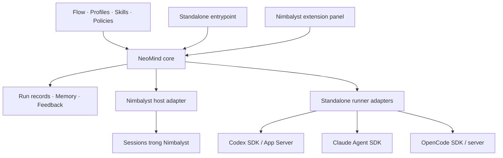

# Adaptive Agent Flow: kiến trúc đã thống nhất và thiết kế chi tiết đề xuất

Ngày: 28/10/2026. Nhánh: `hieu/adaptive-agent-flow`.

Tài liệu này cập nhật các quyết định từ [thảo luận sản phẩm](product-direction.md). Ranh giới kiến trúc đã được người dùng thống nhất; schema, interface, ngân sách và default flow chi tiết vẫn là đề xuất. Chưa có implementation trên nhánh này.

## 1. Các quyết định nền tảng

1. NeoMind điều phối công việc qua các agent runtime có sẵn, tận dụng tools và context management của chúng.
2. Hai môi trường Nimbalyst và standalone hoạt động độc lập; không dựa vào khả năng nhìn thấy/chia sẻ session giữa hai bên.
3. Cùng một định nghĩa flow, agents, skills và logic chuyển bước dùng được ở cả hai môi trường.
4. Người dùng Run rồi theo dõi; core tự tiến hành các bước hợp lệ và chờ người dùng khi có điều kiện cần can thiệp.
5. Mặc định worker không tự spawn subagent/session con. Core quyết định phân chia công việc.
6. Một flow mặc định phục vụ **phát triển tính năng / sửa lỗi code** cho phiên bản đầu, có visualization trong Nimbalyst. Nhóm công việc do người dùng chọn ngày 28/10/2026; editor kéo thả và selector nhiều level là hướng tiếp theo.
7. Memory và feedback dùng Markdown trước; SQLite được nghiên cứu sau với migration và nguồn chuẩn rõ ràng.

## 2. Các khái niệm phải tách biệt

| Khái niệm | Ý nghĩa |
| --- | --- |
| Flow definition | Bản thiết kế có version, các bước, dependency, đầu ra, điều kiện chuyển và giới hạn |
| Run | Một lần thực thi flow đã chọn, trong đúng một môi trường |
| Step / attempt | Công việc logic và một lần thực hiện của nó; retry tạo attempt mới có lịch sử |
| Agent profile | Vai trò, instructions, skills, hooks áp dụng và quyền mong muốn |
| Runner | Công cụ thực thi agent: Codex, Claude Code, OpenCode; khác với model |
| Session binding | Liên kết attempt với session của host/runtime; có thể dùng session mới hoặc tiếp tục khi được cho phép |
| Model/provider | Backend model và nhà cung cấp được runner hỗ trợ, có cấu hình và auth phù hợp |
| Monitor | Hiển thị trạng thái và gửi lệnh điều khiển; không phải nơi duy nhất giữ scheduler/run state |

Một model Claude qua API thuần không tương đương Claude Code runtime. Một flow step cũng không tự động tương đương một subagent native. Các session có context riêng vẫn có thể sửa cùng file; isolation về context không bảo đảm isolation của filesystem.

## 3. Cấu trúc logic



Sơ đồ mô tả code dùng chung, không phải một singleton core dùng chung cho mọi môi trường. Mỗi run có owner trong host của nó. Nimbalyst có thể nạp core như thư viện trong backend module; standalone có thể nạp cùng thư viện trong tiến trình riêng. Chưa yêu cầu daemon/server NeoMind riêng cho phiên bản đầu.

Trong Nimbalyst, dùng session API của host; không khởi chạy thêm SDK bên ngoài để thay thế các session host đã quản lý. Bên ngoài Nimbalyst, adapters điều khiển SDK/runtime trực tiếp. Không yêu cầu cross-host session discovery hay live run migration.

## 4. Ranh giới core và adapter

Core sở hữu flow snapshot, dependencies, trạng thái run/attempt, điều kiện chuyển bước, output handoff, repair limits và yêu cầu can thiệp. Agents không được tự đánh dấu accepted chỉ bằng một câu trả lời.

Adapter sở hữu giao tiếp runtime, ánh xạ IDs, khởi tạo/tiếp tục session, prompt delivery, events/results và quan sát capabilities. Hợp đồng logic đề xuất:

| Operation | Trách nhiệm |
| --- | --- |
| `capabilities` / preflight | Kiểm tra auth readiness, model/runner khả dụng, cancellation, resume, delegation enforcement và usage telemetry |
| `createSession` | Tạo session theo profile, working directory và runner/model bindings; trả session reference có host scope |
| `send` | Gửi work packet; phân biệt được chấp nhận gửi với đã hoàn thành |
| `observe` / `getResult` | Thu trạng thái, events và kết quả; phân biệt error, waiting, interrupted và completed |
| `cancel` | Yêu cầu hủy khi được hỗ trợ và xác nhận kết quả; không suy ra rollback |
| `resume` / reconcile | Tiếp tục hoặc đối chiếu run/session đã lưu theo capability; không mặc định tạo session mới |

Đây là contract đề xuất, chưa phải API triển khai. Capability không hỗ trợ phải được công bố hoặc làm preflight thất bại nếu bắt buộc; không fallback âm thầm sang provider/model khác. CLI/skills có thể cung cấp entrypoint để yêu cầu chạy flow; hướng dẫn bằng văn bản không thay thế core.

## 5. Lựa chọn SDK/runtime cho standalone

| Runner | Hướng tích hợp | Bằng chứng và trạng thái |
| --- | --- | --- |
| Codex | Ưu tiên thử `@openai/codex-sdk`; App Server là lựa chọn khi cần tương tác sâu hơn | SDK TypeScript bọc `codex exec`, stream JSONL; có start/resume threads, events và structured output. Chưa quyết định transport cuối cùng qua thử nghiệm |
| Claude Code | `@anthropic-ai/claude-agent-sdk` | Nimbalyst dùng SDK cho agent provider; không đồng nhất với chat API thuần. Chưa chạy thử inference SDK ở đây |
| OpenCode | `@opencode-ai/sdk` + OpenCode server | API client điều khiển session qua HTTP và events SSE; có thể start server hoặc nối server có sẵn. Cần pin API version và kiểm chứng session isolation |
| Antigravity | **Tạm hoãn**, ngoài phạm vi triển khai hiện tại theo quyết định người dùng 28/10/2026 | SDK/CLI đã được khảo sát nhưng auth SDK qua API key/Google Cloud không phù hợp ngân sách hiện tại. Giữ [report xác minh](antigravity-research.md) làm tham khảo; không tiếp tục cài/test adapter |

Auth là trách nhiệm runtime/provider tương ứng. SDK không đồng nghĩa bắt buộc API key, cũng không mặc định bảo đảm hỗ trợ mọi account/subscription. Reuse cơ chế đăng nhập được runtime hỗ trợ; không copy credentials giữa hosts.

Ràng buộc ngân sách hiện tại: ưu tiên account/subscription đã có, không yêu cầu mua API key để đạt workflow v1. Codex, Claude Code và OpenCode chỉ được xác nhận phù hợp sau khi kiểm chứng đường auth thực tế; đặc biệt OpenCode không tự cung cấp quyền truy cập miễn phí tới mọi model/provider. Không tự fallback sang API có tính phí khi account route không hoạt động.

OpenCode server có thể quản lý nhiều session. Cần xác định lifecycle và ownership của server do adapter tạo; không dừng server do người dùng hoặc ứng dụng khác sở hữu. Cách cấp phát server/process là implementation detail, không phải semantics của flow.

## 6. Delegation mặc định tắt

Policy mong muốn: `delegation: disabled` cho mọi worker session, bao gồm native subagent và tools tạo session con. Việc thêm session phải đi qua quyết định core và hiện trên graph/run history.

Adapter báo mức thực thi: chặn bằng tool/runtime policy đã kiểm chứng; chỉ nhắc bằng instructions; hoặc không hỗ trợ. Không trình bày instructions-only là đã chặn chắc chắn. Khi một flow yêu cầu cưỡng chế mà adapter không đáp ứng, chặn preflight hoặc chờ người dùng quyết định rõ.

Không cần quan sát mọi chi tiết nội bộ để phiên bản đầu chạy được, nhưng không bỏ qua delegation đã phát hiện. Chi phí thấp hơn là giả thuyết cần đo; tắt subagent không tự chứng minh tiết kiệm trên mọi task.

## 7. Kết quả, context handoff và độ tin cậy

Runtime hoàn tất một turn/session không đồng nghĩa step đạt yêu cầu. Core cần đánh giá artifacts, kết quả check và output contract. Các nhãn báo lỗi phải được đọc theo semantics từng adapter; [probe CLI](cli-invocation-probe.md) đã cho thấy Claude có thể trả `subtype: success` đồng thời `is_error: true`.

Work packet nên chỉ chứa mục tiêu, context liên quan, phạm vi, đầu ra và cách kiểm tra. Bàn giao qua artifacts/tham chiếu và bản tóm tắt có nguồn, không mặc định copy toàn bộ transcript. Model-generated structured JSON giúp đọc output nhưng không tự chứng minh nội dung đúng.

Run liên kết flow version, profile/skill version, attempt/session reference, runner/model yêu cầu và quan sát được, code/artifact baseline, checks, feedback. Sau crash hoặc timeout, đối chiếu trước khi retry; kết quả chưa rõ không được đổi thành failed-no-effect hay tự chạy lại thao tác có tác dụng phụ.

Nếu dùng chung project memory/files từ nhiều môi trường, cần giới hạn concurrent writes, kiểm tra phiên bản/hash và giải quyết xung đột. Default flow nên bắt đầu tuần tự; concurrency và workspace isolation cụ thể còn cần thiết kế.

## 8. Nimbalyst visualization và giới hạn host

Panel dùng API host/backend để hiển thị run, step, trạng thái chờ, session transcript, artifacts và feedback. Các lệnh UI gọi core, không tự chỉnh trạng thái run hoặc tạo session bỏ qua core. Liên kết vào task/Kanban cần xác minh API thay vì viết trực tiếp database nội bộ.

SDK session đã đọc có `create`, `sendPrompt`, `getStatus`, `getResult`, `listOwned`, `getUsage`, `onSettled`. API backend chỉ quản lý sessions thuộc extension trong workspace tương ứng. Không mặc định tiếp quản session người dùng đã tạo ngoài extension.

Đóng panel không kết thúc run. Đóng project/Nimbalyst có thể kết thúc host module; chưa hứa chạy nền sau khi đóng ứng dụng. `onSettled` khi module ngừng hoạt động không được replay; startup phải reconcile với sessions/run state đã lưu. Standalone không phụ thuộc VS Code/Nimbalyst mở.

## 9. Memory, feedback và hướng adaptive

Markdown là bước đầu cho project context, quyết định, lessons, run summaries và feedback. Trạng thái run cần cấu trúc/version rõ ràng; định dạng lưu chính xác chưa chốt. Transcript native vẫn thuộc runtime/host; NeoMind không coi transcript là project memory mặc định.

Feedback người dùng là đầu vào đánh giá chính đã được yêu cầu, đi kèm kết quả checks và telemetry có thể quan sát. Chi phí không được báo cáo phải là unknown/unavailable; giá trị 0 do provider không cung cấp không có nghĩa là miễn phí. Không so sánh token giữa providers khi semantics chưa chuẩn hóa.

Các hướng sau phiên bản đầu: nhiều flow có version, level/presets, selector theo loại task/rủi ro/ngân sách; editor kéo thả; benchmark và cải thiện thông qua phiên bản ứng viên có đánh giá và rollback. Chưa cam kết chất lượng tăng theo level hoặc theo số lần chạy.

## 10. Default flow cho công việc code: bản đề xuất để thiết kế tiếp

Nhóm công việc đã được người dùng chốt là phát triển tính năng / sửa lỗi code. Các bước, vai và giới hạn dưới đây là đề xuất, chưa phải lựa chọn đã được xác nhận riêng.

```text
Run + yêu cầu
    -> Khảo sát và lập kế hoạch
    -> Thực hiện thay đổi
    -> Kiểm tra độc lập
       -> đạt: tổng hợp bàn giao, mời người dùng feedback
       -> lỗi xác định: sửa trong ngân sách rồi kiểm tra lại
       -> thiếu thông tin / hết ngân sách / lỗi môi trường: chờ can thiệp
```

| Bước | Nội dung và đầu ra đề xuất |
| --- | --- |
| Khảo sát/lập kế hoạch | Đọc code, tìm cách tái hiện nếu là bug, xác định phạm vi, tiêu chí hoàn thành và checks. Chỉ hỏi người dùng khi thiếu ý định sản phẩm hoặc có quyết định quan trọng chưa thể suy ra |
| Thực hiện | Code/docs trong phạm vi, kiểm tra ban đầu và bàn giao artifacts cùng kết quả thật |
| Kiểm tra độc lập | Đề xuất dùng session mới; đọc yêu cầu và thay đổi, chạy checks phù hợp, tìm regression và đưa verdict có bằng chứng |
| Tổng hợp | Lưu kết quả, giới hạn, những checks chưa chạy; đánh dấu hoàn thành chỉ khi điều kiện đã đáp ứng, sau đó thu feedback |

Không đặt thêm Reviewer như một session bắt buộc trước khi có nhu cầu/rủi ro cụ thể. Không bắt người dùng duyệt từng bước bình thường. Feedback có thể bổ sung sau khi run hoàn tất; kết quả kỹ thuật và mức hài lòng người dùng là hai trường khác nhau.

Task pilot, exact checks, session reuse giữa khảo sát/thực hiện, quyền sửa của Verifier, model defaults và ngân sách repair còn cần thiết kế. Con số retry hoặc số lượng session chưa được chốt. Chưa tự động commit/push/deploy từ flow khi chưa có chính sách và yêu cầu tương ứng.

## 11. Thứ tự research và các câu hỏi còn mở

1. Chọn task pilot trong nhóm phát triển tính năng / sửa lỗi code đã được người dùng chọn; xác định đầu ra, checks và điểm cần can thiệp.
2. Xác nhận phiên bản Nimbalyst và SDK/runtime mục tiêu; pin nguồn và lập capability matrix.
3. Thử SDK inference nhỏ cho từng runner trong môi trường có auth/network phù hợp; thử default flow trên một runner trước rồi kiểm chứng adapter tiếp theo.
4. Thử cùng logic qua Nimbalyst owned sessions, panel và lifecycle events; kiểm tra đóng panel, chờ người dùng, lỗi và reopen/reconcile.
5. Chốt schema flow, output contract, trạng thái run, workspace/file ownership và giới hạn repair/budget từ kết quả thực nghiệm.

Chưa chốt: task pilot cụ thể; provider/model defaults; repair/token/time limits; flow definition format; bước nào bắt buộc verification session riêng; thao tác cancel/resume nào host thực sự đáp ứng.

Việc độc lập giữa hai môi trường đã được chốt, nên không mở lại yêu cầu đồng bộ session để quyết định những phần trên. Nghiên cứu và thiết kế vẫn là phase hiện tại; probe nhỏ không phải bắt đầu triển khai sản phẩm.

## Nguồn và mức bằng chứng

Các nguồn được đọc qua Internet trong trao đổi ngày 28/10/2026; URL nhánh động, chưa phải dependency pins:

- [Nimbalyst extension architecture](https://github.com/nimbalyst/nimbalyst/blob/main/docs/EXTENSION_ARCHITECTURE.md).
- [Nimbalyst backend session SDK](https://github.com/nimbalyst/nimbalyst/blob/main/packages/extension-sdk/src/types/backendSessions.ts) và [panel SDK](https://github.com/nimbalyst/nimbalyst/blob/main/packages/extension-sdk/src/types/panel.ts).
- [Nimbalyst provider catalog](https://github.com/nimbalyst/nimbalyst/blob/main/docs/AI_PROVIDER_TYPES.md).
- [Codex SDK README](https://github.com/openai/codex/blob/main/sdk/typescript/README.md) và [exec transport source](https://github.com/openai/codex/blob/main/sdk/typescript/src/exec.ts).
- [Nimbalyst Codex App Server adapter](https://github.com/nimbalyst/nimbalyst/blob/main/packages/runtime/src/ai/server/protocols/CodexAppServerProtocol.ts).
- [Nimbalyst Claude Code provider](https://github.com/nimbalyst/nimbalyst/blob/main/packages/runtime/src/ai/server/providers/ClaudeCodeProvider.ts).
- [OpenCode SDK documentation source](https://github.com/anomalyco/opencode/blob/dev/packages/web/src/content/docs/sdk.mdx) và [Nimbalyst OpenCode adapter](https://github.com/nimbalyst/nimbalyst/blob/main/packages/runtime/src/ai/server/protocols/OpenCodeSDKProtocol.ts).
- [Google Antigravity SDK](https://github.com/google-antigravity/antigravity-sdk-python), [CLI](https://github.com/google-antigravity/antigravity-cli) và [phân tích phạm vi hỗ trợ](antigravity-research.md).

Các API được quan sát ở tài liệu/type/source; chưa xác minh trên host Nimbalyst của người dùng. Probe CLI hiện chỉ xác nhận khởi chạy và thu events/errors; Codex bị network policy chặn, Claude chưa đăng nhập, OpenCode chưa resolve model/catalog. Không có inference end-to-end thành công để tuyên bố adapters đã hoạt động.
