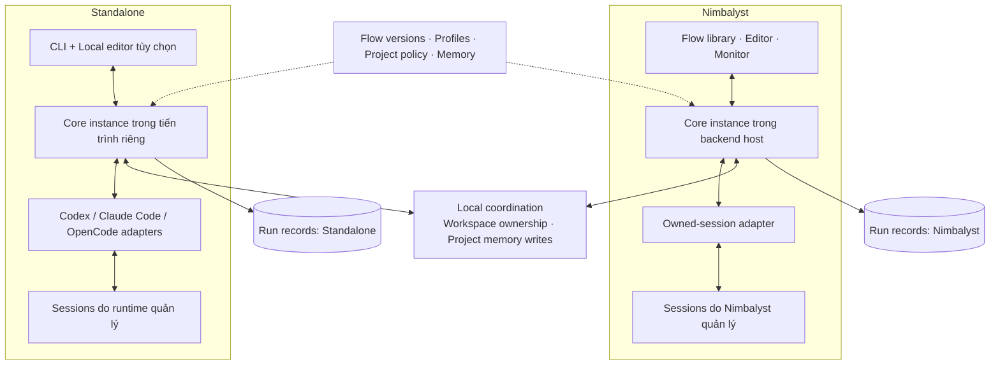
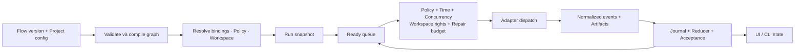
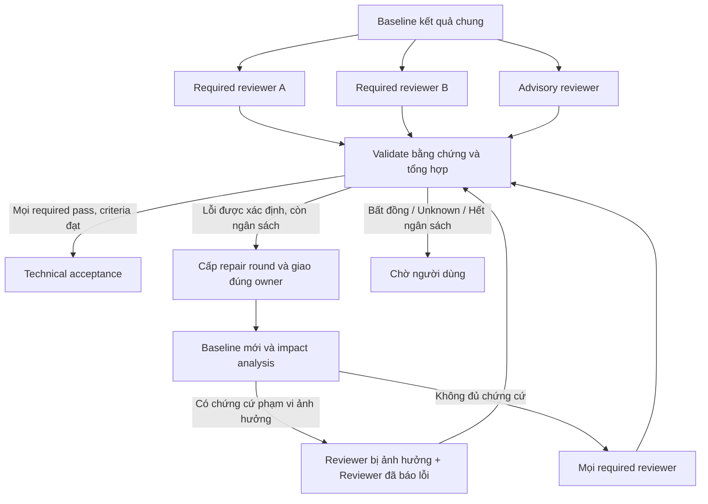
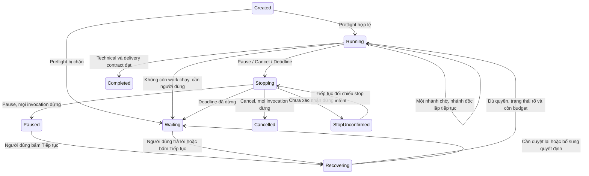
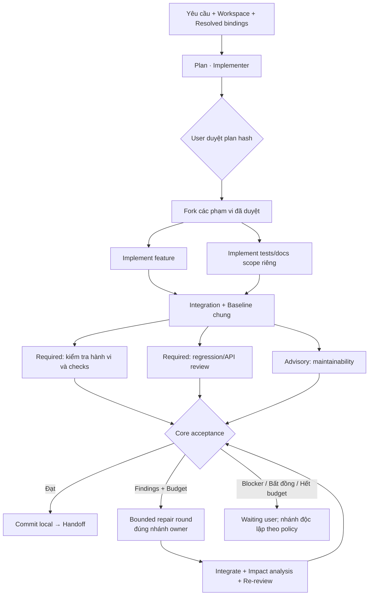

# NeoMind v1 — thiết kế tổng hợp để triển khai

Ngày: 28/10/2026. Baseline thiết kế: `design-v1.0`.

**Đọc tài liệu này để nắm toàn bộ thiết kế hiện tại.** Các report cũ giữ vai trò nguồn/lịch sử. Tài liệu này hợp nhất 12 lựa chọn ban đầu, D1–D11, F1–F21 và các chi tiết do Codex tự thiết kế theo yêu cầu mới nhất: hoàn thiện thiết kế, sau đó giao một chat GPT-6.1 Terra bắt đầu implementation. Việc chọn pilot sản phẩm vẫn tạm hoãn; không phải blocker cho triển khai NeoMind.

Các yêu cầu người dùng đã chọn là ràng buộc. Những giá trị mặc định, schema và cách chia module được quyết định thêm trong tài liệu này là **baseline kỹ thuật do Codex chọn**, có thể điều chỉnh khi có bằng chứng thực nghiệm; không trình bày chúng như từng lựa chọn đã được người dùng duyệt riêng. Trạng thái: thiết kế đã đủ để bắt đầu implementation; chưa có bằng chứng runtime, editor hoặc host integration đã hoạt động.

## 1. Sản phẩm và phạm vi

NeoMind giúp người dùng định nghĩa, thực thi và theo dõi quy trình agent có kiểm tra kết quả. Người dùng quản lý các flow như Fast, Research và Dev; mỗi flow là graph có version, agents, bindings model/reasoning, điều kiện chuyển bước và giới hạn.

| Có trong phạm vi v1 | Để sau v1 |
| --- | --- |
| CRUD, clone, archive/restore và xóa vĩnh viễn định nghĩa flow | Tự chọn flow theo task bằng benchmark/learning |
| Draft → validation → version chạy; snapshot run bất biến | Hot-edit graph của run đang chạy |
| Editor kéo thả và form thuộc tính cùng dùng một schema | Di chuyển live run giữa Nimbalyst và standalone |
| Nhiều flow, profiles, skills và model/reasoning theo bước | Marketplace, cloud sync và quản trị tổ chức nhiều người |
| Fork/join song song, nhiều reviewer, repair có giới hạn | Arbitrary cycles, script tùy ý trong conditions |
| Project policy, approval, pause/cancel/resume và recovery | Tự học rồi âm thầm thay policy/flow |
| Nimbalyst adapter và standalone adapters; cùng core | Antigravity adapter trong phase hiện tại |
| Markdown project memory, feedback và lesson proposals | Chuyển nguồn chuẩn memory sang SQLite |

V1 là phạm vi sản phẩm đầy đủ, được triển khai thành nhiều mốc. Không gọi sản phẩm hoàn thành nếu mới có graph editor hoặc fake runner.

## 2. Kiến trúc tổng thể



Hai môi trường độc lập về run/session/lifecycle. Shared coordination chỉ bảo vệ tài nguyên cùng máy; không đồng bộ transcript, tiếp quản session hoặc tạo một global scheduler. Memory thuộc project và dùng chung giữa hai môi trường. Standalone chạy không cần mở Nimbalyst.

### Các module

| Module | Trách nhiệm |
| --- | --- |
| `domain` | Schemas, IDs, snapshots, validation, bindings và typed errors |
| `core` | Compiler graph, scheduler, budgets, approval, review, state reducer |
| `storage` | Journals, artifacts, recovery và local resource coordination |
| `workspace` | Baseline, worktrees, scope, integrate, Git commit receipts |
| `memory` | Markdown retrieval, provenance, proposals và ghi có kiểm soát |
| `adapter-*` | Giao tiếp host/runtime, capability discovery, session lifecycle |
| `ui` | Library, editor, inspector, monitor, approval/recovery screens |
| `cli` | Các commands cho cùng application service của core |

Baseline implementation dùng TypeScript cho domain/core/CLI/UI, chia package theo trách nhiệm, không tạo microservices. UI dùng React và graph canvas; ưu tiên tái sử dụng primitives của host. Thư viện canvas/SDK cụ thể phải kiểm tra source, license và compatibility, pin version vào lockfile khi implementation; tên thư viện không là ràng buộc của contract. Không bắt đầu bằng port toàn bộ Python KB hoặc merge controlled runtime của nhánh khác.

## 3. Người dùng thao tác như thế nào

### 3.1. Flow library

Danh sách hiển thị tên, mô tả, source template/project, version mới nhất, trạng thái draft/archived, lần chạy gần nhất và capability warnings. Có Tạo từ trống, Tạo từ template, Clone, Đổi tên, Sửa, Archive, Restore, Export và Delete permanently. Search/filter theo project, loại công việc và archived.

Flow có ID ổn định, tên hiển thị không phải khóa tham chiếu. Clone sinh ID mới. Đổi tên không phá run history. Archive không được chọn cho run mới; xóa vĩnh viễn định nghĩa yêu cầu xác nhận tên, không xóa snapshots hay artifacts của runs. Run đang chạy không bị ngắt vì flow nguồn bị archive/delete. Run history có màn hình retention/delete riêng, mặc định không tự xóa.

### 3.2. Editor

```text
┌ Flow: Dev  Version 3  Draft changes ─ Validate ─ Save version ─ Run ┐
│ Palette / Library │ Canvas: nodes + edges          │ Inspector      │
│ Agent task        │                               │ Goal / Profile │
│ Approval          │ Plan → Approval → Fork        │ Model/Reasoning│
│ Fork / Join       │       A ↘       ↙ B           │ Inputs/Outputs │
│ Review group      │       Integration → Reviews   │ Review targets │
│ Repair scope      │                               │ Policy / Limits│
├───────────────────┴───────────────────────────────┴────────────────┤
│ Validation errors / Warnings / Semantic diff / Configuration source │
└────────────────────────────────────────────────────────────────────┘
```

Kéo ô chỉ đổi layout; nối cổng đổi dependencies. Edge có nhãn `completed`, `pass`, `needs_changes`, `blocked` hoặc nhánh condition. Review target dùng field/reference riêng, có thể hiện thành đường nét đứt; không suy từ vị trí hay một execution edge bất kỳ.

Undo/redo, multi-select, zoom/fit, keyboard add/connect/delete và form danh sách bước là yêu cầu UX. Xóa node hiển thị các tham chiếu bị ảnh hưởng trước khi xác nhận. Draft có thể lưu chưa hợp lệ; Save version và Run chặn lỗi cấu trúc/policy. Không cần model/auth hoạt động để lưu một flow structurally valid; preflight runtime thực hiện trước Run.

Inspector hiển thị mục tiêu, profile version, instructions override, skills, quyền, runner/provider/model/reasoning, session group, inputs/outputs, review scope, limits và nguồn từng giá trị. Không hiện lựa chọn reasoning không được adapter xác nhận hỗ trợ; unknown được ghi rõ, không giả định mọi model có cùng các mức.

### 3.3. Trước Run

Chọn yêu cầu, flow version, host, checkout/worktree, bindings resolved và fallback list, concurrency, thời gian, policy và checks. Hiển thị diff so với defaults. Project dirty phải hiện tracked/untracked changes để chọn baseline hiện tại, worktree riêng hoặc dừng. Worktree tạo từ commit không mặc định có nội dung chưa commit; nếu chọn mang changes sang phải preview và xác nhận rõ, không stash/reset âm thầm.

Không hỏi lại các trường đã lưu nếu không có thay đổi, nhưng lựa chọn workspace vẫn là một bước rõ ràng ở mỗi run như người dùng yêu cầu. Preview và thao tác Run tạo snapshot sau khi mọi override hợp lệ.

### 3.4. Monitor và approval

Monitor dùng graph snapshot của run; màu/state thể hiện queued, running, waiting, passed, failed, interrupted và skipped; hiện counts, thời gian hoạt động, số vòng sửa, model thực tế, usage unknown và nhánh bị chặn. Inspector mở session transcript qua host khi được hỗ trợ, findings, diff, checks, approvals và artifacts.

Các actions: Approve plan, Request changes, Answer, Pause, Resume, Cancel, Resolve Git, Feedback và Review lesson. Kế hoạch duyệt ngắn: mục tiêu, phạm vi, phương án, acceptance criteria và checks, có Expand details. Approval lưu plan hash + version + policy hash + scope; Reject/request changes tạo plan version mới. Đổi mục tiêu/hành vi/phạm vi hoặc rủi ro mới làm approval cũ hết hiệu lực. Vi chỉnh kỹ thuật trong scope không buộc duyệt lại.

## 4. Cấu hình, nguồn chuẩn và versioning

```text
<project>/.neomind/
  project.json
  flows/<flowId>/metadata.json
  flows/<flowId>/draft.json
  flows/<flowId>/versions/000001.json
  profiles/<profileId>/metadata.json
  profiles/<profileId>/versions/000001.json
  memory/index.md
  memory/context/*.md
  memory/decisions/*.md
  memory/lessons/*.md
```

Đây là đường dẫn baseline do Codex chọn. File cấu hình JSON `schemaVersion: 1`, UTF-8, JSON Schema sinh từ domain validators; instructions/skills dùng Markdown references có hash. Layout lưu trong flow JSON ở `layout`, tách `definition`; semantic hash bỏ qua layout/tên hiển thị, full snapshot hash bao gồm cả hai. Draft đi cùng repo nhưng không tự commit theo mỗi lần gõ. Published versions không sửa in-place; sửa tay gây hash mismatch thì không được chạy như version cũ, phải import thành draft mới.

Templates chung nằm trong package NeoMind; project sao chép thành ID/version riêng, giữ `originTemplate` để so diff/nâng cấp có chủ đích. Profiles chung có version, project có thể clone hoặc tham chiếu version chính xác. Profile version được pin trong published flow; instructions/skills sửa đổi phải tạo version mới hoặc lưu snapshot nội dung khi resolve, không cho hash trỏ nội dung khác.

Model/reasoning mỗi field chọn `inherit` hoặc `pinned`. Thứ tự resolve: explicit run override → step pinned → flow binding defaults → project role defaults. Profile cung cấp vai/instructions/skills/quyền yêu cầu, không là một nguồn model ngầm thứ năm. Inherit resolve ở run tiếp theo; published version không có nghĩa mọi field đã pin. Snapshot lưu giá trị cuối và nguồn của từng field, cả contents/hash của dependencies.

Cấu hình cá nhân, credentials references và runtime discovery lưu ngoài repo. Không ghi giá trị credentials vào flow, run snapshot hoặc log. Existing runtime auth được tái sử dụng qua cơ chế hỗ trợ chính thức; thiếu auth là blocker, không tự chuyển sang API tính phí.

## 5. Project policy và defaults do Codex chọn

| Setting | Default baseline | Khả năng thay đổi |
| --- | --- | --- |
| Approval trước sửa nội dung project | Bắt buộc | Chủ động sửa policy project |
| Independent review cho output code | Ít nhất một reviewer bắt buộc | Chủ động sửa policy project |
| Commit local sau kiểm tra đạt | Bật cho flow code | Trong giới hạn policy |
| Push / PR / merge / deploy | Không tự làm | Cần yêu cầu rõ cho hành động tương ứng |
| Worker delegation | Disabled; yêu cầu enforcement đã kiểm chứng | Thiếu enforcement thì preflight blocked, người dùng có thể chủ động chấp nhận instructions-only bằng policy được ghi nhận |
| Agent concurrency cap | 4 **mỗi run** | Flow chọn ≤ cap, đầu run chỉ giảm |
| Active time | 30 phút mỗi run | Hiển thị, được đổi trước Run |
| Dev repair rounds | 2 toàn run; 2 cho repair scope mặc định | Flow tùy chỉnh trong policy cap đã cấu hình |
| Temporary check retry | 1 lần mỗi check/baseline/environment fingerprint | Không tính như code repair |
| Run/history retention | Giữ tới khi người dùng xóa | Xóa qua thao tác riêng |

Giá trị 4 và 30 phút là lựa chọn thiết kế mới, không phải kết quả khảo sát model hoặc ngân sách người dùng. Không gán model IDs mặc định chưa xác minh; cài đặt project chọn bindings từ runtime khả dụng. Research read-only không bắt gate duyệt sửa code khi không có bước sửa code; tạo reports trong artifacts của run không nâng quyền sửa source.

Flow không được vượt quyền/gates project; node override không nâng quyền. Policy snapshot giải thích run, nhưng quyền live bị thu hồi áp dụng trước dispatch và side effects tiếp theo: lấy giao của quyền snapshot và policy live. Policy được nới không tự nâng quyền run cũ; muốn dùng quyền mới phải explicit reconfigure, preview và approval mới. Thay đổi policy không cấp quyền tự sửa code đã mất quyền từ trước.

## 6. Graph model và node types

| Type | Contract |
| --- | --- |
| `start` / `finish` | Một start và ít nhất một đường finish; finish chỉ đạt khi gates liên quan đủ |
| `agent_task` | Profile/binding/session group, work packet, output contract, requested capabilities |
| `approval` | Chờ plan hoặc phạm vi cụ thể được duyệt, không tự timeout thành đồng ý |
| `condition` | Declarative predicates trên output schema, không eval code |
| `fork` / `join` | Nhánh có IDs và dependencies rõ; join xác định required/optional inputs |
| `integration` | Ghép artifacts nhánh, xử lý conflict trong kế hoạch, tạo baseline mới |
| `review_group` | Các reviewer bindings riêng, scopes, targets và required/advisory |
| `repair_scope` | Vùng lặp có giới hạn, owner steps và review group cần quay lại |
| `git_commit` | Chỉ commit nội dung của run đã đạt checks và review; receipt chống lặp |

Execution edges ở cùng cấp tạo DAG. Repair là structured region có body DAG và cổng repeat được compiler quản lý; không cho người dùng vẽ arbitrary back-edge. `review_group` có thể mở để chỉnh nhiều reviewer con; `repair_scope` có thể chứa fork/join/integration. Validation cấm overlap repair scopes không đúng nesting, recursive flow calls và nhiều writers không có workspace plan.

`required: false` chỉ dùng cho nhánh tư vấn/read-only có output không cần cho artifact cuối. Nhánh sửa code đóng góp vào kết quả tích hợp luôn required; muốn bỏ một nhánh đó phải đổi kế hoạch/baseline có chủ đích. Join chờ mọi required input thành công, không chấp nhận partial/unknown. Optional branch lỗi được hiển thị; không tự đưa output dang dở vào kết quả.

Condition operators v1: `eq`, `ne`, `in`, `all`, `any`, `exists` trên outputs đã validate; không filesystem glob như một verdict. Mọi outcome có handler hoặc default chuyển waiting, không silent fallthrough.

## 7. Execution và session ownership



Core sở hữu quyết định dispatch; worker không spawn agent/session con. Scheduler chọn ready nodes theo topology rồi thứ tự khai báo để dễ tái hiện; không hứa model output deterministic. Concurrency là agent invocations đang chạy, không đếm tổng session lưu; integration agent và reviewer invocations cũng chiếm slot. Core-only operations có workspace/policy admission riêng dù không chiếm agent slot.

Giới hạn project áp dụng mỗi run, không cộng mọi run. Provider/runtime limits có thể thấp hơn và gây queued/blocked rõ ràng, không âm thầm nâng cap hoặc đổi provider. Giải phóng slot chỉ khi invocation settled hoặc adapter xác nhận không còn chạy; chờ tool tương tác còn giữ invocation thì slot còn chiếm.

Session group là khóa trong **run + host + profile/binding compatible**. Implementer dùng cùng group qua plan/implement/repair; verifier giữ group riêng qua các lần review. Không dùng lại session giữa các runs trong v1. Đổi binding không resume vào model không tương thích; tạo session mới chỉ sau reconcile, lưu lineage và handoff tối thiểu. Intent dispatch được persist trước khi gọi adapter; kết quả dispatch chưa rõ thì query/reconcile, không tự gửi lại prompt có side effects.

Node không được completed chỉ vì runtime turn xong: phải validate output contract và bằng chứng. Attempt mỗi lần dispatch/retry có ID riêng; không ghi đè attempt cũ. Lost session không tạo ra quyền reset approvals, time hoặc repair budget.

## 8. Workspace, baseline và tích hợp

Người dùng chọn checkout/worktree của run đầu tiên, còn flow chọn cách tách workspace của các nhánh. Mỗi canonical workspace path chỉ có một run sở hữu quyền ghi; run khác dùng worktree riêng hoặc xếp hàng, kể cả còn concurrency slots. Các nhánh cùng run được chia sẻ workspace khi admission thỏa.

| Chế độ nhánh | Admission và hành vi |
| --- | --- |
| Worktree riêng | Tạo từ baseline commit nhất quán; mỗi nhánh sở hữu checkout riêng, tích hợp vào integration workspace của run |
| Workspace chung | Khai báo write scopes và runtime enforce được; scopes giao nhau hoặc capability không enforce thì tuần tự hóa writers, không giả vờ hai instructions đã tạo isolation |
| Review song song | Đọc snapshot cùng baseline; checks ghi artifacts chạy trong check workspace riêng hoặc được serialize theo resource keys |
| Run chỉ đọc chung workspace | Chỉ cho concurrent khi baseline bất biến; nếu writer active thì dùng snapshot/worktree read-only hoặc chờ |

Baseline gồm Git HEAD, hashes của tracked contents liên quan, staged/unstaged trạng thái, untracked thuộc scope và artifact refs. Git commit hash đơn lẻ không đủ cho dirty checkout. Scope dùng paths canonical và chống traversal/symlink thoát root; so sánh cả Windows/POSIX forms trong tests. Cách runtime enforce paths phải được capability xác nhận.

Dirty changes được dùng làm input không được tự trở thành phần commit của run. Mỗi write lưu attribution theo baseline. Nếu cùng file/hunk trộn changes có sẵn và changes của run mà không tách được chắc chắn, chờ người dùng chọn scope; không `git add -A`, stash, reset hoặc bỏ changes khác. Worktree import changes phải preview nội dung và dùng patch tương ứng; không copy credentials/ignored data tự động.

Core ghép các thay đổi không conflict; conflict giao integration agent trong scope đã duyệt. Sửa conflict là implementer work, reviewer độc lập không do integration agent tự đảm nhiệm. Integration tạo baseline mới; Git không báo conflict vẫn phải kiểm tra tương thích hành vi. Internal Git commits nếu implementation cần chỉ nằm trên branch riêng của run, không tạo commit vào nhánh người dùng trước review đạt; receipt phân biệt internal integration và final accepted commit.

Nếu user/tool khác sửa code lúc chờ: tính impact với kế hoạch, trong scope cập nhật baseline và reverify, vượt scope chờ reapprove. Thay đổi bên ngoài không tự thuộc commit scope và không reset counters.

## 9. Review, findings và acceptance

Reviewer nhận yêu cầu gốc, kế hoạch đã duyệt, artifact baseline, code/diff và hướng dẫn checks. Pha đánh giá đầu không đưa kết luận/self-verdict của implementer vào context. Reviewer lưu initial findings trước khi được xem các ghi chú bổ sung; command logs tự kiểm tra chỉ cung cấp sau đó nếu cần truy vết. Core không giấu bằng chứng kỹ thuật cần thiết, nhưng không coi implementer nói pass là bằng chứng independent review.

Verdict enum: `pass`, `needs_changes`, `blocked`, `inconclusive`. Finding có ID, severity, claim, locations/artifact refs, evidence và suggested scope. Schema hợp lệ không chứng minh claim đúng; acceptance còn kiểm tra commands/check receipts, baseline và criteria coverage.

Mỗi reviewer có `required` hoặc `advisory`; mặc định mọi required reviewer phải pass. Advisory findings không tự lật verdict nhưng vẫn có thể chỉ ra vi phạm acceptance/policy mà core phải chặn. Required needs_changes có finding kiểm chứng được chuyển repair; tranh luận chưa đủ cơ sở không được biến thành pass hay majoritarian vote, chuyển waiting user với bằng chứng hai phía. Không thêm arbitrator model tự vượt required reviewer trong v1.



Re-review theo F13: chạy lại reviewers đã báo lỗi và reviewers có scope bị ảnh hưởng. Giữ verdict cũ chỉ khi core lưu một impact receipt chứng minh applicability sang baseline mới. Receipt gồm old/new baseline, dependency inventory hash, scopes và rule version; thay lockfile/build config/public API/shared dependencies hoặc không có dependency coverage thì conservative chạy mọi required reviewers. Model nhận xét “không ảnh hưởng” không tự đủ để giữ pass cũ. Findings từ advisory đã dùng để kích hoạt sửa cũng phải được xác minh lại hoặc chuyển required reviewer phụ trách.

Technical acceptance và delivery state tách biệt: kiểm tra đạt là `technicalStatus: accepted`; commit còn thiếu/lỗi thì delivery chưa complete. UI ghi “Kiểm tra đạt · Chờ xử lý Git”, không báo failed kỹ thuật hoặc completed toàn bộ. Research finish có thể accepted và completed mà không cần commit nếu flow không sửa source.

## 10. Budgets, thời gian và lỗi

**Repair round** là một chiến dịch sửa trên baseline theo tập findings của một review epoch, có thể dispatch nhiều nhánh đồng thời dưới cùng round ID. Cấp round chung atomically trước dispatch đầu tiên. Mỗi repair scope cũng tăng một lượt khi tham gia round. Một scope tham gia một round chung không bị trừ hai lần do nhiều findings; gửi sửa bổ sung sau khi epoch đã review lại là round mới. Mọi scope phải nằm trong run cap và cap của chính nó. Tích hợp conflict ban đầu trước review không là repair round nhưng tính thời gian; conflict sau khi sửa trong round thuộc round đó. Thay đổi user không trừ code repair nếu chỉ reverify, nhưng mọi agent repair tiếp theo vẫn phải có budget; không reset vì baseline mới.

**Check retry** tối đa một lần cho tuple `checkId + baselineHash + environmentFingerprint`, không dùng lý do mới để quay lại retry vô hạn. Retry chỉ với lỗi tạm thời có phân loại/evidence và check đã kết thúc; side effects unknown không được retry. Lỗi thiếu dependency/cấu hình không phải transient; chuyển blocked hoặc làm theo phạm vi sửa môi trường đã duyệt. Mỗi attempt lưu exit/output, không xóa lỗi đầu.

**Time** dùng elapsed wall time của hợp các khoảng có automated work, không cộng thời gian agents song song. Bao gồm core integration/check/commit đang hoạt động; thời gian toàn run chờ user/paused hoặc chưa được cấp workspace không tính. Provider request đã gửi mà đợi response vẫn tính; runtime mất liên lạc sau dispatch thì tiếp tục tính cho tới stop confirmed hoặc deadline. Nếu còn nhánh chạy, nhánh khác chờ không dừng đồng hồ. Runtime unavailable trước dispatch chuyển blocked, không tiêu thời gian chạy vô hạn.

Hết time limit: persist stop intent, ngừng dispatch, yêu cầu ngắt work đang chạy và chờ xác nhận; chuyển waiting `budget_exhausted` khi đã dừng, hoặc `stop_unconfirmed` nếu chưa rõ. Tiếp tục cần người dùng chủ động tăng limit/cấp budget mới, lưu grant, không reset consumed time. Pause cũng không miễn phí cho agent còn chạy vì chưa xác nhận ngắt.

Typed errors tối thiểu: `invalid_definition`, `policy_denied`, `capability_missing`, `auth_unavailable`, `binding_unavailable`, `workspace_busy`, `baseline_changed`, `output_invalid`, `check_failed`, `transient_check_error`, `review_disagreement`, `budget_exhausted`, `session_lost`, `effect_unknown`, `storage_error`, `git_error`. Errors quy định retriable/no-effect/unknown, không dựa chuỗi “success” trong output model.

## 11. Vòng đời run, pause/cancel và recovery

Run lưu orthogonal fields: `lifecycle`, `technicalStatus`, `deliveryStatus`, `stopIntent`, `waitingReasons[]` và node/attempt states. Không ép một enum duy nhất chứa mọi tổ hợp. Node states: `pending`, `ready`, `queued`, `running`, `waiting`, `succeeded`, `failed`, `interrupted`, `skipped`. Branch có wait không đồng nghĩa toàn run ngừng.



Pause ngừng dispatch và yêu cầu ngắt agents đang chạy, lưu partial artifacts. Cancel tương tự nhưng terminal sau confirmed stop; giữ code/artifacts/history, không rollback hoặc xóa worktree. Cancelled run không resume trực tiếp trong v1; Clone as new run có preview baseline và grants mới. Release concurrency/workspace chỉ sau invocation settled/stop confirmed; unknown không giải phóng writer ownership như thể an toàn.

Startup tự reconcile sessions, workspace, artifacts và receipts, hiển thị Recovery report rồi chờ explicit Continue trước dispatch mới. Session cũ có thể còn chạy; UI phân biệt điều đó với scheduler đang gated. Startup có stop intent đang dang dở phải tiếp tục quan sát và có thể hoàn tất yêu cầu stop đã được cấp trước crash; không coi đây là quyền giao thêm work. Run owner không còn sống không chứng minh worker đã dừng.

Reconcile kiểm tra run owner generation, session refs, prompt dispatch receipts, head/content hash, approval validity, policy, rounds/time và commit receipts. Nếu kết quả lần trước chưa rõ, quan sát hoặc chờ người dùng; không resend prompt hoặc tạo lại commit. Resume không tự đổi model hay tạo session mới nếu chưa qua explicit capability/fallback policy.

## 12. Storage, locking và durability

Local app state dùng `${XDG_STATE_HOME:-~/.local/state}/neomind/` trên Linux, vị trí app-data tương ứng trên hệ điều hành khác. Key project từ canonical Git common directory và project identity; các worktrees cùng project cùng coordination namespace. Repositories clone ở path khác không mặc định chia sẻ runtime state. Nimbalyst/CLI trên cùng máy dùng namespace chung cho ownership, nhưng journals tách theo host và run.

```text
<stateRoot>/projects/<projectKey>/
  coordination.sqlite
  hosts/<hostId>/runs/<runId>/events.jsonl
  hosts/<hostId>/runs/<runId>/snapshot.json
  hosts/<hostId>/runs/<runId>/artifacts/<artifactId>
  preferences.json
```

SQLite chỉ dùng **coordination** ở v1: run owner generation, workspace writer/read leases, fencing tokens, atomic resource reservations và memory write locks. Không chuyển Markdown memory sang SQLite. Nếu host bundle không hỗ trợ SQLite implementation đã chọn thì capability bị chặn cho concurrent coordination cho tới khi có backend equivalent; không fallback sang một lock giả trong từng process. Chọn SQLite library tương thích cả host/standalone qua spike, pin dependency và test migration; domain không import driver.

Journals append có sequence, event ID, run ID, command/request ID, timestamp và payload schema. Persist intent → perform effect → persist receipt/result. Flush durability cho dispatch, approval, budget grant, write ownership và commit intent; periodic snapshot được replace atomically sau event flush. Journal là nguồn chuẩn run, snapshot là projection có thể rebuild; bỏ torn final line sau crash, corruption giữa file thì block recovery và báo lỗi. Không hứa exactly-once side effects của external runtimes; dùng idempotency/query và `effect_unknown`.

Một owner generation được cấp atomically cho run; runner mới chỉ claim scheduler khi owner cũ xác định mất. Lease timeout không đủ để cấp lại quyền ghi nếu worker cũ có thể còn sống. Fencing kiểm soát NeoMind dispatch, không tự fence tool ngoài hoặc worker đã launch; quarantine workspace khi unknown tới khi xác nhận. Không hỗ trợ coordinator nhiều máy/network filesystem trong v1; preflight chặn shared-state mode không bảo đảm locking.

## 13. Memory và feedback

Memory root là cấu hình **project-wide**, không phụ thuộc host. Với linked worktrees, default dùng `.neomind/memory` ở primary checkout, resolve theo project identity, không dùng từng bản copy worktree như các nguồn chuẩn ngang nhau. Chọn root khác được preview và lưu local project registry; mọi host trên máy dùng cùng mapping. Nếu root unavailable, hiển thị degraded/missing context, không tự dựng một root mới rồi giả là memory đã đồng bộ.

Markdown records có frontmatter `id`, `type`, `status`, `scope`, `sources`, `updatedAt`, `contentHash`. Index dẫn tới context/decisions/lessons; retrieval v1 dựa tags, paths, IDs và search lexical, không nạp tất cả transcript. Context facts tự cập nhật khi có nguồn; decision chỉ khi user xác nhận; lesson phải proposal → approved → promoted. Chưa duyệt giữ trong run artifacts, không đưa vào approved retrieval.

Write có compare-and-swap theo expected hash dưới memory write lock. Conflict không overwrite; tạo proposal/retry sau khi đọc phiên bản mới. Agent không tự ghi trực tiếp approved memory; gửi đề xuất cho core service. Update cần project write permission; không dùng quyền memory để bypass approval sửa source. Run state có thể ghi trước approval trong local state vì không sửa project source.

Runtime instructions như AGENTS.md được adapter khai báo loaded/unknown; NeoMind chỉ nạp relevant memory bằng IDs/hashes và giữ context ledger từng session. Không assume runtime đã đọc khi chưa biết, không chèn full memory hai lần một cách mặc định. Session reviewer riêng vẫn nhận context cần thiết. Memory update giữa run không tự thay accepted plan; context refresh có source/version, quyết định ảnh hưởng scope cần duyệt lại.

Feedback lưu riêng technical truth: mức hài lòng, can thiệp, bước hữu ích/dư thừa, thời gian/chi phí cảm nhận và ghi chú; liên kết run/flow version/baseline. Có thể gửi sau Completed. Usage thiếu là null với lý do, không 0. Không tự sửa flow hoặc promote lesson dựa feedback đơn lẻ.

## 14. Git finalization và attribution

Trước commit: mọi required criteria/check/review hợp lệ, baseline đúng hiện tại, không stop intent, write ownership còn hiệu lực và policy cho phép. Chọn content/hunks thuộc run, index riêng để không đụng staging của user; tạo commit trên đúng run branch hoặc nhánh checkout đã chọn. Không include unrelated tracked/untracked changes, kể cả `.neomind` vừa được user chỉnh nếu không thuộc run scope.

Commit intent chứa parent HEAD, expected tree, accepted baseline, run ID và message. Receipt ghi commit OID/tree/parent. Crash sau commit trước receipt: tra actual HEAD/object graph để xác nhận cùng intent, không commit lại. Hooks có thể đổi files; nếu tree/content thay đổi so với accepted baseline, invalidate checks và review liên quan, không coi commit hook exit 0 là đã giữ baseline.

Commit lỗi chuyển delivery `waiting_git`, technical status giữ accepted chỉ khi artifact baseline còn đúng. User xử lý hoặc cho retry rồi reconcile; nếu code thay đổi phải reverify. Push/PR/merge/deploy không tự diễn ra. Git identity lấy cấu hình hiện có, không tự sửa người khác; nếu user đã chỉ định identity cho tác vụ thì dùng đúng khi commit được yêu cầu.

## 15. Adapter contract và runtime thực tế

```typescript
interface RuntimeAdapter {
  capabilities(request: CapabilityRequest): Promise<CapabilityReport>;
  createSession(request: CreateSessionRequest): Promise<SessionRef>;
  dispatch(request: DispatchRequest): Promise<DispatchReceipt>;
  observe(request: ObserveRequest): AsyncIterable<RuntimeEvent>;
  getStatus(session: SessionRef): Promise<RuntimeStatus>;
  getResult(attempt: AttemptRef): Promise<RuntimeResult>;
  requestStop(request: StopRequest): Promise<StopReceipt>;
  reconcile(request: ReconcileRequest): Promise<ReconcileResult>;
}
```

Capabilities phân biệt `supported_verified`, `instructions_only`, `unsupported`, `unknown`; lưu host/runtime/version cùng evidence. Tối thiểu: auth readiness, model catalog/reasoning options, session isolation/resume, stop confirmation, output/schema, tool/path permissions, delegation control và usage. Không lưu auth secrets. Dispatch có requestId/attemptId/idempotencyKey; receipt chỉ nói accepted/sent/unknown, không nói step passed.

Events có seq/cursor nếu runtime có, normalized errors và raw artifact refs có redaction. `getStatus`/`getResult` không trả completed chỉ vì transport đóng. Stop receipt phân biệt requested/confirmed/unsupported/unknown. Adapter không có capability bắt buộc thì preflight blocked; có instructions-only chỉ được dùng khi user chủ động cho phép trong policy và UI ghi đúng giới hạn.

Nimbalyst adapter dùng owned sessions của extension, không truy cập database nội bộ để tạo task hoặc điều khiển sessions không thuộc quyền. Đóng panel không mất scheduler backend; đóng host có thể mất backend, áp dụng recovery F21. Task/Kanban integration chỉ dùng public API đã xác minh; không giả là API đã tồn tại.

Standalone ưu tiên một đường Codex runtime được xác minh trước; transport cụ thể SDK/App Server chọn qua capability spike, không viết transport đoán. Sau đó Claude Code và OpenCode adapters theo cùng contract; inference/auth phải được chứng minh riêng. Fallback chỉ trong allowlist bindings đã preview: thứ tự khai báo, tối đa mỗi candidate một lần trong attempt recovery; lỗi auth/policy hoặc side effects unknown không tự fallback. Tạo session thay thế có lineage và actual binding receipt, không bịa usage.

## 16. Data contracts tối thiểu

Schema version 1 kiểm tra ở mọi boundary; unknown fields ở executable definition là lỗi để bắt typo. UI metadata có namespace mở riêng. IDs là opaque strings, không dùng display name làm khóa. Hash là SHA-256 của canonical JSON/content với quy tắc newline/encoding xác định trong domain.

| Record | Fields bắt buộc chính |
| --- | --- |
| FlowVersion | schemaVersion, flowId, version, name, definition, layout, semanticHash, contentHash, createdAt |
| FlowDefinition | startNodeId, nodes, edges, bindings, sessionGroups, limits, workspacePolicy, outputContract |
| ProjectConfig | projectId, policyVersion, policy, roleDefaults, limits, memoryConfig, defaultFlowRef |
| ProfileVersion | profileId, version, instructions, skills refs/hashes, requestedPermissions, output defaults |
| RunSnapshot | runId, hostId, projectKey, flow full snapshot, profile/skill contents, resolved bindings/provenance, policy, baseline, limits |
| Plan | planId, version, goal, scope, approach, acceptanceCriteria, checks, riskChanges, contentHash |
| Approval | approvalId, actor, source, planHash/version, policyHash, scopeHash, decision, timestamp |
| WorkPacket | run/step/attempt IDs, goal, source requirement, approved plan ref, scope, input refs, output schema, checks, context refs, limits |
| AttemptResult | status, actual binding/session, output refs, check refs, errors, usage with nullable fields |
| CheckReceipt | checkId, baselineHash, command/args/cwd, environment fingerprint, exitCode, output refs, started/endedAt, effect classification |
| ReviewResult | reviewer/session, required flag, target refs/baseline, verdict, findings, check refs, criteria coverage |
| ImpactReceipt | old/new baseline, dependency evidence, reviewer scopes, invalidated/retained verdict refs và lý do |
| RunEvent | eventId, seq, runId, requestId, type, timestamp, schemaVersion, payload |

Một session worker không tạo Approval record thay người dùng. Local single-user approval qua CLI/UI có actor identity local và action receipt; không claim là strong human authentication. Invalidation và reapproval đều thành events, không sửa event cũ.

CLI commands cùng app service: `flow list/create/clone/rename/archive/restore/delete`, `flow validate/publish/export/import`, `profile ...`, `run start/status/plan/approve/answer/pause/resume/cancel/recover`, `run git retry`, `memory proposals/approve/reject`, `doctor capabilities`. Interactive và JSON modes có exit codes ổn định; exact flags được ghi vào CLI reference khi implementation, không giả các commands đã tồn tại.

## 17. Ba templates và một flow Dev mở rộng

Templates sinh ra bindings dạng inherit, yêu cầu project chọn runner/model thật trước run đầu.

| Template | Nội dung | Limits baseline |
| --- | --- | --- |
| Fast | Plan → Approval → Implement → Required verify → Commit/handoff | 1 implementer + 1 verifier, 2 rounds, cap 2 |
| Dev | Plan → Approval → Implement → Required verify → Repair scope → Commit/handoff | Cùng hai vai đã chọn, 2 rounds, cap 4 |
| Research | Question/context → Parallel research → Synthesis → Required source review → Report | Read-only source, artifacts output, 2 rounds, cap 4; approval trước publish ra project nếu có |

Dev mặc định vẫn hai vai; ví dụ dưới đây là template **Dev Parallel** tùy chọn, không thay flow mặc định người dùng đã chọn:



Trong compiler, cạnh repair ở sơ đồ là structured repair control, không là chu trình DAG tự do. Node tests/docs có write scope độc lập; nếu runtime không enforce shared workspace thì dùng worktrees hoặc serialize. Mỗi reviewer có session riêng và target baseline chung.

## 18. Thứ tự implementation và tiêu chí hoàn thành

| Mốc | Đầu ra phải chạy được | Gate kiểm chứng |
| --- | --- | --- |
| M0 — Foundation | Package layout, schema/types, validators, example templates và fake adapter deterministic | Import/export round-trip; invalid graph/policy bị chặn; resolved config snapshot ổn định |
| M1 — Core | Scheduler DAG/fork/join/repair, approvals, budgets, typed errors, journal và fake runtime | Test branches, reviewer gates, stop/unknown, crash points, no duplicate dispatch và no budget overspend |
| M2 — Workspace/memory/CLI | Worktrees, ownership cross-process, integration, memory CAS, CLI full flow | Temp Git repos có dirty/staged/untracked changes; không mất changes; concurrent CLI/host lock conformance |
| M3 — Editor/monitor | Library CRUD, drafts/versions, drag/drop + inspector, flow validation, run screens | UI thao tác thực tế; graph/form same semantics; published snapshot không đổi khi edit; keyboard path |
| M4 — Real standalone | Một adapter thật chạy được flow Dev end-to-end bằng auth hiện có; tiếp tục các adapters còn lại | Real inference, checks, model discovery, stop/resume/recovery evidence; fake tests không thay E2E |
| M5 — Nimbalyst | Backend core + owned sessions + panel editor/monitor; public APIs đã pin | Host acceptance: đóng panel, đóng/reopen host, own-session scope, approvals, multi-review và recovery |
| M6 — Full v1 acceptance | Hai hosts, Fast/Research/Dev, parallel branches, profiles, memory, histories và docs | Matrix acceptance dưới đây; thông báo rõ adapters/platforms/capabilities chưa verified |

Mốc là thứ tự triển khai, không hạ phạm vi v1 đã chọn. Không dừng sau scaffold, mock editor hoặc một mốc đầu rồi gọi hoàn thành. Nếu host/auth không cho thực nghiệm, hoàn thiện phần không bị chặn, ghi blocker chính xác và giữ khả năng kiểm thử qua conformance harness. Không cài/test Antigravity hoặc tự mua API key.

### Acceptance matrix và tests có ý nghĩa

1. Flow CRUD/draft/publish/delete và profile overrides; clone ID mới, run history sống sau xóa definition, template update không tự mutate project.
2. Node bindings inherit/pin, actual fallback allowlist, unsupported reasoning blocked, source/provenance UI rõ, no auth secret in snapshots.
3. Approval hash/version/scope; chỉnh plan invalidates, instructions worker không tự giả approval, live policy revoke không bị snapshot cũ vượt qua.
4. Fork/join required/optional, per-run concurrency (hai run tổng có thể vượt cap mỗi run), bounded repair atomic allocation, transient retry dedup.
5. Workspace shared/private, conflict integration, dirty changes attribution, staged/untracked preservation, external edits impact và review fallback conservative.
6. Required/advisory reviewers; disagreement waiting; retain verdict chỉ bằng impact receipt, session isolation, no verifier auto-code-fix.
7. Pause/cancel request vs confirmed, all states timeout, recovery old worker còn chạy, no workspace release khi unknown, lost receipt/idempotency handling.
8. Journal crash/truncated append/corruption, cross-process owner fencing, memory CAS, rejected/unapproved lessons không vào approved retrieval.
9. Commit failure waiting Git, hooks đổi content, crash sau commit trước receipt, no unrelated files commit, no push/PR tự động.
10. UI browser tests cho canvas/keyboard/config/approval/recovery, actual host acceptance riêng; docs links/JSON examples schema-valid.

Tests dùng fake adapters cho adverse scheduling/crash và real runtimes cho integration. Không snapshot toàn bộ UI hoặc test chỉ lặp cấu trúc implementation. Mỗi milestone lưu command, exit, summary, baseline và capability matrix; không coi skipped tests là pass.

## 19. Handoff triển khai và quyền thực hiện

Người dùng đã yêu cầu Codex tự hoàn thiện thiết kế và tạo chat **GPT-6.1 Terra** bắt đầu implement sau khi thiết kế đủ. Tài liệu này là baseline bàn giao; không cần hỏi lại bộ trắc nghiệm hoặc đợi thêm lựa chọn để scaffold/build/test các mốc.

Hành vi “product flow cần duyệt plan” là yêu cầu của NeoMind khi chạy task cho người dùng, không buộc chat implementation xin duyệt lại toàn bộ thiết kế đã được giao. Chat triển khai vẫn phải tuân theo sandbox/repository rules và hỏi khi có quyết định sản phẩm lớn làm đổi yêu cầu đã chọn. Được tự giải quyết chi tiết routine, test failures và compatibility, ghi design deviation khi thay contract. Không dùng quyền implementation để push/PR/deploy hoặc sửa changes không thuộc task.

Đọc [implementation handoff](implementation-handoff.md) để biết checkout, ownership và thứ tự công việc. Chưa triển khai runtime tại thời điểm viết thiết kế này. Mọi claim tính năng hoạt động phải kèm bằng chứng từ implementation session.
