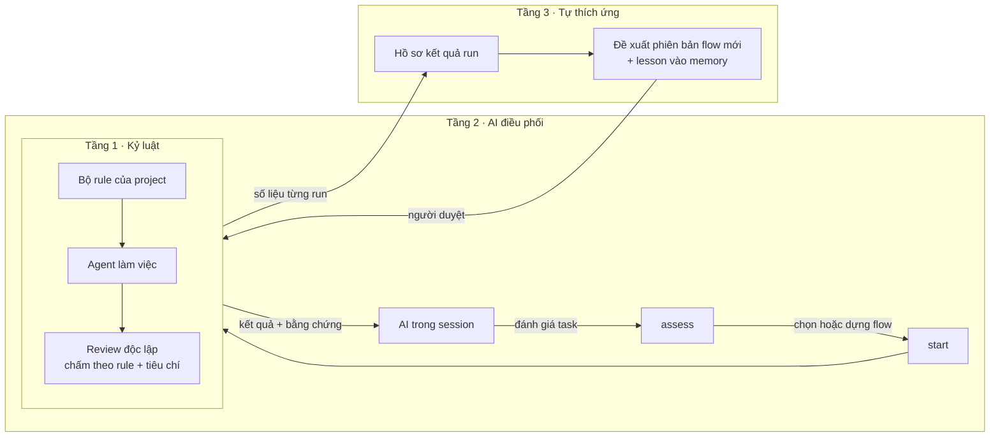

# Định hướng NeoMind từ tháng 11/2026

Ngày: 04/11/2026 · Trạng thái: **đề xuất, chờ người dùng duyệt**. Giai đoạn 1 có kế hoạch chi tiết; giai đoạn 2 và 3 là hướng đi, sẽ lập kế hoạch riêng khi có dữ liệu từ giai đoạn 1.

## Vì sao cần định hướng lại

Sau khoảng một tuần, NeoMind có ~9.800 dòng code core, 4.900 dòng test, journal/recovery, fork/integration nhiều giai đoạn, shared workspace, memory LSA và canvas. Nhưng chưa có lần dùng thật nào ngoài repo demo, pilot Calculator chưa chạy, và chưa có số liệu so sánh flow với một agent làm một mình. Phần "adaptive" trong tên dự án chưa bắt đầu. Hệ thống đang được làm chắc hơn nhanh hơn tốc độ kiểm chứng giá trị của nó.

## Điều người dùng đã chốt (04/11/2026)

- **Đối tượng:** hướng tới công cụ cho team, nhưng **trước mắt phát triển cho một người dùng**. Nhiều người dùng đưa vào [backlog](#backlog-nhiều-người-dùng); thiết kế chừa đường khi không tốn thêm nhiều công.
- **Hướng đi:** dùng thật và đo (A), rồi làm phần adaptive (D). Chưa ưu tiên cắt gọn hay chuyển hẳn sang Nimbalyst.
- **Project chạy thử thật:** [`W:\projects\AI\leetcode-practice`](../../../../leetcode-practice/README.md), repo luyện LeetCode bằng C rồi C++ của người dùng (khởi tạo 04/11/2026). Repo NeoMind dùng cho các việc phát triển chính nó.
- **Vấn đề cần giải** (lời người dùng):
  1. Agent không theo một RULE cố định; không có agent review độc lập theo một quy trình cụ thể.
  2. Xa hơn: NeoMind được dùng **bởi AI**. AI đánh giá mức độ task, dùng API của NeoMind để tự tạo workflow, rồi chỉ kiểm tra kết quả của flow đó.
  3. Flow **tự thích ứng**: tự chỉnh sửa theo thời gian và lưu memory, để ngày càng tốt hơn.

## Tầm nhìn: ba tầng

**Hồ sơ kết quả run** là điểm nối giữa các tầng: tầng 2 dùng nó để biết task kiểu nào hợp với flow nào, tầng 3 dùng nó để biết flow cần sửa ở đâu. Không có số liệu thì "tự thích ứng" chỉ là đoán, nên giai đoạn 1 phải đi trước.

### Nguyên tắc chung cho mọi tầng

- **Policy của project là mức sàn.** AI hay flow tự sửa đều không được hạ: không bỏ review độc lập, không bỏ checks, không tự duyệt plan khi project không cho phép.
- **Thay đổi do AI đề xuất (flow, rule, memory) phải qua người duyệt** trước khi có hiệu lực.
- **Rule và flow nằm trong Git** (thư mục `neomind/` của repo), để sau này chia sẻ cho người khác không cần cơ chế mới. CLI/API là bề mặt chính; Flow Studio và Nimbalyst là giao diện.
- **Chừa đường cho nhiều người dùng:** event do người tạo (duyệt, feedback, duyệt đề xuất) ghi trường `actor` như hiện nay, không giả định chỉ có một người; không lưu dữ liệu dùng chung vào chỗ chỉ thuộc một máy.
- Mỗi thay đổi được đo trước và sau; không coi "cảm thấy tốt hơn" là bằng chứng.

## Hiện trạng liên quan (đã kiểm tra trong code)

| Chủ đề | Hiện tại | Chỗ trong code |
| --- | --- | --- |
| Prompt của agent | Dựng theo thứ tự: instructions của profile → skill → memory đã duyệt → task → goal của bước | `LocalRun.prompt`, `src/runtime/local-run.ts:220` |
| Rule của project | **Không có khái niệm riêng.** Codex vẫn tự đọc AGENTS.md của repo và `~/.codex/AGENTS.md` (không bị tắt, là vấn đề đã ghi nhận); Claude bỏ qua CLAUDE.md và settings theo thiết kế. Kết quả: rule tới agent không nhất quán giữa hai runner | `src/runtime/worker.ts:9`, `src/adapters/claude-policy.ts:104` |
| Reviewer chấm gì | Hợp của `criteria` trên node `review_group` và `acceptanceCriteria` của plan. Tiêu chí nào `fail` thì review không qua | `src/domain/review-requirements.ts:6`, `src/core/review-evidence.ts:77` |
| Số liệu đã có trong journal | Token theo session, thời gian chạy, gia hạn, các vòng sửa, kết quả và phát hiện của reviewer, duyệt plan, yêu cầu sửa plan, checks | `RecoveryReport`, `src/core/recovery.ts:64` |
| Đánh giá của người dùng | **Chưa có** (không có điểm, không có "kết quả có được nhận không") | — |
| Version của flow | Draft có revision, publish thành version bất biến có hash | `src/storage/flow-library.ts` |
| Lesson | Proposal có cổng duyệt; tự sinh từ các vòng sửa khi run xong | `src/memory/proposals.ts`, `proposeRepairLessons` trong `local-run.ts` |
| AI dùng NeoMind | Đã có session tool: flows, preview, start, wait, status, approve (cần người xác nhận), apply, clean, session | `src/runtime/session-tools.ts` |

## Giai đoạn 1 — Kỷ luật và đo (1–2 tuần)

### 1.1 Bộ rule của project

- File `neomind/rules.md`, commit cùng repo để cả team dùng chung. Mỗi rule là một dòng có mã: `- [R1] Không sửa file ngoài phạm vi plan đã duyệt.` Mã giúp review, số liệu và lesson trỏ tới đúng rule.
- Khi tạo run, core đọc rule, ghim nội dung và hash vào snapshot của run (giống memory), để replay và review dùng đúng bản lúc chạy.
- `LocalRun.prompt` đưa rule vào **mọi** agent, đặt sau instructions của profile, với nhãn bắt buộc: khác memory (chỉ là tham khảo).
- `reviewRequirements` thêm mỗi rule thành một tiêu chí bắt buộc, ví dụ `Rule R1: …`. Vi phạm thì review `needs_changes` như các tiêu chí khác, không cần cơ chế mới.
- Preview hiển thị rule nào sẽ áp dụng; UI run hiển thị kết quả chấm theo từng rule.
- **Cần người dùng quyết:** có tắt việc Codex tự đọc AGENTS.md hay không. Đề xuất: tắt, để hai runner nhận cùng một bộ rule tường minh. AGENTS.md vẫn có thể được trỏ vào `rules.md` nếu muốn dùng chung nội dung.

### 1.2 Hồ sơ kết quả run

- Tính từ journal (không cần ghi thêm): token, thời gian, số vòng sửa, số lần sửa plan, phát hiện của review theo tiêu chí/rule, checks đạt/hỏng, có giao kết quả hay không (commit hoặc đã áp dụng).
- Thêm event `run_feedback` do người ghi: điểm 1–5, kết quả có được nhận không, ghi chú ngắn. Bề mặt: CLI `run feedback`, nút trong màn run, session tool.
- Lệnh tổng hợp `run stats <project> [--flow …]` xuất JSON/CSV theo flow, để so sánh.

### 1.3 Dùng thật trên `leetcode-practice` và repo NeoMind

`leetcode-practice` hợp để thử tầng 1 vì nó có rule rất rõ và dễ bị agent vi phạm: [AGENTS.md của repo](../../../../leetcode-practice/AGENTS.md) cấm AI viết lời giải hộ (R1), chỉ gợi ý từng bước (R2), review theo checklist firmware (R3). Một agent không được kiểm soát rất dễ "giúp" bằng cách viết luôn lời giải; reviewer độc lập phải bắt được điều đó.

Việc dự kiến:

- **Công cụ (Dev/Fast):** build/test harness cho `c/` (GCC, `-std=c11 -Wall -Wextra -Werror`, test case cục bộ), script tạo thư mục bài từ template, thống kê `progress.md` (bài theo topic, bài đến hạn ôn).
- **Review bài giải của người dùng:** một flow chỉ đọc, agent review `solution.c` theo R3 và trả lời theo R5; reviewer độc lập kiểm tra nhận xét có đúng và có lỡ đưa lời giải hay không (R1, R2). Flow này có thể cần thêm vào template có sẵn.
- **Repo NeoMind:** các việc nhỏ từ next-plan và bàn giao (áp dụng vào checkout từ snapshot, xóa `.retained` cũ, vấn đề AGENTS.md của Codex).
- Xen kẽ Fast và Dev; một vài việc làm thêm bằng một agent đơn lẻ để có mốc so sánh, nhất là để xem agent đơn lẻ có vi phạm R1 không.
- Ghi lại sau mỗi run qua `run_feedback`. Ghi chép thêm những chỗ dùng khó chịu, sửa nhanh nếu nhỏ.

**Xong khi:** `leetcode-practice` và repo NeoMind có `rules.md`; reviewer chấm theo từng rule ở cả Codex và Claude; có ít nhất 10 run thật kèm feedback; và một bản tóm tắt số liệu trả lời được: flow nào đáng dùng cho loại việc nào, review bắt được gì (kể cả vi phạm rule) mà agent đơn lẻ bỏ sót, chi phí chênh lệch bao nhiêu.

## Giai đoạn 2 — AI điều phối (lập kế hoạch sau giai đoạn 1)

- Tool **assess**: nhận mô tả task, trả về flow nên dùng, lý do, và rule/checks nên thêm. Ban đầu dựa trên quy tắc đơn giản rút ra từ số liệu giai đoạn 1, chưa cần mô hình học.
- Bước đầu AI chỉ **chọn** trong các flow đã publish. Cho AI **dựng** flow mới theo spec chỉ khi việc chọn đã ổn; flow do AI dựng đi qua cùng compiler/preview và phải thỏa policy sàn.
- Vòng làm việc của AI: assess → preview → start → wait → đọc kết quả và bằng chứng review → báo người dùng. Cổng duyệt plan vẫn là của người, trừ khi project cho phép tự duyệt.

## Giai đoạn 3 — Flow tự thích ứng (lập kế hoạch sau giai đoạn 2)

- Sau mỗi N run của một flow, bước "cải thiện" đọc hồ sơ kết quả, các rule hay bị vi phạm, các phát hiện review lặp lại, rồi đề xuất:
  - **phiên bản flow mới** (ví dụ thêm một check, thêm reviewer cho loại file nào đó, tăng reasoning ở bước hay hỏng);
  - **lesson** vào memory, dùng cơ chế proposal sẵn có;
  - **rule mới** khi một lỗi lặp lại đủ nhiều.
- Mọi đề xuất qua người duyệt. Phiên bản mới chạy song song với bản cũ trên các run tiếp theo; giữ bản nào có số liệu tốt hơn.

## Câu hỏi mở

1. Tắt việc Codex tự đọc AGENTS.md (đề xuất: tắt, dùng `rules.md` tường minh)?
2. Rule chỉ ở mức project, hay cần thêm rule theo flow hoặc theo thư mục (ví dụ rule riêng cho `ui/`)? Đề xuất: bắt đầu ở mức project.
3. Mức tự động của tầng 3: chỉ đề xuất khi người gọi, hay tự đề xuất sau mỗi N run?
4. Có rule nào áp dụng chung cho mọi project của người dùng (ví dụ ở thư mục state), hay mỗi repo một bộ? Đề xuất: mỗi repo một bộ trước.

## Backlog: nhiều người dùng

Chưa làm; ghi lại để thiết kế hiện tại không chặn đường:

- Khái niệm người dùng và vai trò: ai được sửa `rules.md`, duyệt plan, duyệt đề xuất của tầng 3. Tạm thời Git review thay thế.
- Chia sẻ flow, rule, lesson giữa các repo và giữa người với người.
- Gộp số liệu run của nhiều người để tầng 2 và tầng 3 học từ nhiều nguồn hơn.
- Phân quyền khi AI điều phối thay mặt một người trong team.

## Ngoài phạm vi lúc này

Cắt gọn có hệ thống (chỉ sửa những chỗ vướng khi dùng thật), chuyển hẳn giao diện sang Nimbalyst, các mục acceptance còn mở trong next-plan (browser, screen reader, host Nimbalyst) trừ khi giai đoạn 1 cần.
