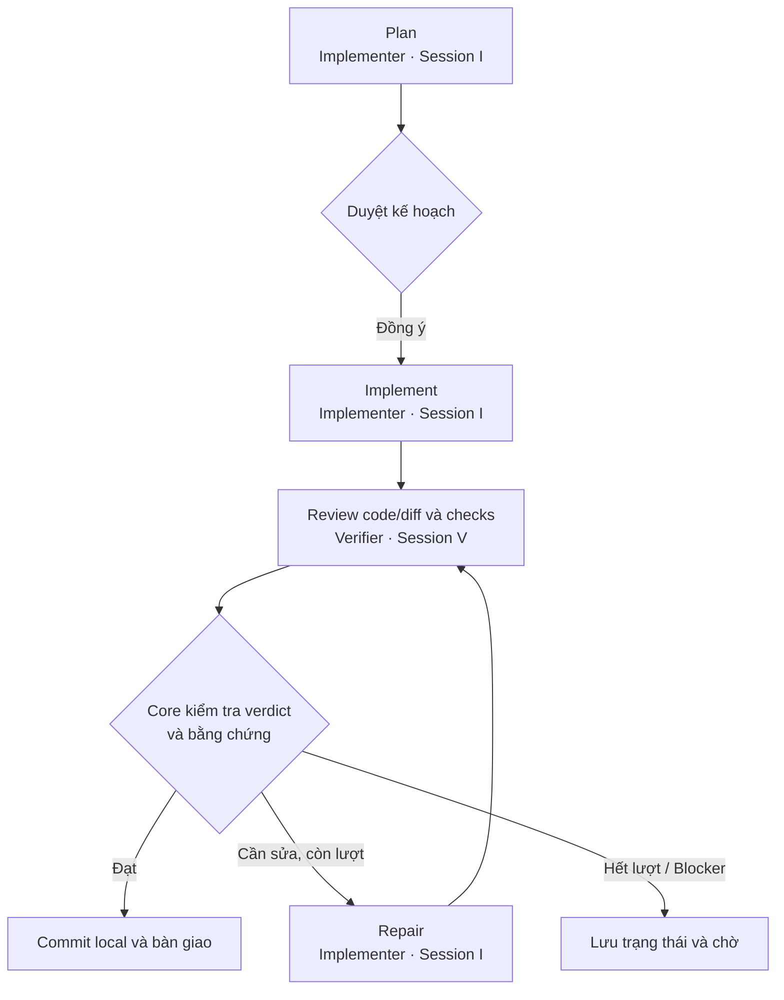
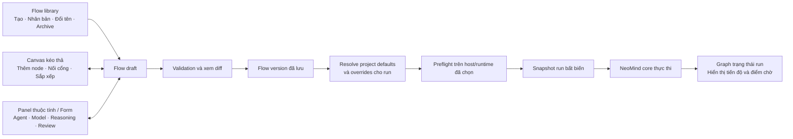
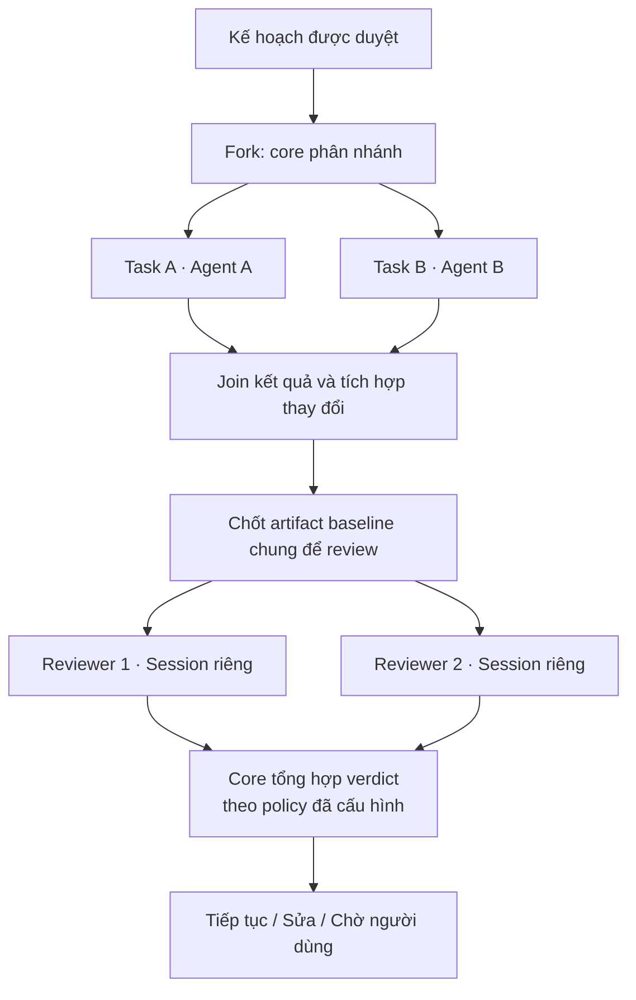
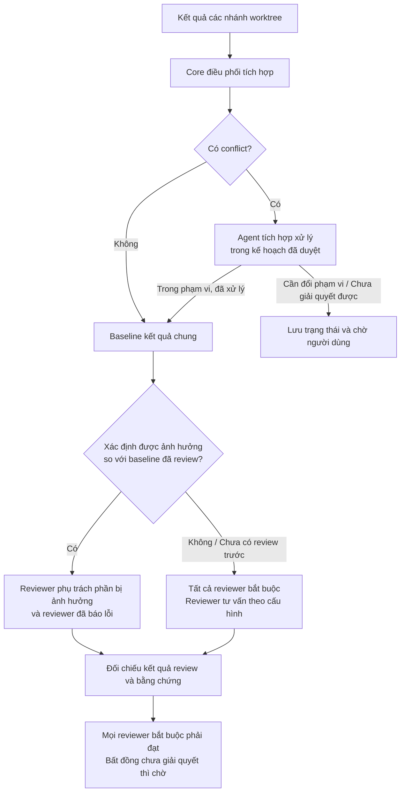
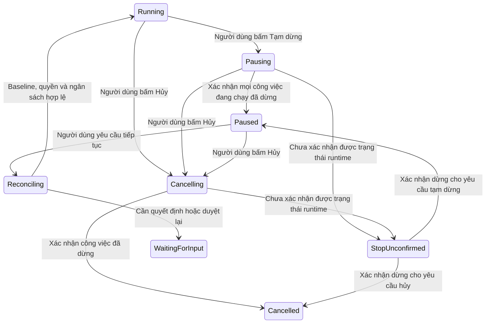

# NeoMind: cấu hình flow linh hoạt và editor kéo thả

**Bản tổng hợp mới nhất:** [NeoMind v1](design-v1.md) đã tự hoàn thiện các chi tiết kỹ thuật còn mở theo yêu cầu người dùng và làm baseline implementation. Tài liệu này lưu các lựa chọn F1–F21 và quá trình thảo luận; các ghi chú “chưa chốt” dưới đây là trạng thái trước bản tổng hợp.

Ngày: 28/10/2026. Trạng thái: thiết kế để thảo luận, chưa triển khai.

Yêu cầu mới của người dùng: quản lý nhiều flow như Fast, Research, Dev; tạo mới, chỉnh sửa, xóa, đổi tên; cấu hình agent, model, mức suy luận và quan hệ review; muốn chỉnh flow bằng kéo thả. Những hành vi này mở rộng hướng trước đó chỉ có một flow mặc định. Chi tiết schema, UI, versioning và quy tắc thực thi trong tài liệu này là đề xuất, chưa phải mọi lựa chọn đã được duyệt.

**Phạm vi được chọn tiếp theo — C:** thiết kế đầy đủ cả nhánh song song và nhiều reviewer ngay từ phiên bản đầu; người dùng chấp nhận phạm vi phát triển lớn hơn. Phạm vi này bao gồm quản lý nhiều flow, editor kéo thả và cấu hình agent/model/reasoning. Cơ chế isolation, join, tổng hợp verdict và xử lý xung đột còn cần chốt; lựa chọn C chưa phải cho phép bắt đầu triển khai runtime hoặc tự chạy các agent song song trong phiên thiết kế này.

Tiếp tục thiết kế hệ thống; người dùng đã chọn tạm hoãn pilot. Cách tính thời gian và hành vi Tạm dừng/Hủy đã chốt tại F18–F20 bên dưới.

## 1. Flow là một định nghĩa có thể tái sử dụng

Một flow mô tả các bước, agent thực hiện từng bước, dữ liệu bàn giao, quan hệ kiểm tra và điều kiện chuyển bước. Run là một lần chạy trên một phiên bản cụ thể của flow đó. Fast/Research/Dev là tên các flow người dùng quản lý; tên không quyết định chất lượng, số agent hoặc quyền thực thi.

| Khái niệm | Nội dung cấu hình |
| --- | --- |
| Flow | Tên, mô tả, phiên bản, input, output và defaults |
| Agent binding | Profile, instructions, skills, runner/provider/model, reasoning và quyền yêu cầu |
| Step/node | Công việc, agent binding, input/output, tiêu chí đạt và session policy |
| Transition/edge | Khi nào chuyển bước: hoàn tất, review đạt, cần sửa hoặc cần người dùng |
| Review relation | Reviewer kiểm tra output của bước nào, theo tiêu chí gì và trả sửa về đâu |
| Run settings | Workspace, overrides được phép, thời gian và các policy áp dụng |

Một flow có thể dùng nhiều runner/model. Một agent có thể thực hiện nhiều bước với cùng session; mỗi ô trên graph không nhất thiết tạo session mới. Đề xuất cấu hình session group để thể hiện rõ việc đó, trong khi mỗi attempt vẫn có lịch sử riêng.

## 2. Quản lý danh sách flow

| Thao tác | Hành vi đề xuất |
| --- | --- |
| Tạo mới | Bắt đầu từ flow trống hoặc template; tên hiển thị do người dùng đặt |
| Nhân bản | Sao chép thành flow có ID mới; có thể điều chỉnh mà không tác động bản nguồn |
| Chỉnh sửa | Tạo/cập nhật draft; xem thay đổi, kiểm tra hợp lệ rồi lưu phiên bản dùng để chạy |
| Đổi tên | Đổi tên hiển thị, giữ ID ổn định và liên kết lịch sử; run giữ tên tại thời điểm bắt đầu |
| Xóa | Cho chọn Archive có thể khôi phục hoặc xóa vĩnh viễn định nghĩa flow; lịch sử và snapshot run quản lý bằng thao tác riêng |
| Chọn mặc định | Project chọn flow mặc định; người dùng có thể chọn flow khác trước khi Run |

Đã chọn tách draft và phiên bản đã lưu để chạy: chỉnh ở draft, kiểm tra hợp lệ rồi lưu thành phiên bản mới. Run giữ snapshot đã resolve, không tự đổi hành vi khi người dùng chỉnh flow hoặc profile giữa chừng. Thay đổi flow đang chạy cần một thao tác có chủ đích và cơ chế duyệt/reconcile riêng; chưa thiết kế hot-edit live run.

Thư viện gồm templates dùng chung trong NeoMind và flow riêng từng project. Project có thể sao chép template thành flow riêng; cập nhật template không tự đổi flow đang dùng. Cách đề nghị nâng cấp và hiển thị diff từ template là chi tiết UX còn mở.

Flow và agent profiles riêng project được lưu thành file cấu hình trong repo để theo Git; layout canvas đi cùng flow. Trạng thái run và cấu hình cá nhân lưu riêng. Đường dẫn, định dạng và cách quản lý draft trong working tree cần đặc tả. Run snapshot phải đủ tự mô tả để lịch sử vẫn đọc được sau khi định nghĩa flow bị xóa hoặc đổi tên.

## 3. Cấu hình agent tại từng bước

Khi chọn một agent step, panel thuộc tính hiển thị:

- Tên bước, mục tiêu, vai/profile và instructions bổ sung.
- Skills cần dùng và cách lấy context/memory liên quan.
- Runner, provider, model và reasoning effort nếu được hỗ trợ.
- Quyền yêu cầu: đọc workspace, sửa code, chạy checks; adapter phải công bố mức thực thi thực tế.
- Input/output và điều kiện hoàn tất.
- Session group: tiếp tục cùng session hoặc session độc lập theo thiết kế flow.
- Timeout/budget và hành vi khi lỗi hoặc cần người dùng.

Ví dụ cho Dev mặc định: bước lập kế hoạch và thực hiện dùng binding `implementer`, cùng session group; bước kiểm tra dùng binding `verifier` và session group riêng. Verifier giữ session qua các vòng sửa, chỉ tạo mới khi không thể tiếp tục.

Đã chọn thư viện agent profiles dùng chung và profiles riêng project. Mỗi bước chọn profile rồi có thể ghi đè instructions, skills, model hoặc reasoning trong giới hạn policy. Cần hiển thị nguồn cấu hình và các overrides; cách version/pin profiles và nhận cập nhật còn cần đặc tả, không tự sửa snapshot của run đang chạy.

### Model và mức suy luận

UI chọn theo thứ tự runner → provider/model → các mức suy luận được hỗ trợ. Danh sách model và reasoning lấy từ capabilities/config đã được xác minh của adapter, không hardcode rằng mọi model đều có low/medium/high hoặc cùng ý nghĩa. Khi chưa biết capability, hiển thị chưa xác minh và yêu cầu preflight. Nếu binding không khả dụng, mặc định chờ người dùng chọn lại; chỉ tự thay khi flow đã khai báo danh sách thay thế được phép trong policy project, và ghi rõ mỗi lần đổi. Không suy từ lỗi capability thành quyền tự đổi model.

Đề xuất thứ tự áp dụng binding: **override cho run → cấu hình riêng của step → binding mặc định của flow → defaults theo vai của project**. Profile cung cấp vai/instructions/quyền mong muốn; không tự động đổi một flow đã pin khi profile được cập nhật. Mỗi trường hiện nguồn giá trị, ví dụ `Kế thừa project` hoặc `Ghi đè cho bước này`. Bản resolved config xuất hiện trước Run và được lưu cùng run.

Đã chọn mỗi bước có chế độ **Kế thừa** hoặc **Ghim giá trị** cho model/mức suy luận. Các defaults mới chỉ tác động bước kế thừa ở run tiếp theo; run đang chạy giữ snapshot cũ. Giữ một phiên bản flow không đồng nghĩa ghim mọi giá trị được kế thừa; run snapshot phải lưu cả giá trị resolved và nguồn cấu hình.

Danh sách thay thế phải mô tả binding hợp lệ, không ghép tùy ý model của lựa chọn này với reasoning của lựa chọn khác. Trước khi chuyển binding giữa run, adapter cần kiểm tra khả năng tiếp tục session/context; nếu không chứng minh được trạng thái trước đó thì chờ reconcile. Fallback không reset bộ đếm sửa, retry hoặc thời gian. Cách xác định lỗi đủ điều kiện fallback, thứ tự danh sách và chuyển session cụ thể còn cần đặc tả.

Quyền không áp dụng kiểu “giá trị sau ghi đè mọi thứ”: quyền yêu cầu phải nằm trong quyền người dùng/project cho phép và khả năng adapter. Run override không tự bỏ approval hoặc nâng quyền sửa code cho verifier.

## 4. Cấu hình “ai review ai”

Đề xuất người dùng tạo một bước review và chọn **output của bước đích**, thay vì chỉ chọn tên một agent. Cùng agent có thể sinh nhiều output khác nhau, nên verdict cần gắn đúng step/attempt và baseline.

| Thuộc tính | Ví dụ |
| --- | --- |
| Reviewer | Agent kiểm tra, session độc lập với agent tạo output |
| Review target | Output của bước Implement, gồm code/diff và baseline |
| Criteria | Yêu cầu gốc, kế hoạch đã duyệt, checks và tiêu chí hoàn thành |
| Context policy | Tự đánh giá trước khi xem kết luận của implementer, theo quyết định đã chốt |
| Khi đạt | Chuyển sang commit/bàn giao hoặc bước tiếp theo của flow |
| Khi cần sửa | Gửi findings về bước Repair của implementer rồi review lại |
| Giới hạn | Hai vòng sửa cho Dev mặc định; hết giới hạn thì chờ người dùng |
| Lỗi môi trường | Thử lại checks tối đa một lần khi có vẻ tạm thời, rồi chờ; tách khỏi bộ đếm sửa code |

Reviewer báo verdict; core quyết định chuyển bước theo contract và bằng chứng. Theo phạm vi mới đã chọn, flow cần cấu hình nhiều reviewer cho một target và review đồng thời ngay từ thiết kế đầu. Các reviewers phải kiểm tra cùng artifact baseline; quy tắc tổng hợp, quyền chặn và xử lý bất đồng cần được cấu hình rõ, không mặc định biểu quyết đa số.

## 5. Ba mẫu flow để người dùng bắt đầu

Các mẫu dưới đây minh họa tính linh hoạt, chưa phải cấu hình sản phẩm đã được người dùng chọn. Model bindings để người dùng chọn từ runner khả dụng, không suy ra model cụ thể từ tên flow.

| Mẫu | Các bước minh họa | Cách tùy chỉnh |
| --- | --- | --- |
| Fast | Khảo sát/kế hoạch → Duyệt → Thực hiện → Kiểm tra độc lập → Commit/bàn giao | Giới hạn phạm vi, instructions ngắn và chọn binding phù hợp; vẫn giữ các gate của flow code đã chốt |
| Research | Xác định câu hỏi → Thu thập nguồn → Tổng hợp → Review nguồn/lập luận → Báo cáo | Bước research và review có thể dùng model khác nhau; không mặc định có sửa code hoặc commit |
| Dev | Khảo sát/kế hoạch → Duyệt → Thực hiện → Kiểm tra độc lập → Sửa/kiểm tra lại → Commit | Xuất phát từ flow mặc định đã chọn, cho thay binding và nội dung chuyên môn |

Project đặt giới hạn quyền tối đa và những gate bắt buộc. Flow chỉ được tùy chỉnh trong giới hạn đó; muốn nới phải chủ động sửa policy project. Gate duyệt trước sửa file, quyền commit/push và yêu cầu kiểm tra độc lập được hiển thị như policy áp dụng; không bị mất âm thầm khi xóa node hoặc đổi template. Các quyết định v1 trước đây tiếp tục áp dụng cho flow code mặc định. Cách ánh xạ từng gate theo loại công việc và xử lý thay đổi policy trong lúc run chạy còn cần đặc tả.

## 6. Editor kéo thả

Về thiết kế, có thể xây editor graph cho NeoMind. Khả năng chạy editor cụ thể trong panel Nimbalyst cần prototype host thực tế; hiện chưa khẳng định đã xác minh tích hợp. Không cần thao tác kéo thả để runtime hiểu flow: graph editor và form cùng sửa một định nghĩa cấu trúc.

Giao diện đề xuất gồm ba vùng:

| Vùng | Nội dung |
| --- | --- |
| Trái | Danh sách flow và palette các loại node: Agent task, Approval, Review, Condition, Bounded repair, Finish; Git operation có cấu hình quyền riêng |
| Giữa | Canvas, tên bước, liên kết và nhãn outcome; nút thêm/xóa/nối cũng dùng được không cần kéo thả |
| Phải | Thuộc tính node/edge được chọn; bindings, context, review target, checks, giới hạn và lỗi validation |

Kéo node chỉ đổi vị trí hiển thị. Đổi thứ tự thực thi phải đổi các cạnh phụ thuộc. Nối cạnh biểu thị chuyển bước; gán review target là quan hệ riêng có nhãn rõ, không suy ra từ việc vẽ hai node gần nhau. Layout được lưu tách khỏi semantics thực thi.

Undo/redo và xác nhận tác động khi xóa node là phần UX đề xuất. Runtime monitor hiển thị snapshot của run; sửa flow trong editor tạo draft cho lần chạy sau, không tự sửa graph đang chạy.

Standalone dùng cùng các file định nghĩa flow trong repo thông qua file/form hoặc công cụ editor riêng về sau. Run standalone không phụ thuộc phải mở panel Nimbalyst để chỉnh hay thực thi flow; format import/export chính xác chưa chốt. Việc mở file cùng repo không đồng nghĩa runtime hai môi trường chia sẻ session hoặc run state.

## 7. Validation trước khi Run

Đề xuất cho lưu draft chưa hoàn chỉnh, nhưng chỉ chạy khi graph và bindings hợp lệ:

- Step IDs duy nhất, có điểm bắt đầu/kết thúc, tham chiếu input/output và review target tồn tại.
- Nhánh outcome có đường xử lý; không có vòng lặp vô hạn. Repair loop khai báo giới hạn riêng; chưa hỗ trợ arbitrary cycles trong bản editor đầu.
- Policy của project được đáp ứng: approval, quyền sửa/chạy checks/Git và độc lập của verifier.
- Reviewer đọc đúng artifact baseline; không tự coi cùng session implementer là review độc lập.
- Runner/model/reasoning, auth và quyền thực tế đáp ứng yêu cầu; hiển thị thiếu hụt, chỉ tự fallback trong danh sách đã được phép và ghi lịch sử.
- Session group hợp lệ: không dùng chung session cho các vai cần độc lập hoặc bindings không tương thích.

Editor đầu nằm trong phạm vi thiết kế flow tuần tự, nhánh theo kết quả, bounded repair, nhánh song song và nhiều reviewer. Parallel execution cần contract về workspace và kết quả, không chỉ thêm cách vẽ graph.

### Nhánh song song và nhiều reviewer: cấu trúc cần thiết kế

Sơ đồ minh họa khả năng của editor, chưa buộc mỗi flow phải có hai implementers hoặc hai reviewers. Flow code mặc định hai vai vẫn là một mẫu hợp lệ. Các quyết định cần chốt tiếp:

- **Fork:** nhánh nào có thể chạy cùng lúc, giới hạn concurrency và runner/session tương ứng.
- **Workspace:** nhánh chỉ đọc, nhánh được sửa; workspace riêng hay chung; cách tích hợp và xử lý conflict. Kế hoạch phải bao gồm phạm vi các nhánh.
- **Join:** chờ tất cả hay một tập nhánh bắt buộc; xử lý nhánh thất bại, bị hủy hoặc chưa rõ kết quả. Không dùng output dang dở để acceptance.
- **Review:** reviewers bắt buộc hay tư vấn, cùng kiểm tra một baseline, điều kiện pass và cách phân xử bất đồng.
- **Repair:** chuyển findings về nhánh nào; giới hạn hai vòng của flow mặc định ánh xạ thế nào vào nhiều nhánh; sửa xong làm mất hiệu lực những review nào.
- **Recovery:** lưu riêng trạng thái từng nhánh/session; không chạy lại nhánh đã hoàn thành chỉ vì nhánh khác bị gián đoạn. Quyền tạo workers vẫn thuộc core.

## 8. Các lựa chọn còn cần người dùng chốt

1. Phạm vi C đã chọn: CRUD nhiều flow, editor kéo thả, song song và nhiều reviewer từ phiên bản đầu. Cần chốt semantics thực thi trước khi triển khai.
2. Library đã chốt có templates chung và flow/profiles riêng project lưu trong repo theo Git; cần đặc tả đường dẫn, định dạng, import/export và đề nghị nâng cấp template.
3. Project policy là giới hạn bắt buộc đã chốt; cần xác định nội dung mặc định và xử lý khi policy thay đổi giữa run.
4. Đã chọn cả Archive và xóa vĩnh viễn định nghĩa flow, run history quản lý riêng; retention và UX xác nhận xóa còn cần đặc tả.
5. Giá trị thời gian mặc định, cách tính khi xếp hàng và cách yêu cầu ngắt runtime lúc hết hạn cần đặc tả; quy tắc chờ người dùng đã chốt tại F18.

Chưa chọn thư viện UI, file schema hoặc model IDs. Nghiên cứu dependency và API host thực tế thực hiện khi chốt phạm vi editor.

## 9. Các quyết định cấu hình flow đã được người dùng chọn

Các lựa chọn dưới đây cập nhật những mục còn mở tương ứng ở trên. Schema và chi tiết enforcement vẫn cần đặc tả.

| Mục | Chọn | Quyết định |
| --- | --- | --- |
| F1 — Workspace song song | C | Cấu hình theo flow: worktree riêng hoặc workspace chung; core kiểm tra điều kiện trước khi chạy. |
| F2 — Nhiều reviewer | A | Cấu hình reviewer bắt buộc hoặc tư vấn theo flow. Tất cả reviewer bắt buộc phải đạt; bất đồng chưa giải quyết được thì chờ người dùng. |
| F3 — Nhánh bị chặn | A | Cấu hình theo flow; mặc định nhánh độc lập tiếp tục, bước phụ thuộc chờ. Có thể chọn yêu cầu dừng toàn bộ khi một nhánh bị chặn. |
| F4 — Ngân sách sửa | A | Giới hạn chung cho run và giới hạn từng vòng sửa trong graph; mọi nhánh phải nằm trong ngân sách chung. Flow Dev mặc định vẫn tối đa hai vòng sửa. |
| F5 — Flow library | A | Templates dùng chung trong NeoMind và flow riêng từng project; sao chép template để chỉnh, cập nhật template không tự đổi flow đang dùng. |
| F6 — Project policy | A | Project đặt giới hạn quyền tối đa và gate bắt buộc; flow tùy chỉnh trong giới hạn đó, nới giới hạn phải chủ động sửa policy project. |
| F7 — Xóa flow | C | Có Archive và xóa vĩnh viễn định nghĩa flow; lịch sử run quản lý bằng thao tác riêng. |
| F8 — Phiên bản flow | A | Chỉnh bản nháp, kiểm tra hợp lệ rồi lưu phiên bản mới để chạy; run đang chạy giữ snapshot cũ. |
| F9 — Kế thừa bindings | A | Từng bước chọn Kế thừa hoặc Ghim model/mức suy luận. Defaults mới áp dụng bước kế thừa ở run tiếp theo; trước Run hiển thị cấu hình thực tế, run đang chạy giữ nguyên. |
| F10 — Binding không khả dụng | A | Mặc định chờ người dùng chọn lại; flow có thể khai báo danh sách thay thế được phép, chỉ tự dùng trong danh sách và ghi rõ mỗi lần đổi. |
| F11 — Concurrency | A | Project đặt mức trần, flow đặt giới hạn trong mức trần, có thể giảm đầu run; bước sẵn sàng còn lại xếp hàng chờ. |
| F12 — Tích hợp nhánh | A | Core điều phối tích hợp: tự ghép thay đổi không conflict; conflict giao agent tích hợp xử lý trong kế hoạch đã duyệt, vượt phạm vi thì hỏi người dùng; sau đó kiểm tra kết quả chung. |
| F13 — Review lại | B | Chỉ reviewer phụ trách phần bị ảnh hưởng và reviewer đã báo lỗi kiểm tra lại; core phải xác định phạm vi ảnh hưởng, không rõ thì chạy lại tất cả reviewer bắt buộc. |
| F14 — Agent profiles | A | Profiles dùng chung và riêng project; mỗi bước chọn profile rồi ghi đè instructions, skills, model hoặc reasoning trong giới hạn policy. |
| F15 — Concurrency nhiều run | B | Mức trần project là giới hạn riêng cho mỗi run, không phải tổng tất cả run; nhiều run có thể cùng dùng tối đa mức đó. |
| F16 — Workspace nhiều run | A | Mỗi workspace chỉ có một run được sửa tại một thời điểm; run khác dùng worktree riêng hoặc xếp hàng. Run chỉ đọc có thể cùng chạy nếu baseline giữ ổn định. |
| F17 — Lưu cấu hình | A | Flow và profiles riêng project lưu thành file trong repo theo Git; layout canvas đi cùng flow, run state và cấu hình cá nhân lưu riêng. |
| F18 — Đồng hồ run | A | Chỉ tính thời gian xử lý tự động gồm agent, tools và checks; tạm dừng bộ đếm khi toàn run chờ người dùng, còn nhánh chạy thì vẫn tính. |
| F19 — Tạm dừng | B | Ngừng giao bước mới, yêu cầu ngắt các agent đang chạy, lưu trạng thái và đối chiếu thay đổi trước khi tiếp tục. |
| F20 — Hủy run | A | Yêu cầu ngắt agent, giữ code/artifacts và lịch sử; chỉ đánh dấu đã hủy sau khi xác nhận dừng, không tự rollback hoặc xóa worktree. |
| F21 — Khôi phục sau gián đoạn | A | Sau khi mở lại host/CLI, tự đối chiếu session, code và trạng thái đã lưu; hiển thị kết quả khôi phục rồi chờ người dùng bấm Tiếp tục trước khi giao thêm việc. |

### Các hệ quả thiết kế cần triển khai thành contract

- **Workspace:** lựa chọn workspace của cả run và cách chia workspace cho các nhánh là hai cấu hình khác nhau. Core phải hiển thị cả hai trước Run. Worktree riêng cần tích hợp kết quả và kiểm tra trên baseline chung; workspace chung cần phát hiện vùng ghi chồng và phối hợp checks có tác động ghi. Điều kiện chấp nhận workspace chung, ownership và giải quyết conflict chưa chốt.
- **Review:** tư vấn không tự trở thành gate bắt buộc; findings vẫn được lưu và xử lý theo tiêu chí của flow. Không dùng bỏ phiếu đa số để vượt một reviewer bắt buộc chưa đạt. Tất cả verdict áp dụng cho cùng baseline; thay đổi artifact có thể làm mất hiệu lực verdict cũ. Quy tắc phân biệt finding hợp lệ và bất đồng cần người dùng còn cần đặc tả.
- **Chờ:** lưu trạng thái chờ ở cấp nhánh. Với policy mặc định F3, run có thể vừa có nhánh chờ người dùng vừa có nhánh đang chạy; không biểu diễn toàn run là đã dừng. Quy tắc chờ toàn run đã chọn cho flow tuần tự vẫn áp dụng cho flow mặc định. Khi chọn dừng toàn bộ, core yêu cầu dừng và xác nhận trạng thái từng session; không coi gửi lệnh cancel là mọi thao tác đã dừng hay rollback.
- **Ngân sách:** core cấp lượt sửa trước khi dispatch để nhánh chạy đồng thời không cùng vượt ngân sách còn lại. Giá trị cụ thể của flow tùy chỉnh và cách tính một lượt sửa khi nhiều nhánh cùng tham gia chưa chốt. Bộ đếm không reset khi retry/resume hoặc tạo session thay thế. Ngân sách sửa code và thử lại checks vì môi trường là hai bộ đếm khác nhau.
- **Concurrency:** scheduler cấp slot cho các agent đang thực thi, xếp hàng các bước đã đủ dependency nhưng chưa có slot. Số session còn lưu không đồng nghĩa số agent đang chạy. Theo F15, mức trần cấu hình ở project áp dụng riêng từng run, không phải một pool chung; tổng số agent của nhiều run có thể lớn hơn mức đó. Cách giải phóng slot khi chờ approval và xử lý giới hạn riêng của provider còn cần đặc tả; không hứa concurrency vượt capabilities runtime.
- **Quyền ghi workspace giữa các run:** F16 là quyền ghi cấp run. Khi một run đã sở hữu workspace, các nhánh bên trong run đó vẫn tuân theo chế độ workspace và điều kiện ghi của F1. Run khác không được ghi vào workspace đó dù còn slot concurrency; phải dùng worktree riêng hoặc chờ. Checks có tác động ghi cần được tính khi cấp quyền, không mặc định mọi reviewer là tác vụ chỉ đọc. Cơ chế phối hợp quyền giữa Nimbalyst/CLI, thay đổi do người dùng và kiểm tra baseline ổn định còn cần đặc tả; lock của NeoMind không tự ngăn công cụ ngoài ghi file.

Mô hình trạng thái tuyến tính trong `architecture.md` minh họa flow Dev mặc định. Run song song cần trạng thái từng node/attempt, nguyên nhân bị chặn và trạng thái tổng hợp; enums/schema của phần này chưa được chốt.

### Tích hợp và xác định review cần chạy lại

Không có conflict Git không chứng minh các thay đổi tương thích về hành vi; kết quả tích hợp vẫn phải qua checks/review. Cách tạo artifacts nhánh hoặc commits tạm để tích hợp và ownership của workspace tích hợp còn cần đặc tả; quyết định này không cấp quyền push hoặc merge vào nhánh chính.

F13 cho phép giữ verdict cũ của reviewer không bị ảnh hưởng, nhưng core cần lưu chứng cứ vì sao verdict đó còn áp dụng cho baseline mới. Mapping reviewer scope, dependencies và baseline phải đủ để xác định ảnh hưởng; nếu chưa đủ, chạy lại tất cả reviewer bắt buộc. Reviewer đã báo lỗi vẫn phải xác minh việc sửa, không chỉ dựa vào implementer nói đã sửa. Không dùng số dòng diff ít hoặc không trùng file làm bằng chứng duy nhất rằng không có ảnh hưởng.

Agent tích hợp sửa conflict cũng không thể tự đảm nhiệm review độc lập cho chính thay đổi đó. Cách tính công việc tích hợp vào thời gian và ngân sách sửa, xử lý conflict không giải được và cơ chế duyệt kế hoạch cập nhật cần đặc tả tiếp.

## 10. Tạm dừng, hủy và thời gian xử lý

F18 định nghĩa thời gian xử lý tự động ở cấp run: nếu một nhánh chờ nhưng nhánh khác vẫn chạy thì đồng hồ tiếp tục. Đề xuất đo thời gian thực của các khoảng hoạt động, không cộng thời gian từng agent song song; đây là semantics cần đưa vào schema. Giá trị giới hạn mặc định, thời gian xếp hàng, thời gian tạm dừng chủ động và hành vi sau khi hết hạn còn cần đặc tả.

Tên trạng thái là đề xuất. Core phải giữ ý định Tạm dừng hoặc Hủy để không chuyển sai từ `StopUnconfirmed`; hai đường đó không cho phép tự chọn trạng thái kết thúc. Không cấp slot hay giao bước mới sau yêu cầu dừng. Không giải phóng quyền ghi workspace dựa riêng vào việc gửi lệnh ngắt: công việc chưa xác nhận dừng vẫn có thể đang ghi.

Adapter cần công bố khả năng ngắt và cách xác nhận; khi không hỗ trợ hoặc mất liên lạc, UI hiển thị chưa xác nhận và phần việc có thể còn chạy, không báo đã tạm dừng/hủy thành công. Khi resume, đối chiếu artifacts, session, baseline, approvals, bộ đếm và tác dụng đã xảy ra trước khi quyết định tiếp tục hay thử lại. Không rollback, xóa worktree hoặc reset ngân sách tự động.

### Khôi phục sau khi đóng hoặc crash

Theo F21, startup tự đọc run records và đối chiếu session, code/baseline, artifacts và thao tác có tác dụng phụ đã xảy ra. Hiển thị báo cáo khôi phục và chờ người dùng bấm **Tiếp tục** trước khi dispatch thêm. Khôi phục không tự tạo session thay thế, chạy lại checks hoặc commit lại; các hành động đó cần đi qua quyết định resume sau khi đã đối chiếu.

Run có thể được phát hiện vẫn đang chạy trong runtime dù tiến trình điều phối đã đóng. UI phải phân biệt **runtime còn hoạt động** với **core đã cho tiếp tục dispatch**; việc chờ bấm Tiếp tục không khẳng định runtime cũ đã dừng. Khi trạng thái chưa rõ, giữ tình trạng chưa xác nhận và quyền ghi tương ứng cho tới khi đối chiếu được, không cấp workspace cho run khác chỉ vì host đã khởi động lại.

Cách xác định run owner, tránh hai core cùng khôi phục một run, xác minh intent Tạm dừng/Hủy trước crash và xử lý host không truy vấn được session cũ còn cần đặc tả kỹ thuật. Lịch sử phải giữ kết quả reconciliation và quyết định tiếp tục của người dùng.
