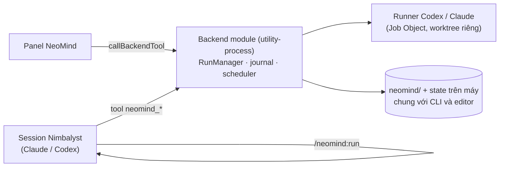

# NeoMind trong Nimbalyst: extension · spike 30/10/2026

## Quyết định (30/10/2026)

NeoMind vào Nimbalyst dưới dạng **extension**. Mọi session Nimbalyst có thể start và theo dõi flow NeoMind qua tool MCP (tương ứng các lệnh CLI). Agent của từng bước vẫn chạy bằng **runner Codex/Claude của NeoMind**, không dùng session của Nimbalyst. Lý do: SDK 0.7.1 chưa có stop có bằng chứng, cwd/worktree theo session, và model thực tế. Runner Nimbalyst để sau, khi SDK đủ, theo cùng contract `AgentRunner`.

Cách duyệt đã chốt: agent trong session **được gọi** duyệt kế hoạch hoặc áp dụng thay đổi, nhưng **phải hỏi người dùng trước** ngay trong session. Người dùng cũng duyệt được trong panel.

## Cách extension được ghép với Nimbalyst

- `extensions/nimbalyst/manifest.json`: id `local.neomind`. Có 3 thành phần:
  - backend module `neomind-runtime`, chạy trong `utility-process`, quyền `mcp-server-register`;
  - panel `neomind`;
  - plugin lệnh `/neomind:run`.
- Backend: `activate(ctx)` nhận `ctx.services.{workspacePath, dataDir, log, registerMcpTools}`, đăng ký tool rồi trả về `{ methods, deactivate }`. Mỗi lần gọi có `ctx.call` (`caller`, `sessionId`).
  - Tool có `panelOnly: true` thì không lộ ra cho agent.
  - Host tự gắn tiền tố theo đoạn cuối của id: agent thấy `neomind_start`, panel gọi `neomind.status`.
  - Hợp đồng này lấy từ extension Crew có sẵn; **không có trong type công khai** của SDK 0.7.1, nên có thể đổi.
- Bundle: backend gói core NeoMind và zod vào một file ESM (`vite.backend.config.ts`). Panel để React do host cung cấp (`vite.panel.config.ts`). Dựng bằng `npm run build` trong `extensions/nimbalyst`.

## Kết quả spike

| Câu hỏi | Kết quả |
| --- | --- |
| Utility process chạy được git, Claude Code, Codex? | Được (Electron 43.7, Node 24.21). Codex cài qua npm phải chạy bằng `node.exe` trên PATH: trong Electron, `process.execPath` là `Nimbalyst.exe` (đã sửa trong `resolveWindowsCodex`). |
| Job Object (giới hạn và dừng process) | Được, dừng có xác nhận. |
| `node:sqlite` (khóa, coordination) | Có. |
| Panel gọi backend | Được, qua `host.callBackendTool('neomind.status')`. |
| Session mới thấy tool `neomind_*` và `/neomind:run`? | Có. Session Claude và session Codex mới đều thấy `neomind_start` và `neomind_status` (kiểm 30/10); `/neomind:run` hiện trong danh sách lệnh. Session mở trước khi backend đăng ký tool thì không thấy. |

## Bài học khi cài

- Extension do người dùng cài phải được cấp quyền chạy native code. Hộp thoại xin quyền chỉ hiện khi Nimbalyst **khởi động backend lúc mở workspace**. Cài lúc workspace đang mở thì không có hộp thoại, panel báo "Backend tool not available". Hai ô trạng thái trong Settings chỉ để hiển thị, không bấm được.
- Cách bật an toàn: giữ một cửa sổ Nimbalyst khác đang mở, đóng riêng cửa sổ workspace, rồi mở lại workspace đó. Thoát hẳn app thì Nimbalyst có thể tự thoát ngay lúc khởi động vì không có workspace để khôi phục (`[SingleInstance] No open-file after timeout, quitting`). Lần đó backend NeoMind chưa chạy, nên đây là hành vi của Nimbalyst.

## Bản đầy đủ (30/10/2026, sau spike)

**Tool cho session** (`src/runtime/session-tools.ts`, mỗi tool một lệnh CLI, cùng `RunManager`): `flows`, `preview`, `start`, `status`, `wait` (chờ đổi phase, tối đa 240 giây), `approve`, `request_changes`, `pause`, `resume`, `cancel`, `extend_time`, `apply`, `retry_commit`, `include_imported`, `clean`, `session` (transcript).
- `approve`, `apply`, `include_imported` và `clean` có `force` bắt buộc `confirmed: true`. Mô tả tool dặn agent hỏi người dùng trước. Host không chứng minh được agent đã hỏi, nên journal ghi lần duyệt từ session là nguồn `session` (thêm vào schema duyệt).
- Tool `api` chỉ dành cho panel: một request API của editor.

**Panel = editor đầy đủ.**
- Phần định tuyến `/api/*` của server được tách thành `createEditorApi(projectRoot, runs)`. Server HTTP và backend extension dùng chung hàm này, và chung một `RunManager` trong process.
- Panel render `App` của `ui/src` trong shadow root. CSS (`:root` → `:host`) không lẫn với Nimbalyst. `api()` có transport thay được: HTTP trong trình duyệt, `callBackendTool('neomind.api')` trong panel.
- `window.prompt` (Electron không có) được thay bằng hộp nhập trong trang (`ui/src/dialog.tsx`).
- React Flow kéo theo `use-sync-external-store` dạng CommonJS. Bản đó gọi `require('react')`, mà môi trường panel không có `require`, nên extension không nạp được và biểu tượng biến mất. Đã thay bằng bản ESM trong `extensions/nimbalyst/src/shims`.

**Sửa core khi chạy thật:** worktree của run nằm dưới `%LOCALAPPDATA%\neomind\<hash>\workspaces\…`, dài hơn checkout. Repo có file nằm sâu (NeoMind có `references/ai-workflow-kit/...`) thì vượt MAX_PATH và `git worktree add` thất bại. Mọi lệnh git của NeoMind trên Windows giờ dùng `core.longpaths=true`, truyền qua biến môi trường, không sửa config repo.

**Chạy thật từ session (30/10):** session Claude này gọi `neomind_preview`, `neomind_start`, `neomind_wait` và `neomind_session` trên repo NeoMind, flow Research (Codex gpt-6-luna, suy luận thấp).
- Run đi hết các bước: research, review không đạt, vòng sửa, research lại, review đạt, review làm lại vì bằng chứng sai, rồi dừng ở **blocked** sau 86 giây và khoảng 313k token.
- Lý do: hai trích dẫn không khớp nguyên văn. Báo cáo chép sai đường dẫn tuyệt đối của worktree và reviewer "sửa" lại khi trích; reviewer cũng bỏ dấu `!` khi trích một dòng mã. Bước kiểm tra tự động bắt đúng cả hai.
- Đã thêm vào prompt Research: trích nguồn bằng đường dẫn tương đối, không dùng đường dẫn tuyệt đối.

**Lệnh `/neomind:run`** dẫn agent qua `preview`, `start`, `wait`; hỏi người dùng trước `approve` và `apply`.

**Giới hạn còn lại:**
- `extension_reload` chỉ nạp lại panel. Backend chỉ chạy bản mới sau khi mở lại workspace.

## Việc tiếp theo

1. Ghép run với session: biết session nào start run nào (`session-runs.jsonl` đã ghi), và báo session khi run cần duyệt hoặc đã xong.
2. Thử run Fast/Dev thật từ một session trên `demo/claude-e2e1`, gồm đóng/mở workspace giữa chừng (recovery).
