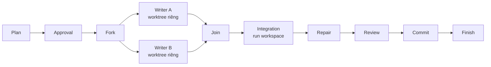

# Nhiều writer song song và tích hợp nhánh (mục 2 của handoff)

Ngày: 29/10/2026. Phạm vi: lát cắt đầu của design-v1 mục 8 cho standalone executor. Thay thế việc `standaloneDiagnostics()` chặn mọi flow có `integration` hoặc nhiều writer.

## Hình dạng flow được hỗ trợ

- Writer nằm trong nhánh fork chạy trong **worktree riêng** tạo từ `sourceHead`; các writer khác vẫn chạy trong run workspace như trước.
- Sau join phải có đúng một node `integration` trước mọi review/commit nhận output của nhánh.
- Run workspace phải sạch khi tới fork: chưa hỗ trợ writer trước fork (cần commit nội bộ làm base). Preview chặn trường hợp này.
- Mỗi writer trong nhánh dùng session group riêng; node integration có profile/binding/session group riêng để xử lý conflict và repair.

## Work packets

`plan.workPackets` (tùy chọn): `[{ nodeId, goal, scope }]`. Flow có writer trong nhánh thì kế hoạch phải có đúng một packet cho mỗi writer đó; `scope` nằm trong `plan.scope` và `writeScopes` của node. Packet là một phần của kế hoạch nên được duyệt cùng plan hash. Sandbox của writer chỉ được ghi trong `scope` của packet.

## Thực thi

1. **Branch workspace.** Lần dispatch đầu của writer nhánh: journal `branch_workspace_intent` → tạo detached worktree `<state>/workspaces/<runId>--<nodeId>` tại `sourceHead` (đã tồn tại thì chỉ nhận nếu đúng commit và sạch) → giữ writer lease riêng (nhận lại lease cùng run sau crash) → `branch_workspace_bound`.
2. **Song song.** Writer/agent trong nhánh fork được dispatch đồng thời trong giới hạn concurrency; node khác chạy tuần tự khi không còn nhánh đang chạy. Lỗi một nhánh dừng các nhánh còn lại rồi đối chiếu như hiện tại. Dispatch ghi chỉ bị chặn bởi attempt chưa rõ **trong cùng workspace**.
3. **Integration (core).** Với mỗi nhánh: tạo tree từ worktree nhánh đúng baseline đã hoàn tất, commit nội bộ trên ref riêng `refs/neomind/<runId>/<nodeId>` (không đụng nhánh người dùng). Gộp lần lượt bằng `git merge-tree --write-tree` (Git ≥ 2.38), không chạm workspace. Journal `integration_intent` (base, commits, tree gộp, file conflict) rồi mới áp tree vào run workspace (`read-tree -m -u`, sau đó đưa index về HEAD) và journal `integration_applied` với baseline mới. Kết quả gộp được ghi như một attempt hoàn tất của phiên `core-integration` để review/commit dùng chung đường hiện có.
4. **Conflict.** Có file conflict thì giao agent integration trong run workspace, chỉ trong phạm vi đã duyệt. Sau lượt agent, core kiểm tra không còn dòng đánh dấu conflict trong các file đó; còn thì chặn run. Không có conflict thì không gọi agent.
5. **Repair.** Review target là node integration; repair owner là node integration. Vòng repair không gộp lại mà giao agent integration sửa trong run workspace theo findings.
6. **Recovery.** `integration_intent` chưa có `applied`: workspace còn sạch ở base → áp lại (deterministic); tree hiện tại đúng tree gộp → ghi `applied`; khác → chặn chờ người dùng. Branch workspace có intent chưa bound được nhận lại khi resume.

## Bằng chứng tham chiếu check

Reviewer trích receipt bằng `receiptId` (12 ký tự đầu của output hash do core cấp) thay cho hash đầy đủ. Trong các run thật, Luna/low chép sai hash 64 ký tự (mất/thừa ký tự giữa chuỗi) kể cả sau khi được báo lỗi. Mã ngắn vẫn chỉ có từ receipt core cấp nên giữ nguyên bảo đảm; tham chiếu `outputHash` đầy đủ vẫn hợp lệ cho journal cũ.

## Kiểm chứng (29/10/2026, Windows 11)

- Deterministic (`test/parallel-run.test.ts`, `test/integration-workspace.test.ts`): hai writer chạy đồng thời trong worktree riêng; gộp không conflict không gọi agent; conflict giao agent integration và chỉ chấp nhận khi hết marker; marker còn sót chặn run trước review; vòng repair trên kết quả tích hợp không gộp lại; thiếu work packet không duyệt được; nhánh lỗi dừng nhánh còn lại; preview chặn hình dạng chưa hỗ trợ.
- Codex thật, template `parallel`, `demo/repo1`: plan v1 dùng file làm scope → bị chặn khi duyệt → `run changes` → v2 (A: `calc.js`, B: `test.js`, scope `.`) → hai nhánh song song → gộp không conflict → `npm test` pass → review (retry evidence, rồi `run resume` với `receiptId`) → commit `7fbadbc`. ~296k tokens. Đường conflict chưa chạy với model thật.

## Ngoài phạm vi lát cắt này

Writer trước fork, nhiều node integration, shared workspace với write scopes giao nhau, checkout hiện tại của người dùng, conflict đổi tên/xóa phức tạp (được giao agent như conflict nội dung nhưng chưa có kiểm tra riêng), dọn ref/worktree nội bộ sau run.
