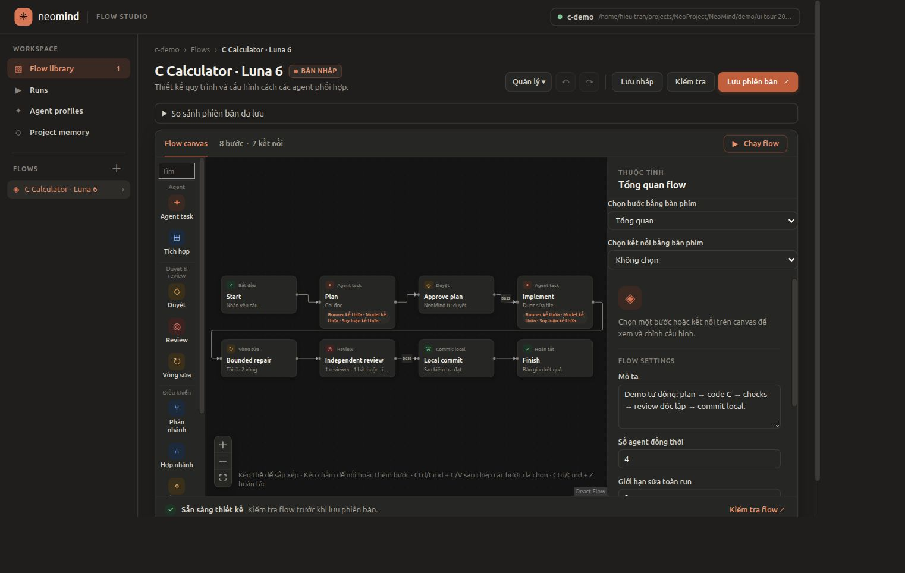
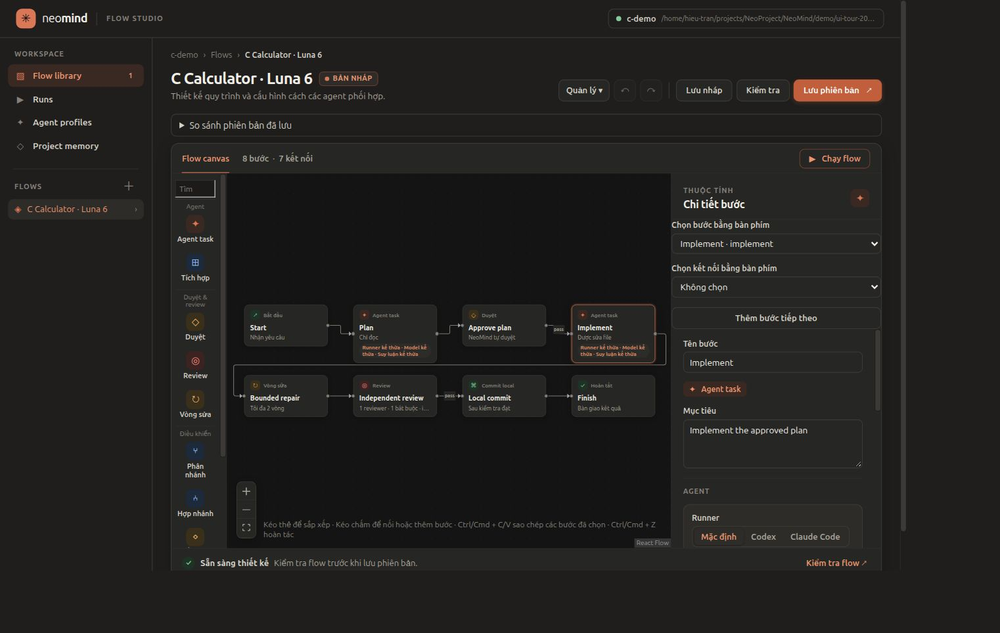
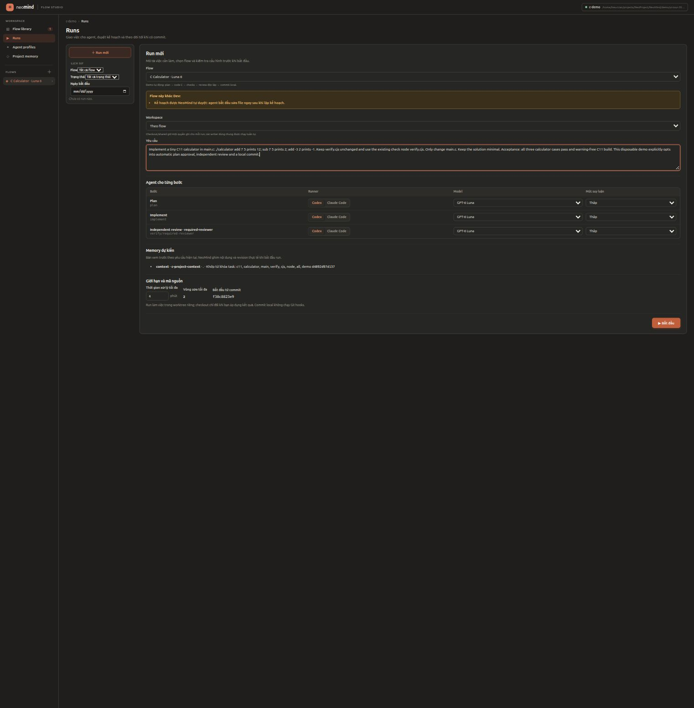
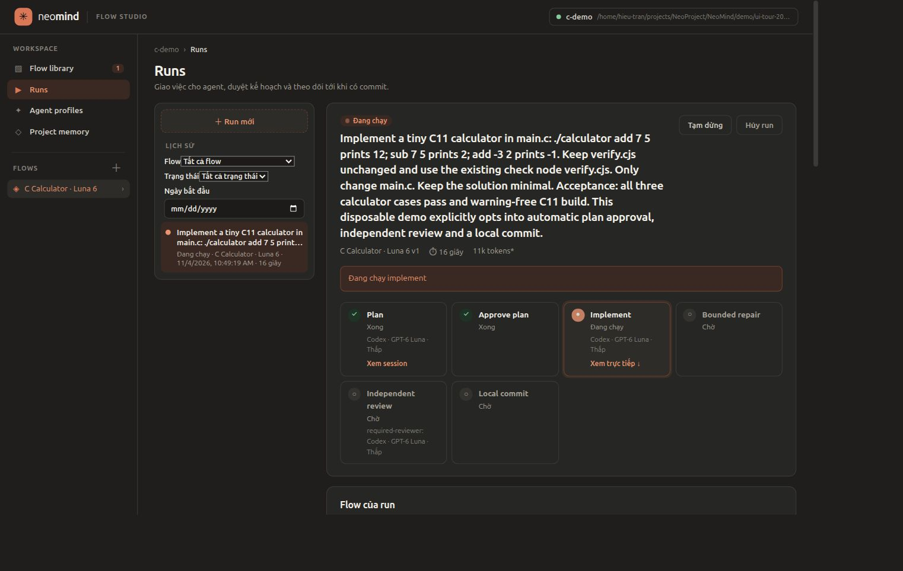
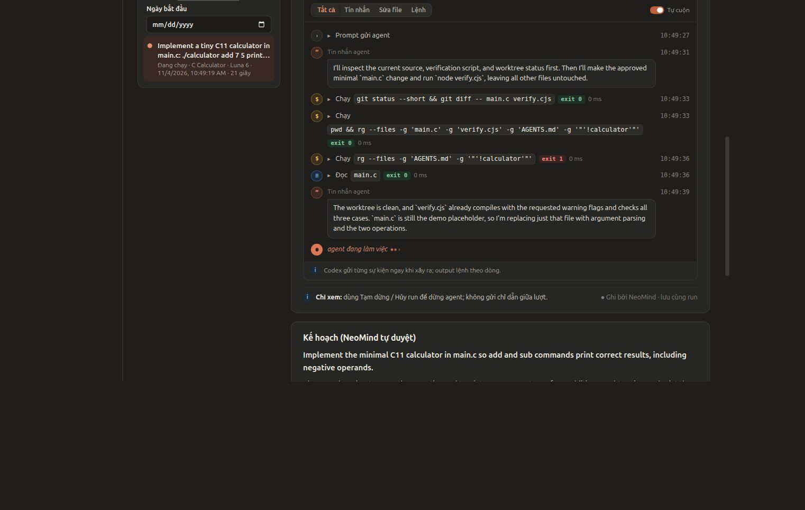
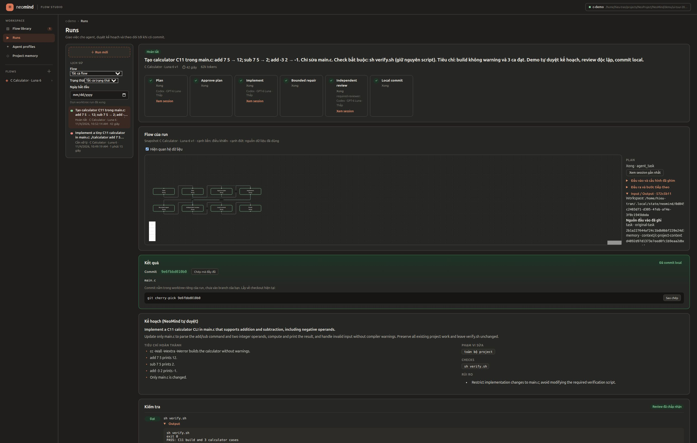
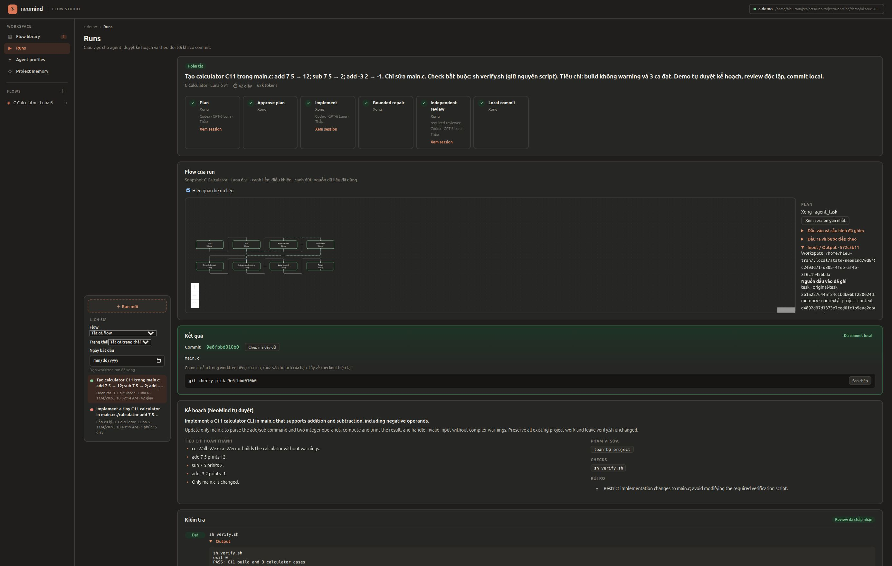
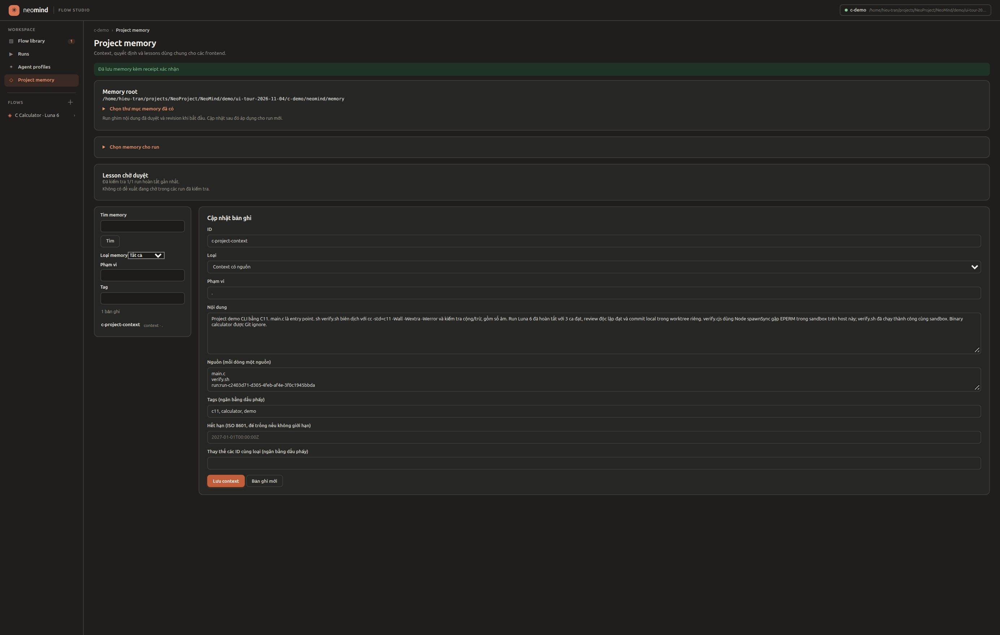
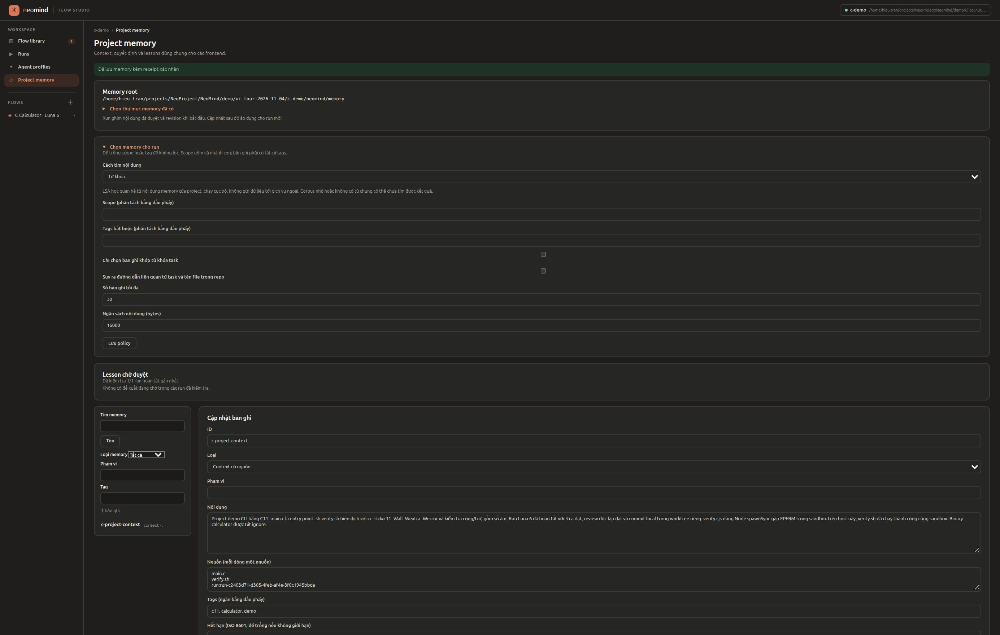
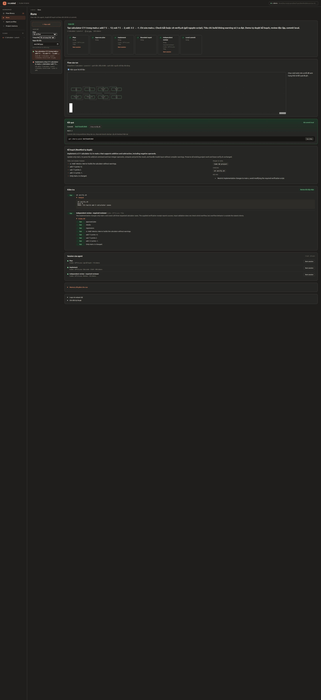

# NeoMind — Bộ ảnh chạy thực tế trên Linux

Ngày 04/11/2026 (Asia/Jakarta). Project demo calculator C11, runner Codex, model gpt-6-luna, reasoning low.

Flow: Plan → tự duyệt kế hoạch (chỉ cấu hình demo) → Implement → checks → review độc lập → commit local.

- Run hoàn tất: `run-c2403d71-d305-4feb-af4e-3f0c1945bbda`.
- Thời gian xử lý: 42,25 giây.
- Check `sh verify.sh`: biên dịch C11 với `-Wall -Wextra -Werror`, kiểm tra cộng, trừ và số âm: đạt.
- Reviewer độc lập: 8/8 tiêu chí đạt. Không có vòng sửa.
- Commit trong worktree demo: `9e6fbbd010b06653525cc118f73a3726e2a10400`; chỉ thay đổi `main.c`.
- Run thành công báo 62.125 tokens, trong đó 24.192 cached input; chi phí USD không được runner cung cấp. Con số này không gồm lần đầu bị chặn.

Lần đầu dùng `node verify.cjs` bị lỗi `spawnSync cc EPERM` trong sandbox. Host chạy cùng check thì đạt. Flow dừng trước commit; kiểm tra bằng `sh verify.sh` trong cùng sandbox đạt, rồi một run mới hoàn tất. Chưa xác định nguyên nhân gốc của lỗi Node subprocess.

Ảnh là giao diện thật. Đây là demo flow Dev tuần tự với một implementer và một reviewer; không phải acceptance đầy đủ mọi biến thể song song, accessibility hoặc Windows. Trang memory có context và policy; demo này chưa tạo lesson proposal.

Dữ liệu thực thi gốc nằm trong demo bị Git ignore và runtime riêng. Bản lưu trong thư mục này gồm 10 ảnh, gallery offline và báo cáo đã rút gọn, bỏ session IDs và payload journal. Không sửa source NeoMind trong đợt chụp ảnh.

## 1. Canvas thiết kế flow

## 2. Cấu hình runner, model và mức suy luận

## 3. Cấu hình trước khi chạy

## 4. Agent đang sửa code bằng Luna 6

## 5. Log và hoạt động trực tiếp

## 6. Flow đã hoàn tất

## 7. Kết quả commit và checks

## 8. Project memory sau khi cập nhật context

## 9. Chính sách chọn memory

## 10. Toàn trang kết quả và 8 tiêu chí review

