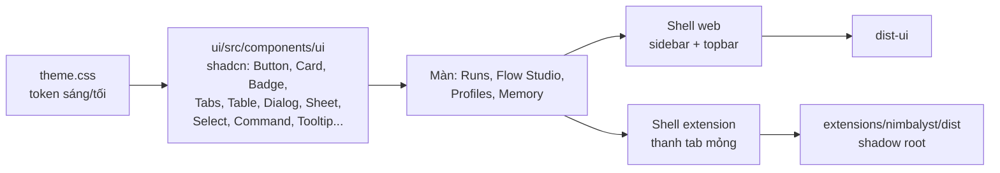

# Kế hoạch thiết kế lại UI NeoMind (editor web + extension Nimbalyst)

Ngày: 05/11/2026. Trạng thái: **đã chốt; GĐ 0 xong (mục 7); GĐ 1 xong phần code ngày 05/11 trên branch `ui/redesign-p1`** (kết quả ở cuối mục GĐ 1), panel Nimbalyst đã kiểm đạt; còn cài skill.

Đã chốt với người dùng:

| Câu hỏi | Quyết định |
| --- | --- |
| Nền component | Tailwind v4 + shadcn/ui (Radix) |
| Theme | Theo theme Nimbalyst (sáng/tối), màu nhấn trung tính; bản web có công tắc sáng/tối |
| Extension | Bỏ topbar/sidebar riêng, chỉ giữ thanh tab mỏng kiểu Nimbalyst; bản web vẫn có shell đầy đủ |
| Ngôn ngữ | Toàn bộ tiếng Việt, giữ thuật ngữ kỹ thuật (flow, run, commit, review, worktree) |
| Skill thiết kế cho agent | Frontend Design, UI UX Pro Max, shadcn/ui. Không dùng Better Design, Superdesign |
| Phạm vi | Theo giai đoạn, mỗi giai đoạn merge được riêng, không đổi backend |
| Màu clay | Chỉ còn ở logo NeoMind; mọi chỗ khác trung tính, màu dành cho trạng thái |
| Màn mở đầu | Runs đứng đầu sidebar; mở app thì vào Runs |
| Theme bản web | Theo hệ điều hành, có công tắc sáng/tối, lưu lựa chọn |
| Cách làm mockup | Mockup HTML cho bố cục (`docs/design/mockups/*-v2`); trang `/__gallery` chỉ chạy ở bản dev cho component |
| Font | Đóng gói Be Vietnam Pro + JetBrains Mono vào bundle (chạy offline) |

## 1. Hiện trạng

Ảnh chụp ngày 05/11 bằng Edge headless trên một repo tạm (2 flow mẫu Dev, Parallel; chưa có run):

| Màn | Ảnh | Vấn đề thấy được |
| --- | --- | --- |
| Màn trống | [current-empty.png](redesign/current-empty.png) | Icon trang trí đè lên tiêu đề và mô tả. Đã có 2 flow vẫn báo "Tạo flow đầu tiên". |
| Flow Studio | [current-flow-studio.png](redesign/current-flow-studio.png) | Thẻ bước chữ 11px, khó đọc. Inspector mở đầu bằng hai ô "Chọn bước/kết nối bằng bàn phím" (chỗ dành cho a11y lại chiếm vị trí chính), nhãn tràn khỏi padding. Cột thêm bước phải cuộn. Thanh trạng thái dưới canvas bị cắt. Ba tầng tiêu đề (breadcrumb, H1, "So sánh phiên bản", tab canvas) trước khi tới canvas. |
| Runs | [current-runs.png](redesign/current-runs.png) | Bộ lọc lịch sử là `select` mặc định của trình duyệt, khác hẳn form bên phải. Lỗi API tiếng Anh ("Publish the flow before starting a run") hiện thành khối đỏ to dù chỉ là bước chưa làm. Nút "Run mới" và "Bắt đầu" cùng màu cam, không rõ nút nào chính. |
| Agent profiles | [current-profiles.png](redesign/current-profiles.png) | Gần như trống: một thẻ giải thích và form 3 ô rộng hết màn. Không thấy profile có sẵn. |
| Project memory | [current-memory.png](redesign/current-memory.png) | Ba thẻ xếp chồng, mỗi thẻ một kiểu chữ/khoảng cách; trạng thái quan trọng ("chưa chọn memory root") chỉ là một dòng chữ thường. |

Vấn đề chung:

- **Màu nhấn dùng cho mọi thứ.** Clay `#d97757` là màu của mục đang chọn, nút chính, link, tiêu đề tab, icon, badge "Bản nháp". Không còn màu nào để báo "cần bạn xử lý".
- **Không có hệ component.** `styles.css` có 450 class viết tay, 523 dòng; mỗi màn tự tạo form, thẻ, nút. 10 chỗ dùng `window.confirm`/`prompt` của trình duyệt.
- **Nhãn Anh/Việt lẫn lộn:** "Flow library", "Agent profiles", "Project memory", "FLOW SETTINGS", "Memory root" cạnh nhãn tiếng Việt.
- **Extension:** panel render nguyên `App` (topbar 58px + sidebar 232px) bên trong Nimbalyst vốn đã có thanh bên và tab, nên mất ~25% bề ngang và có hai logo, hai điều hướng. Panel luôn tối dù Nimbalyst đang dùng theme sáng.

## 2. Hướng thiết kế

### Ý tưởng: "bảng điều khiển ca trực"

NeoMind là nơi giao việc cho agent rồi theo dõi chúng; người dùng mở nó để biết *việc gì đang chạy, việc gì đang chờ mình*. Giao diện nên bình tĩnh, chữ rõ, mật độ thông tin vừa phải; **màu chỉ dành cho trạng thái**. Mọi thứ còn lại là xám trung tính theo theme Nimbalyst.

Nguyên tắc (lấy từ Frontend Design: chọn hẳn một hướng thẩm mỹ và theo đến cùng):

1. **Một việc chính mỗi màn.** Mỗi màn có tối đa một nút chính (nền đậm); còn lại là nút viền hoặc nút chữ.
2. **Màu = trạng thái.** Năm màu ngữ nghĩa dùng thống nhất ở badge, stepper, thẻ bước trên canvas, danh sách run, callout:

   | Trạng thái | Màu | Dùng cho |
   | --- | --- | --- |
   | Đang chạy | xanh dương | run/bước đang chạy (kèm chấm nhấp nháy) |
   | Cần bạn | hổ phách | chờ duyệt kế hoạch, bị chặn cần quyết định |
   | Lỗi | đỏ | thất bại, finding bắt buộc chưa đạt |
   | Xong | xanh lá | hoàn tất, review đạt, commit xong |
   | Chờ / tắt | xám | chưa chạy, đã hủy |

3. **Clay chỉ còn ở logo NeoMind.** Màu nhấn tương tác (focus ring, mục đang chọn, link) lấy từ theme Nimbalyst; bản web dùng xám đậm/trắng kiểu shadcn "neutral".
4. **Lỗi theo mức độ.** Bước chưa làm (chưa publish flow) là gợi ý xám có nút hành động ("Publish flow"), không phải khối đỏ. Đỏ chỉ dành cho lỗi thật.
5. **Không dùng hộp thoại của trình duyệt.** Mọi xác nhận đi qua `AlertDialog`, nói rõ hậu quả ("Thay đổi trong worktree được giữ lại").

### Chữ

- UI: **Be Vietnam Pro** (thiết kế cho tiếng Việt, dấu không bị chồng ở cỡ nhỏ), cỡ 13/14/16/20/24.
- Code, hash, đường dẫn: **JetBrains Mono** (có đủ dấu tiếng Việt cho comment).
- Đóng gói font cùng bundle (`@fontsource`), không tải từ CDN: editor và extension phải chạy offline.
- Trong extension: nếu Nimbalyst có biến font, dùng font của host cho thân bài, chỉ giữ font mono riêng.

Giai đoạn 0 dùng UI UX Pro Max kiểm lại cặp font và bảng màu cho loại sản phẩm "developer tool / dashboard"; nếu nó gợi ý khác, ghi lý do chọn vào mục Quyết định.

### Token

Đặc tả token và component cơ bản: [v2-shared.css](mockups/v2-shared.css) (mọi mockup v2 chép nguyên khối này; brief chung ở [v2-brief.md](mockups/v2-brief.md)). Khi code, nó thành một file `ui/src/theme.css` theo quy ước shadcn (`--background`, `--foreground`, `--card`, `--muted`, `--border`, `--ring`, `--primary`…) cộng 5 cặp token trạng thái (`--status-running`, `--status-running-soft`, …). Hai bộ giá trị `.light` / `.dark`. Mọi component chỉ đọc token, không viết mã màu trực tiếp.

Ánh xạ theme Nimbalyst: biến CSS kế thừa được vào shadow root, nên trong extension `--background`, `--foreground`, `--border`, `--ring` sẽ lấy biến của host nếu có (`var(--host-x, giá-trị-mặc-định)`). Tên biến thật của Nimbalyst chưa biết, xác minh ở giai đoạn 0.

## 3. Kiến trúc kỹ thuật

- **Tailwind v4** qua `@tailwindcss/vite` cho cả `ui/vite.config.ts` và `extensions/nimbalyst/vite.panel.config.ts`. CSS vẫn được nạp `?inline` vào shadow root như hiện tại.
- **shadcn/ui** chép component vào `ui/src/components/ui/` (cấu hình `components.json`, alias `@/`). Chỉ thêm component khi màn cần, không chép cả bộ.
- **Tách shell:** `App` nhận prop `shell: 'web' | 'panel'`. Màn (`RunsPage`, `FlowStudioPage`, …) không biết mình nằm trong shell nào. `extensions/nimbalyst/src/index.tsx` render `<App shell="panel" />`.
- **Theme:** `ThemeProvider` đặt class `.light`/`.dark` lên gốc của app (trong shadow root thì lên `.neomind-panel-root`). Web: theo `prefers-color-scheme` + công tắc, lưu `localStorage`. Panel: theo Nimbalyst.
- React Flow: đổi màu nền, lưới, cạnh, control sang token; thẻ bước thành component riêng dùng `Card` + `Badge` trạng thái.

### Rủi ro cần xử lý sớm

| Rủi ro | Cách xử lý | Kiểm ở |
| --- | --- | --- |
| Radix render Dialog/Popover/Select/Tooltip vào `document.body`, tức là **ra ngoài shadow root** nên mất style | `PortalContainerContext` trỏ tới node trong shadow root; sửa các component shadcn có `Portal` để truyền `container` | GĐ 0 |
| Tailwind v4 khai báo `@property`; quy tắc này không có hiệu lực trong shadow root, làm hỏng shadow/ring/transform | Chép các khối `@property` sang `document.adoptedStyleSheets` một lần khi panel mount (chỉ đăng ký biến, không đổi giao diện Nimbalyst) | GĐ 0 |
| React do Nimbalyst cung cấp (external) | Radix chỉ cần `react`/`react-dom` peer; kiểm bundle không kéo React thứ hai và không có `require()` CommonJS (như vụ `use-sync-external-store` trước đây) | GĐ 0 |
| Chưa rõ Nimbalyst có biến theme nào, có báo đổi theme cho panel không | Mở devtools renderer / `get_renderer_debug_logs` đọc biến trên `:root`; thiếu thì dùng `prefers-color-scheme` + `MutationObserver` trên class của `<html>` | GĐ 0 |
| Session khác đang sửa `ui/` | Chỉ bắt đầu GĐ 1 khi các worktree kia đã merge; GĐ 1 làm trên branch riêng, rebase thường xuyên | trước GĐ 1 |
| Không có test UI | Kiểm bằng ảnh chụp Edge headless trước/sau mỗi màn (script CDP như lúc khảo sát: bấm qua các màn và chụp), so sánh bằng mắt | mọi GĐ |

## 4. Các giai đoạn

Mockup v2 (mở trong Nimbalyst hoặc trình duyệt; thanh góc dưới phải đổi theme tối/sáng, shell web/panel và các trạng thái của màn):

| Mockup | Màn | Giai đoạn |
| --- | --- | --- |
| [11-design-system-v2](mockups/11-design-system-v2.mockup.html) | Token, chữ, nút, badge, form, callout, overlay | GĐ 1 |
| [12-shell-v2](mockups/12-shell-v2.mockup.html) | Shell web và panel, Ctrl K, màn chưa có flow | GĐ 1 |
| [13-runs-v2](mockups/13-runs-v2.mockup.html) | Danh sách run + Run mới | GĐ 2 |
| [14-run-approval-v2](mockups/14-run-approval-v2.mockup.html) | Chờ duyệt kế hoạch | GĐ 2 |
| [15-run-running-v2](mockups/15-run-running-v2.mockup.html) | Đang chạy, hoạt động trực tiếp | GĐ 2 |
| [16-run-blocked-v2](mockups/16-run-blocked-v2.mockup.html) | Bị chặn, hết thời gian, commit/checks lỗi | GĐ 2 |
| [17-run-completed-v2](mockups/17-run-completed-v2.mockup.html) | Hoàn tất, áp dụng vào main, chi phí | GĐ 2 |
| [10-session-viewer-v2](mockups/10-session-viewer-v2.mockup.html) | Xem session | GĐ 2 |
| [18-flow-studio-v2](mockups/18-flow-studio-v2.mockup.html) | Flow Studio | GĐ 3 |
| [19-profiles-v2](mockups/19-profiles-v2.mockup.html) | Agent profiles | GĐ 4 |
| [20-memory-v2](mockups/20-memory-v2.mockup.html) | Project memory | GĐ 4 |

Mockup v1 (`00`–`09`) giữ lại làm lịch sử; phần ĐỀ XUẤT cần backend trong v1 vẫn theo bảng quyết định của `docs/design/README.md`. Mockup v2 vẽ cả những phần đó để thấy bố cục cuối, nhưng khi code mỗi giai đoạn chỉ làm phần có dữ liệu sẵn; phần cần backend để trống chỗ hoặc ẩn.

Điểm cần người dùng xem khi duyệt mockup (các agent dựng mockup tự quyết hoặc chưa chắc):

| # | Mockup | Điểm | Đề xuất |
| --- | --- | --- | --- |
| 1 | 16 | Vòng sửa đã dùng hết (2/2) đang tô xanh lá | Đổi sang hổ phách: đó là một phần lý do run dừng |
| 2 | 16 | Trạng thái "Checks lỗi" của flow Fast vẽ bước Checks riêng; template Fast thật không có bước này, không commit | Sửa mockup theo template thật khi duyệt GĐ 2 |
| 3 | 12 | Project chưa có flow nào thì mở Flows (màn chọn mẫu) thay vì Runs | Đồng ý |
| 4 | 12, 18 | Phím tắt mới: `Ctrl K` tìm toàn app, `N` run mới, `/` thêm bước trong Flow Studio | Đồng ý |
| 5 | 13 | Thêm flow nháp mẫu "Viết tài liệu" để minh họa flow chưa publish | Chỉ là dữ liệu mẫu |
| 6 | 15 | Hoạt động trực tiếp chỉ hiện thao tác (đọc, sửa, lệnh); tin nhắn và suy luận chỉ ở Xem session | Theo quyết định 5 của README |
| 7 | 15 | Nhãn tự đặt: "Nhánh A/B" cho hai agent song song, "Tích hợp" cho bước integrate; ẩn bước fork/join khỏi stepper | Cần duyệt |
| 8 | 16, 19, 20 | Hành động chưa có trong code: "Chạy lại checks", "Mở worktree", "Xem thử memory với một task", chuyển bước sang profile bản mới (sửa nháp flow), revision của cả memory root | Ghi vào bảng "cần backend"; GĐ 2–4 ẩn nếu chưa có API |
| 9 | 10 | Mockup Xem session làm trước bộ style chung nên dùng token riêng (giá trị gần giống) | Đồng bộ khi code, không cần sửa mockup |

Mỗi giai đoạn: người dùng duyệt mockup v2 của giai đoạn đó (vẽ ghi chú trực tiếp lên mockup) rồi mới code; xong thì chụp lại ảnh, `npm test`, `npm run build:ui`, `cd extensions/nimbalyst && npm run build`, thử trong Nimbalyst cả theme sáng và tối.

### GĐ 0. Spike kỹ thuật (xong 05/11/2026, xem mục 7)

- Cài Tailwind v4 + một `Dialog`, một `Select`, một `Tooltip` shadcn vào panel; kiểm portal, `@property`, bundle.
- Đọc biến theme của Nimbalyst, quyết định cách ánh xạ.
- Chạy UI UX Pro Max cho "developer tool dashboard, dark + light" để kiểm font/màu.
- Kết quả ghi vào mục Quyết định của file này. Nếu portal hoặc `@property` không xử lý được gọn, dừng lại hỏi người dùng (phương án lùi: CSS thuần + Radix primitives).

### GĐ 1. Nền tảng và shell

- `theme.css` (từ `v2-shared.css`), `ThemeProvider`, font, cấu hình Tailwind/shadcn, `components.json`.
- Trang `/__gallery` chỉ có ở `vite dev`: mọi component ở mọi trạng thái, cả hai theme, để duyệt component thay cho mockup.
- Component cơ bản: `Button`, `Badge` (5 trạng thái), `Card`, `Input`, `Textarea`, `Select`, `Tabs`, `Tooltip`, `AlertDialog`, `Sheet`, `Separator`, `Skeleton`, `EmptyState`, `StatusDot`.
- Shell web: sidebar gọn (Runs đứng đầu vì là việc chính; Flows; Profiles; Memory), project ở topbar rút gọn đường dẫn (`neomind-demo · W:\projects\…`, đầy đủ trong tooltip), tìm nhanh `Ctrl K`, công tắc sáng/tối. Mở app thì vào Runs.
- Shell panel: thanh tab 40px, đếm "run cần bạn" trên tab Runs, không logo, không topbar.
- Thay 10 chỗ `window.confirm`/`prompt` bằng `AlertDialog` / dialog nhập.
- Đổi toàn bộ nhãn sang tiếng Việt; bảng thuật ngữ giữ nguyên: flow, run, commit, review, worktree, profile, memory, lesson.
- Sửa màn trống: chỉ hiện khi thật sự chưa có flow; có flow thì mở thẳng flow gần nhất.
- Xóa class cũ khi màn tương ứng đã chuyển xong; `styles.css` chỉ còn phần React Flow cho tới GĐ 3.

**Kết quả GĐ 1 (05/11/2026, branch `ui/redesign-p1`):**

- Đã làm: `ui/src/theme.css`, `app.css`, `lib/` (`theme.tsx`, `portal.tsx`, `shadow.ts`, `utils.ts`), `components/ui/` (Button, Badge/StatusDot/Tag, Card, Input/Textarea/Field, Select, Tabs, Tooltip, Dialog/Sheet, DropdownMenu, Separator, Skeleton, Kbd, EmptyState, Callout), `shell/AppShell.tsx` (web, panel, Ctrl K), `shell/FlowStart.tsx` (màn chưa có flow, hộp thoại tạo flow), `dialog.tsx` (`confirmAction`, `askText`), `/__gallery`, `components.json`. Không còn `window.confirm`/`prompt`; nhãn tiếng Anh còn sót đã dịch; canvas React Flow theo theme.
- Khác dự kiến:
  - **Preflight của Tailwind tắt** tới GĐ 4; `theme.css` chỉ thêm `box-sizing: border-box` cho phần trong `.nm-theme`.
  - **CSS cũ nằm trong layer.** `app.css` xếp layer `xyflow, legacy, theme, base, components, utilities`. Để `styles.css` ngoài layer thì nó thắng mọi utility (`button { font: inherit }` làm sai cỡ chữ mọi nút mới). Đã kiểm: không class nào của màn cũ trùng tên utility Tailwind.
  - **Cầu nối biến cũ** (`--ink`, `--surface`, `--accent-2`…) trỏ sang token mới: màn cũ đổi theo theme sáng/tối ngay. `--accent` cũ (clay) đổi tên thành `--clay` vì trùng tên token shadcn.
  - **Font chỉ woff2, tự khai báo `@font-face` có `unicode-range`.** File CSS theo subset của `@fontsource` không có `unicode-range`, nên face latin che face tiếng Việt; bỏ `.woff` dự phòng bớt 99 KB khỏi panel.
  - Bundle panel 1,25 MB chưa minify (trước 668 KB): Radix, tailwind-merge, lucide, font nhúng base64.
- Panel trong Nimbalyst: người dùng kiểm đạt ngày 05/11.
- Chưa làm trong GĐ 1: cài skill thiết kế và kiểm font/màu bằng UI UX Pro Max (mục 5). Khi thêm component bằng `npx shadcn add`, phải sửa `Portal` của nó nhận `container` từ `usePortalContainer()`.

### GĐ 2. Runs (màn dùng nhiều nhất)

- **Danh sách run** bên trái: nhóm "Cần bạn" (hổ phách) lên đầu, rồi "Đang chạy", rồi lịch sử. Mỗi dòng: chấm trạng thái, yêu cầu (1 dòng), flow, thời gian tương đối. Bộ lọc thành một hàng `Select` nhỏ + ô tìm; khoảng ngày dùng `Popover` lịch.
- **Run mới:** theo mockup 13. Ô yêu cầu lên đầu (việc người dùng làm trước tiên), flow là thẻ chọn khi ≤ 6 flow, bảng "Agent cho từng bước" dạng `Table` gọn. Thông báo chặn ("chưa publish flow") là gợi ý có nút "Publish flow". Thanh dưới cố định: lý do khóa + nút "Bắt đầu".
- **Run monitor:** header (trạng thái, yêu cầu, flow, thời gian) + stepper ngang dùng màu trạng thái; thẻ kế hoạch chờ duyệt có viền hổ phách và nút "Duyệt và thực hiện" là nút chính duy nhất; hoạt động trực tiếp và "Xem session" mở trong `Sheet` bên phải thay vì cuộn xuống. Các trạng thái theo mockup 14–17.
- **Xem session** làm lại theo mục 4a bên dưới.
- Giữ nguyên dữ liệu và API; các phần đánh dấu ĐỀ XUẤT trong `docs/design/README.md` cần backend thì không làm ở đây.

### 4a. Ngăn "Xem session" (timeline của agent)

Ảnh người dùng gửi ngày 05/11: lượt "Plan" của Claude Code, 11 sự kiện, chưa có tin nhắn/sửa file/lệnh. Code: `SessionDrawer`, `FilterBar`, `Timeline`, `EventRow` trong `ui/src/RunActivity.tsx`; CSS `.drawer*`, `.tl`, `.ev*`, `.segmented` trong `styles.css`.

Vì sao trông xấu:

| # | Vấn đề | Chỗ trong ảnh |
| --- | --- | --- |
| 1 | **Bốn hàng điều khiển trước khi tới nội dung** (~170px): Lượt, nguồn ghi, thống kê, bộ lọc. Nội dung chính bị đẩy xuống nửa dưới. | phần trên |
| 2 | **Ba kiểu nút chọn khác nhau cho cùng một việc "chọn một trong nhiều"**: Lượt là viên thuốc cam đặc; nguồn là khối xám có nền; bộ lọc có viền cam tràn ra ngoài khung. Nguyên nhân: `.segmented button.on` khai báo hai lần với hai kiểu khác nhau (`styles.css` dòng 266 và 377), `.drawer-turns` dùng kiểu thứ ba. | "Lượt 1", "NeoMind ghi", "Tất cả" |
| 3 | **Dòng thống kê viết bằng font code in đậm** kèm emoji ⏱, trông như log máy. | "1 phút 20 giây 36k tokens" |
| 4 | **Timeline phẳng**: mọi dòng cùng cỡ, cùng độ đậm. Đầu vào ("Prompt gửi agent") và đầu ra ("Kết quả có cấu trúc"), hai thứ quan trọng nhất, nặng ngang "Đọc .gitignore". Bảy lần "Đọc" liên tiếp chiếm bảy dòng. | danh sách |
| 5 | **Quá nhiều khung trên một dòng**: vòng tròn icon có viền màu, tam giác ▸, chip tên file có viền. Ba thứ có viền/ký hiệu mỗi dòng nên rất nhiễu. Icon là ký tự Unicode nhỏ (≡ ⌕ {} ›), khó đoán nghĩa. | cột icon, tên file |
| 6 | **Màu icon trùng màu trạng thái**: xanh dương = đọc, xanh lá = kết thúc, cam = output. Người xem tưởng đó là trạng thái. | cột icon |
| 7 | **Lề trái lệch**: dòng có ▸ và dòng không có ("Lượt kết thúc") bắt đầu ở hai cột khác nhau. | dòng cuối |
| 8 | **Giờ bên phải bị cắt** ("16…"): ngăn tràn ngang khi panel hẹp. | mép phải |
| 9 | **Không thấy nội dung**: phải mở từng dòng mới biết prompt hay kết quả là gì. Tiêu đề "Plan" là id thô của bước, không có kết quả của lượt. | toàn màn |

Hướng làm lại (mockup: hiện tại, đề xuất theme tối, đề xuất theme sáng đặt cạnh nhau, số đỏ khớp bảng trên):

[Xem session v2](mockups/10-session-viewer-v2.mockup.html "width=1160 height=1100")

- **Header một khối**: dòng 1 là tên bước bằng tiếng Việt ("Lập kế hoạch") + badge trạng thái lượt (Xong / Đang chạy / Lỗi) + biểu tượng khóa, "…", đóng. Dòng 2: menu "Lượt 1/3 ▾", rồi `Opus 5.5 · 1 phút 20 giây · 36k tokens` bằng font thường (tên runner và session id trong tooltip). Không có hàng riêng cho lượt.
- **Nguồn ghi** ("NeoMind ghi" / "Session gốc") ít khi đổi: chuyển vào menu "…" của header; chỉ hiện nổi khi bản ghi có khoảng trống (callout hiện có đã có nút "Xem session gốc").
- **Bộ lọc** là một hàng tab chữ nhỏ có số đếm: `Tất cả 11 · Tin nhắn 0 · Sửa file 0 · Lệnh 0`; tab bằng 0 làm mờ. Dùng chung component `Tabs` với mọi chỗ khác.
- **Timeline ba tầng**:
  - *Mốc* (prompt, tin nhắn/kế hoạch của agent, kết quả có cấu trúc, lỗi): thẻ có tiêu đề + 2–3 dòng xem trước, bấm để mở hết. Kết quả có cấu trúc hiển thị thành các trường (mục tiêu, file, tiêu chí) thay vì JSON.
  - *Thao tác* (đọc, tìm, sửa, lệnh): dòng gọn 28px, không viền; tên file dạng mono không đóng khung. Các thao tác cùng loại liên tiếp gộp lại: "Đọc 7 file" (README.md, AGENTS.md, … mở ra xem đủ). Sửa file hiện `+12 −3`; lệnh hiện mã thoát.
  - *Kết thúc*: chân timeline tóm tắt (thời gian, token, file đã sửa), không lặp lại số token ở header.
- **Icon** từ bộ Lucide (đi kèm shadcn), một màu xám; chỉ lỗi dùng đỏ, đang chạy dùng xanh dương có chấm nhấp nháy. Một đường dọc nối các icon làm trục thời gian.
- **Thời gian** là cột cố định bên phải, tương đối từ đầu lượt (`+0:12`), giờ đầy đủ trong tooltip; không bao giờ tràn ngang.
- Chú thích "Chỉ xem, không tiếp tục session" chuyển thành tooltip của biểu tượng khóa ở header thay vì một đoạn chữ dài cuối ngăn.

Chỉ đổi giao diện: dữ liệu sự kiện (`Row`) đã có đủ trường cho mọi điểm trên, kể cả `added`/`removed` và `diff` của sửa file.

### GĐ 3. Flow Studio

- Gộp ba tầng tiêu đề thành một thanh: tên flow + badge Bản nháp, nút Hoàn tác/Làm lại, Kiểm tra, "Lưu phiên bản" (chính), menu "…" chứa so sánh phiên bản, export/import, đổi tên, lưu trữ.
- Thêm bước: `Command` (phím `/` hoặc nút "+"; `Ctrl K` dành cho tìm kiếm toàn app) thay cột icon phải cuộn; cột trái thu thành dải icon 48px có tooltip.
- Thẻ bước: chữ 13px, icon theo loại, chip runner/model ("Codex · GPT-6 Luna" hoặc "Mặc định"), viền đỏ + số lỗi khi có vấn đề; khi xem run, viền theo màu trạng thái.
- Inspector: tiêu đề bước → Agent (runner/model/suy luận) → Quyền → "Nâng cao" thu gọn. Hai ô chọn bằng bàn phím chuyển xuống cuối, ẩn cho tới khi focus bằng bàn phím (vẫn giữ cho a11y).
- Ngăn "Vấn đề" ở đáy canvas, bấm một dòng thì chọn bước lỗi.
- Canvas cao hết phần còn lại của màn, không để thanh dưới bị cắt.

### GĐ 4. Profiles và Memory

- **Profiles:** danh sách trái chia "Có sẵn" (Implementer, Verifier) và "Của project"; bên phải chi tiết profile: phiên bản, quyền dạng công tắc có giải thích, skills dạng bảng thay JSON, "Được dùng ở" các flow/bước. "Tạo profile" là `Dialog`. Theo mockup 19.
- **Memory:** trạng thái memory root là banner rõ ràng có hai nút (Khởi tạo / Chọn thư mục); "Lesson chờ duyệt" thành hàng đợi có Duyệt/Bỏ qua; bảng bản ghi lọc theo loại, phạm vi. Theo mockup 20.

### GĐ 5. Hoàn thiện extension và tài liệu

- Kiểm toàn bộ màn ở bề ngang panel hẹp (900px) và rộng; bỏ `min-width: 1024px`, dùng breakpoint (dưới 1100px: inspector Flow Studio thành `Sheet`, danh sách run thu gọn).
- Kiểm đổi theme Nimbalyst khi panel đang mở.
- Cập nhật `docs/design/README.md` (design system mới, đánh dấu v1 là lịch sử), `nimbalyst-extension.md` (portal, `@property`, theme), `implementation-status.md`, ảnh chụp mới cạnh ảnh cũ trong `docs/design/redesign/`.

## 5. Skill cho agent khi code

Cài trong project (`.claude/skills/` hoặc plugin), ghi vào `AGENTS.md` khi nào dùng:

| Skill | Dùng khi | Cách cài |
| --- | --- | --- |
| [Frontend Design](https://github.com/anthropics/skills) (`skills/frontend-design`) | Mỗi lần làm mockup hoặc dựng màn: giữ hướng "bảng điều khiển ca trực", tránh giao diện mẫu | chép thư mục skill hoặc qua plugin marketplace của Anthropic |
| [UI UX Pro Max](https://github.com/nextlevelbuilder/ui-ux-pro-max-skill) | GĐ 0 kiểm font/màu; GĐ 2–4 tra pattern cho bảng, form, trạng thái trống | `/plugin marketplace add nextlevelbuilder/ui-ux-pro-max-skill` |
| [shadcn/ui](https://ui.shadcn.com) | Thêm component (`npx shadcn add …`), tra API component | CLI shadcn; MCP server của shadcn nếu muốn agent tự tra registry |

Không đưa nội dung skill vào policy của NeoMind (giống quy tắc với `references/ai-workflow-kit`). Skill chỉ hướng dẫn agent làm UI repo này.

## 6. Hoàn tất khi

| Giai đoạn | Hoàn tất khi |
| --- | --- |
| GĐ 0 | Dialog, Select, Tooltip shadcn hiển thị đúng trong panel Nimbalyst ở cả hai theme; mục 7 đã điền |
| GĐ 1 | Shell web và panel khớp mockup 12; không còn `window.confirm`/`prompt`; không còn nhãn tiếng Anh ngoài bảng thuật ngữ; `/__gallery` có mọi component cơ bản |
| GĐ 2 | Mọi trạng thái run (chờ duyệt, đang chạy, bị chặn, lỗi, xong, hủy) và Xem session khớp mockup 10, 13–17 với dữ liệu thật |
| GĐ 3 | Flow Studio khớp mockup 18; sửa, kiểm tra, lưu phiên bản một flow Dev từ đầu tới cuối không cần cuộn trang |
| GĐ 4 | Profiles và Memory khớp mockup 19, 20 |
| GĐ 5 | Mọi màn dùng được ở panel 900px và web 1440px, cả hai theme; tài liệu và ảnh chụp đã cập nhật |

Mỗi giai đoạn còn phải qua: `npm test`, `npm run build:ui`, build extension, ảnh chụp trước/sau trong `docs/design/redesign/`.

## 7. Kết quả GĐ 0 (05/11/2026)

Mã thử ở branch local `spike/ui-shadcn` (worktree `test_workflow_worktrees/ui-spike`): `ui/src/spike/` (CSS, component kiểu shadcn, hàm mount trong shadow root, màn tự kiểm tra) và extension thử `extensions/nimbalyst-spike` (id `local.neomind-ui-spike`, đã gỡ khỏi Nimbalyst). Kiểm ở hai nơi: trang web mount trong shadow root (Edge headless + CDP) và panel Nimbalyst thật (người dùng chụp màn hình, theme "midnight-teal" tối và theme sáng).

| Rủi ro | Kết quả | Cách làm khi code |
| --- | --- | --- |
| Radix Portal ra ngoài shadow root | Dialog, Select, Tooltip đều nằm trong shadow root, đủ style ở hai theme (Dialog kiểm cả trong Nimbalyst) | Context `PortalContainer`; mọi component shadcn có `Portal` truyền `container`. Vùng Portal là con của lớp bọc theme |
| **Mới:** chữ trong hộp thoại tối trên nền tối | Vùng Portal nằm cạnh app nên không thừa hưởng màu chữ, font | Đặt `bg-background text-foreground font-sans` trên lớp bọc theme (chứa cả app và vùng Portal), không đặt trên gốc app |
| `@property` của Tailwind không có hiệu lực trong shadow root | Xác nhận: mất `shadow-*`, `ring-*` | Khi panel mount, chép 40 rule `@property` (và `@font-face`) vào `document.adoptedStyleSheets` một lần; chỉ đăng ký biến/font, không đổi giao diện Nimbalyst |
| **Mới:** Tailwind không sinh class khi build panel | Build chạy từ `extensions/nimbalyst/`, ngoài `ui/`, nên Tailwind không quét thấy mã: panel gần như không có style | Khai báo `@source` ngay trong file CSS theme (đường dẫn tương đối tới `ui/src`) |
| Font đóng gói không hiện trong shadow root | Xác nhận: `@font-face` trong shadow root bị bỏ qua | Cùng cách đưa ra document như `@property`. Panel: font nhúng base64 trong bundle (5 file woff2); web: file asset riêng |
| React của Nimbalyst | Nimbalyst cấp React **19.2.7** (repo ghim 19.3.1). Radix chạy được; bundle không có `require()`, React vẫn external | Không dùng API chỉ có từ React 19.3 trong `ui/src`; ghi vào `nimbalyst-extension.md` |
| Theo theme Nimbalyst | `<html class="dark-theme" data-theme="<id theme>">` (theme tùy biến có id riêng, vd `com.local.midnight-teal:local-midnight-teal`); `:root` có 73 biến CSS. Đổi theme trong Settings thì panel đổi theo ngay | Đoán theme: class `dark-theme`/`light-theme` → độ sáng nền `body`. Theo dõi bằng `MutationObserver` trên `<html>`, `<body>` và `<head>`, **có debounce** (một lần đổi theme bắn 20–28 thay đổi). Chỉ theo sáng/tối, dùng token của NeoMind; không phụ thuộc tên biến của Nimbalyst (chưa có tài liệu) |
| Kích thước bundle | Panel thử 603 KB (chưa minify, gồm Radix, Tailwind CSS, font) so với panel NeoMind hiện tại 668 KB | Chấp nhận |

Chưa làm: kiểm cặp font/màu bằng UI UX Pro Max (skill chưa cài). Chuyển sang đầu GĐ 1, cùng lúc cài các skill ở mục 5.

GĐ 1 dùng lại từ spike: `PortalContainer` và cách truyền `container`, hàm đưa `@property`/`@font-face` ra document, `@source`, lớp bọc theme chứa vùng Portal, hàm đoán và theo dõi theme của host.
