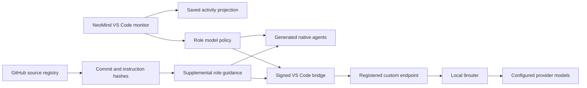

# NeoMind feature delivery

Scope: `copilot/neomind`, 23 October 2026. This branch extends the existing engineering core and VS Code bridge.

| Request | Delivered behavior | Practical limit |
| --- | --- | --- |
| NeoMind identity | Package, CLI, MCP name, extension settings/commands, protocols, generated agents, skill names, documentation and new `.neomind` storage | Historical receipts, older validation reports, license notices and real upstream URLs retain their original provenance. Legacy storage aliases remain readable. |
| Animated agent universe | Procedural textured planets, orbiting task moons and record stations, pan/zoom/focus, motion controls, mission-control inspector and guarded 9router model selection in VS Code | Bounded snapshots retain signed versus reported provenance; communication trails replay saved relationships rather than intercepting arbitrary live inter-agent chat. |
| Adopt useful upstream work | Star-filtered GitHub discovery, immutable bare caches, exact commit pins, selected instruction hashes, role guidance injection and persistent revision watcher | Runtime code/tools require an explicit adapter. Changes are candidates until inspected and adopted; a watcher does not silently replace guidance. |
| 9router and model control | Local secret-free gateway configuration, health/catalog/probe with optional bearer authentication, per-role model/provider/effort policy, VS Code picker and conflict-aware native adapter refresh | A running gateway, registered VS Code models and a configured catalog for custom selections are prerequisites. Managed installation and direct HTTP agent execution remain planned. |

## Architecture

The core continues to own assignments, capabilities and evidence. Imported skill text supplies guidance within those roles. Router aliases, selected editor models and responding backends stay separate observations.

## Follow-up implementation plan

1. **Managed 9router sidecar.** Select a reviewed upstream release and artifact digest. Add install/start/stop/restart/status operations with loopback binding, a separate data directory, retained provider configuration, crash recovery and rollback. Ship after Windows lifecycle tests and a real authenticated gateway smoke pass. Upstream currently packages an application/CLI rather than a supported embedded library.
2. **REA external runtime adapter.** Add an external-provider manifest with a pinned executable, arguments, tool allowlist, operation timeouts and an invocation-bound persistent MCP session. Connect only the applicable researcher/analyst role. Verify real tool discovery, session state, teardown and a bounded REA task before claiming its runtime capabilities.
3. **Richer communication telemetry.** Add explicit dispatch/message events at the orchestrator's actual send/receive points. Feed those events into the existing map projection with sequence IDs and provenance. Retain the distinction between current activity and replayed history.
4. **Optional direct gateway executor.** Implement the tool-call loop and streaming transport as a new executor while preserving NeoMind capability gates and cancellation. Bind gateway configuration and model observations to its own evidence type. Validate real requests, cancellation, provider failures, key handling and task isolation before enabling strict acceptance.

Each phase can ship separately; none requires copying an upstream application into NeoMind's engineering core.

## Try the delivered features

Build with `npm ci` and `npm run build`. Initialize a target project using `neomind init`, or migrate its existing storage before running `neomind update`. Install the supplied `artifacts/neomind-agent-monitor-0.1.0.vsix` through VS Code's **Install from VSIX** command, or use the complete extension source directory for development. Set User setting `neomind.bridge.runtimePath` to the trusted runtime directory and open **NeoMind: Open Agent Map**. Viewing the map does not require enabling the optional inference bridge. [Extension setup](vscode-bridge.md).

Use `neomind upstream discover`, `track`, `clone`, `check`, `watch`, and `adopt` for source reuse. Run `neomind update` after initial caching or adoption to refresh generated native agents. The watcher requires its process to remain running and preserves pins until explicit adoption. Remote operations respect the target project's saved network policy. [Upstream usage](upstream-agents.md).

Configure the running local 9router with `neomind router configure --base-url http://127.0.0.1:20128/v1`; register its models in VS Code and the configured catalog before assigning custom IDs. Model changes apply to new invocations; finish or stop active signed work first. [Model controls](model-control.md).

For a browser-only renderer demonstration, run `node scripts/preview-monitor.mjs` and open its printed loopback URL. Its records are explicitly labelled fixture data, and its model buttons do not change real settings.

Research: [map sources](research/agent-map.md), [REA](research/rea-adoption.md), [9router](research/9router-integration.md). The [live REA smoke record](validation/neomind-upstream-smoke.json) distinguishes a real source clone from runtime execution.
