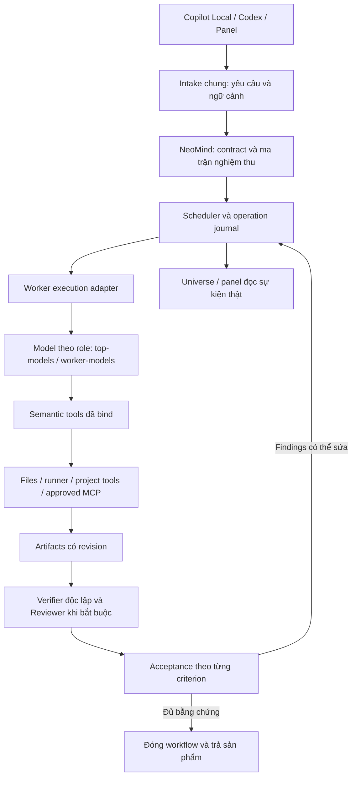

# Kế hoạch sửa nền tảng thực thi NeoMind

> **Tài liệu lịch sử — đã được thay thế.** Quyết định triển khai cho đợt WorkForce theo [kế hoạch tổng hợp WorkForce](2026-10-28-workforce-final-plan.md). Nội dung bên dưới giữ làm dấu vết khảo sát, không dùng các lựa chọn engine/roles/budget cũ để ghi đè kế hoạch hiện hành.

Ngày: 28/10/2026. Trạng thái: **kế hoạch sau khảo sát; chưa triển khai và chưa nghiệm thu**.

## 1. Mục tiêu và phạm vi

Người dùng giao yêu cầu bằng ngôn ngữ thông thường trong Copilot Local, Codex hoặc panel. NeoMind tạo sản phẩm, kiểm chứng độc lập, tự xử lý lỗi có thể phục hồi và đóng đúng workflow. Người dùng không cần biết assignment token, task ID, report ID hay cú pháp nội bộ.

Giữ V-model và các trách nhiệm ASPICE mà NeoMind đã chọn: yêu cầu có thể kiểm chứng, thiết kế phù hợp phạm vi, truy xuất nguồn gốc, kiểm chứng/đánh giá độc lập, quản lý cấu hình và xử lý thay đổi/lỗi. Mục tiêu là bằng chứng kỹ thuật có ý nghĩa; số agent, số tool call hay số record không phải thước đo hoàn thành.

Đợt sửa tập trung vào contract, execution, assurance, recovery, instructions và nghiệm thu. Không thêm giao diện Universe, plug-in, dashboard hay tính năng sản phẩm mới. Không lấy việc đổi tên `blocked` làm bằng chứng đã sửa hệ thống.

## 2. Baseline đã đọc và các giới hạn khảo sát

- Source: `D:\workspace\NeoMind`, nhánh `codex/controlled-workflows`, commit `76344c673d536212c8c9b5de1605f839392b3c5c`; working tree sạch trước khi thêm kế hoạch này.
- Source và runtime cài toàn cục cùng khai báo `0.1.0-alpha.15`; extension source khai báo `0.11.6`. Trùng version không chứng minh cùng bytes hoặc host đang nạp đúng build.
- NeoLearning hiện cấu hình `neomind-controlled`, profile `basic`, `max_workers: 3`, `repair_attempts: 1`, network `local-only`; hai alias là `customendpoint/top-models` và `customendpoint/worker-models`.
- Đã đọc các guide về process/workflow, architecture, controlled workflows, tool schema, controller, execution, acceptance, Bridge và runner; đối chiếu các test hiện có. Không sửa cấu hình NeoLearning, không gọi model, không điều khiển VS Code và không chạy lại acceptance trong khảo sát này.
- Các nhận định mã nguồn bên dưới là kết quả đọc tại baseline này. Kịch bản kiểm thử và chỉ tiêu bên dưới là đề xuất, chưa phải kết quả đạt.

## 3. Những gì thực sự đang sai

| Quan sát trong source | Hệ quả | Việc phải làm |
| --- | --- | --- |
| Controlled worker đã nhận semantic tools được bind danh tính trong `src/controlled-context.ts`, `src/vscode-session.ts`; public manager credentials đã được sửa trong `src/mcp.ts:766-779`. | Một phần nền tảng đúng đã có. Không cần viết lại giao thức assignment hay coi mọi lỗi cũ vẫn chưa được sửa. | Giữ và kiểm thử cơ chế binding này; thu hẹp tool surface của cửa giao việc. |
| Public MCP vẫn đăng ký assignment/bootstrap/progress/record tools bên cạnh manager tools; controlled workers thì có surface riêng. | Model ở chat có thể đi nhầm sang đường orchestration cũ dù worker đã được bind đúng. | Controlled intake chỉ dùng ba manager tools; legacy có view tương thích rõ phiên bản. |
| `src/controlled-tools.ts:51-83` và `src/controlled-workflow.ts:295-330` bắt plan có checker script độc lập và negative controls cho mỗi check. | Request ghi chú hoặc dùng test suite sẵn có vẫn phải dựng wrapper/checker mới; planner phải nghĩ về quá nhiều chi tiết execution. | Backend biên dịch plan chuyên môn thành check/operation phù hợp loại đầu ra. |
| `src/controlled-execution.ts:131-188` chủ yếu hỗ trợ Node/Python producer tạo file mới và quan sát phiên bản compiler. | Build/test/sửa sản phẩm có sẵn thường phải đi vòng qua script mới; producer tạo mới bị dùng như primitive chung. | Phân biệt đọc/build/test, tạo mới, sửa CAS và tác động bên ngoài. |
| Guide chung yêu cầu Reviewer, báo cáo bảy phần, curator/contribution; controlled guide mô tả luồng ngắn theo rủi ro. | Instructions có thể thêm nghĩa vụ ngoài contract thực tế. | Một định nghĩa process, các projection theo mode/profile/role; kiểm tra instructions với tool list thật. |
| `src/engineering.ts:981-982` chuyển controlled task sang validator riêng; `src/controlled-acceptance.ts:349` cho `ready/design-ready` thành công sau kiểm tra contract. | Profile được chọn chưa chứng minh coverage thiết kế/V-model tương ứng. Nhiều thủ tục nhưng thiếu kiểm chứng đúng nghĩa. | Lưu applicability và ma trận criterion–design–check–evidence; gate đánh giá đúng nghĩa vụ áp dụng. |
| `src/controlled-workflow.ts:1609-1632` có thể requeue cùng phase cho lỗi protocol/environment; diagnosis allowance dùng `repair_attempts`. | Thử lại khi điều kiện chưa thay đổi, hoặc hết lượt chẩn đoán trước khi hoàn tất sửa sản phẩm. | Chỉ retry sau remediation có postcondition; tách lỗi hạ tầng khỏi sửa sản phẩm. |
| `src/controlled-workflow.ts:1708-1744` chuyển phần lớn lỗi acceptance thành protocol blocker chung. | Lỗi nội dung, evidence hay scope chưa luôn được giao về đúng bên sửa. | Acceptance trả findings có criterion, nguyên nhân, owner và hành động sửa cụ thể. |
| `src/controlled-cornell-format-context.ts` xác định compiler chính và curriculum note là hai nghĩa vụ khác nhau, nhưng chưa cưỡng chế chung một nguồn ngữ nghĩa. | Một bản note đúng cấu trúc không bảo đảm bản note còn lại đúng nội dung/sơ đồ. | Một nguồn nội dung; các renderer theo đích; kiểm chứng nội dung độc lập. |

Đường thực thi hiện tại: MCP/panel → controlled host/controller → native receipt → VS Code session → bound MCP tools → VS Code model/tool loop → reports/checks → acceptance → journal. Đường này đã là một harness đáng kể; thêm framework mà giữ nguyên hai cơ chế quản lý cùng một trạng thái sẽ tăng rủi ro.

## 4. Kiến trúc đích: một chủ sở hữu cho từng trách nhiệm

- **NeoMind** sở hữu yêu cầu, applicability, task/attempt/operation ID, scope, checkpoint, traceability, repair routing và acceptance.
- **Execution adapter** sở hữu conversation/model turn/tool loop; không tự mở thêm hệ điều phối subagents hoặc quyết định engineering acceptance.
- **Tool gateway** bind quyền/danh tính và giữ CAS file writes; model cung cấp nội dung chuyên môn.
- **Verifier** quan sát sản phẩm thực, tạo evidence và findings; không sửa implementation hay tự hạ tiêu chí.
- **UI/chat** gửi việc và theo dõi cùng execution record; đóng chat không chuyển quyền điều phối về model trong chat.

Interface thực thi worker cần nhỏ: `execute(boundAssignment, toolGateway, signal)`, luồng events, `inspect(executionId)`, `cancel(executionId)`. Không cho model tự cấp ID/credentials. Hợp đồng kết quả phải thể hiện completed/interrupted/failed/uncertain và provenance thật của engine.

## 5. Tận dụng backend có sẵn: quyết định cụ thể

| Phần | Quyết định cho đợt sửa | Lợi ích và giới hạn |
| --- | --- | --- |
| Markdown/YAML records, SQLite/FTS5, hash/evidence, history | Giữ. | Có sẵn dữ liệu và truy xuất; không chuyển database để chữa lỗi orchestration. FTS chỉ tìm ứng viên, không chứng minh procedure phù hợp. |
| MCP SDK và bound semantic gateway | Giữ, thu gọn public intake. | Tái sử dụng giao thức hiện có; bỏ nhu cầu model tự thao tác lifecycle. |
| `src/command-runner.ts` | Giữ runner async hiện có. | Đã có argv, timeout, output limit, cancellation và process-tree handling; không viết thêm executor tương đương. Đây không phải OS sandbox cho mọi script. |
| Công cụ của project | Dùng scripts/test runners/compilers/validators hiện có khi phù hợp. | Backend lưu command, effect, baseline và version; tránh sinh wrapper chỉ để hợp schema NeoMind. Script có sẵn vẫn cần kiểm tra phạm vi/tác động. |
| VS Code LM Bridge | Baseline cho sửa contract và nghiệm thu Local hiện tại. | Giữ đường customendpoint đã cấu hình; sửa interface chung trước khi thay engine. |
| OpenCode SDK/server | Một thử nghiệm tương thích giới hạn trong workspace dùng một lần, sau khi có cùng execution interface. | Có thể thay session/tool loop tự viết. Chỉ được chọn khi chứng minh tool binding, alias, lifecycle, permission và hiệu quả. Không đưa vào đường găng để trì hoãn sửa contract. |
| REA/CodeGraph/Context7/Playwright | Khả năng chuyên môn tùy nhu cầu, qua connection/permission hiện có. | Không dùng chúng để sửa ownership, state hay Cornell contract của NeoMind. Không thêm plug-in trong đợt này. |

Tài liệu chính thức OpenCode có session/prompt/abort, typed SDK, events, MCP và custom provider/base URL. Đây mới là cơ sở để thử nghiệm, không phải chứng nhận tương thích NeoMind/9router. Không chồng thêm LangGraph/DeepAgents hoặc một orchestrator thứ hai trong đợt sửa này.

**Proof chọn OpenCode:** hai alias streaming và tool calling thật qua 9router; hai worker có gateway riêng; chặn built-in write/bash/task ngoài scope; duplicate/lost response; cancel model/checker; restart đối soát; requested/observed model trung thực; Windows native và Ubuntu core. Phải xử lý rõ acceptance hiện ghim issuer `neomind-vscode-lm` (`src/controlled-acceptance.ts:367`): adapter mới có provenance riêng, không giả receipt của VS Code. Quyền/credentials của Copilot không tự chuyển thành credentials cho engine ngoài.

Nếu proof không đạt, dừng nhánh thử nghiệm và hoàn tất sửa trên Bridge. Nếu đạt và đo tốt hơn, thay implementation vòng lặp tương ứng và loại phần trùng; không bọc vòng lặp cũ quanh vòng lặp mới.

## 6. Một contract sinh instructions, tools và tiêu chí kiểm tra

Tái sử dụng schema Zod/metadata hiện có, thêm **ma trận nghiệm thu do backend quản lý**:

`criterion → yêu cầu/thiết kế áp dụng → output → phương pháp kiểm chứng → revision → evidence → review disposition`.

Coordinator cung cấp mục tiêu, tiêu chí chuyên môn, quyết định, đầu ra và rủi ro. Backend tự tạo IDs/liên kết, xác định operation/check adapters, kiểm tra đường dẫn/toolchain và lưu baseline. Schema execution chi tiết vẫn là nội bộ, không dồn hết vào payload planning của model.

Giữ nguyên wording của request. Tham chiếu file/folder đính kèm được resolve từ ngữ cảnh client cung cấp hoặc khảo sát project trong scope; chuỗi `#attachment:...` không tự trở thành đường dẫn hợp lệ. Chỉ hỏi lại khi không xác định được duy nhất đối tượng hoặc có xung đột thật.

- Có một definition cho process/mode/profile; từ đó tạo planning schema, tool examples, role packets, installed guides và validator coverage.
- Public controlled intake chỉ có `manager_run`, `manager_status`, `manager_control` của NeoMind. Các MCP độc lập khác không bị xóa. Legacy workflows dùng view riêng, không tự đổi mode hay giảm assurance.
- Worker chỉ thấy tool thực sự có và nghĩa vụ của assignment hiện tại. Không đọc guide setup/private của cửa giao việc như điều kiện để làm sản phẩm.
- Dữ liệu chuyên môn nhập nhằng phải được làm rõ; backend không đoán semantic intent để ép payload vượt validator.
- Contract được compile/preflight trước side effects, có quyết định applicability. Hợp đồng đã freeze được thay bằng change/impact record khi cần, không sửa âm thầm.
- Tên gate `ready/design-ready` chỉ được dùng khi nghĩa vụ tương ứng đã đạt; không dùng contract-integrity check làm bằng chứng thiết kế đã review.
- Sinh lịch sử bảy phần từ kết quả chuyên môn và observations đã lưu khi đủ dữ liệu; agent chỉ bổ sung phần phân tích thực sự thiếu. Không bịa lessons/evidence để đủ form.

## 7. V-model và ASPICE: giữ nghĩa vụ, tổ chức thực hiện theo rủi ro

Giữ ba profile hiện có `basic/software/embedded`; task family mô tả loại sản phẩm, không tạo hệ profile assurance thứ tư.

| Nhánh đặc tả/thiết kế | Kiểm chứng đối ứng | Bằng chứng NeoMind cần |
| --- | --- | --- |
| Nhu cầu và intended use | Validation/acceptance | Request gốc, ví dụ sử dụng thật, kết quả có đáp ứng mục đích không. |
| Yêu cầu hệ thống/phần mềm | System/software verification | Criterion có phép kiểm tra hoặc inspection cụ thể trên đúng output revision. |
| Kiến trúc/interface | Integration verification | Interface/decision áp dụng, kiểm tra kết nối và failure paths. |
| Thiết kế chi tiết/implementation | Unit/component verification | Unit tests, oracle hoặc phân tích phù hợp; expected results độc lập. |

Các trách nhiệm xuyên suốt: quality assurance, configuration management, problem/change management, risk và measurement. Backend materialize record/link từ ma trận; agents không gọi CRUD chỉ để điền trace graph.

Trước implementation, freeze criterion → verification strategy, coverage classes, expected outcomes và oracle assumptions. Verifier có thể triển khai chi tiết checker sau đó trong scope riêng đã cam kết; thay đổi kỳ vọng/đặc tả phải có impact/change record và evidence mới. Không bắt Planner viết toàn bộ checker trước khi có sản phẩm.

Với việc nhỏ, rationale/interface và review có thể nằm trong một artifact ngắn có cấu trúc. Verifier có thể đảm nhận cả kiểm chứng và disposition review trong một phiên độc lập với Implementer **nếu process profile mới quy định rõ**. Reviewer riêng vẫn bắt buộc khi rủi ro cao hoặc contract cũ yêu cầu. Các mục không áp dụng có lý do được lưu, không bị xóa vì muốn chạy nhanh.

Không đồng nhất ASPICE với chuỗi nhiều agents hoặc nhiều báo cáo. Mapping hiện có tham chiếu Automotive SPICE 4.1; nguồn VDA chính thức xác nhận publication 4.1. Khảo sát này không đánh giá đầy đủ mọi process outcome và không chứng nhận capability level. Phần PDF 4.1 không đọc được bằng web tool trong lượt này; mapping trong kế hoạch dựa vào process guide của repo và phải đối chiếu bản chuẩn chính thức khi triển khai nghĩa vụ chi tiết.

## 8. Luồng công việc và sửa lỗi

Luồng thường: **hiểu yêu cầu/tìm công cụ → plan ngắn đã compile → Implementer → Verifier độc lập → tổng hợp/đóng**. Explorer/Planner/Architect/Researcher/Curator/Release chỉ tham gia khi có câu hỏi hoặc đầu ra cụ thể. Specialist độc lập có thể chạy song song trong giới hạn `max_workers`; thao tác cùng mutable state được serialize.

### Execution và verification

- Operation có loại rõ: read-only observation; build/test trong scope; tạo artifact mới; CAS edit; external effect đã được cấp quyền. Không bắt mọi operation là generator tạo file mới.
- Dùng runner sẵn có cho `npm test`, pytest, C/C++ build, HDL simulation hoặc validator được duyệt; adapter khai báo argv/effects/inputs/outputs, không mở arbitrary shell tự do.
- Independent Verifier kiểm tra implementation và nội dung, không chỉ exit code. Custom checker/oracle mới hoặc đã sửa cần negative controls chứng minh phát hiện sai; không bắt tạo fixture mới cho mọi lần dùng compiler/test runner đã được qualification.
- Verifier trả toàn bộ findings có thể quan sát trong lượt đó, gắn criterion/location/expected/actual. Repair xử lý một nhóm findings liên quan, tránh mỗi lượt mới phát hiện một lỗi hình thức vốn đã có từ đầu.

### Cornell

Giữ template nghiên cứu, thực hành và đáp án riêng, default `00_note/NeoMind`. Khi project yêu cầu curriculum note, cả hai destination được render từ cùng nguồn nội dung có version: problem facts, strategies, invariant, complexity, worked example, diagram data, questions/answers và nguồn.

Renderer quyết định heading/style/link; không để hai agents viết lại độc lập hai bản thuật toán. Kiểm chứng số liệu, thuật toán và diagram vẫn độc lập với renderer. Mermaid render thành công chưa chứng minh sơ đồ đúng. Không thêm artifact hay gate ngoài request và quy ước project đã áp dụng.

### Failure routing và recovery

| Loại lỗi | Ai xử lý | Điều kiện được thử lại |
| --- | --- | --- |
| Implementation/nội dung sai | Implementer/Debugger | Findings có criterion, sửa output/producer đúng scope; có independent verification mới. |
| Checker/oracle sai | Verifier | Sửa checker trong scope riêng; negative controls vẫn bắt sản phẩm sai. Không sửa implementation thay Developer. |
| Payload/identity/state/protocol | Backend | Reconcile binding/operation/checkpoint và chứng minh postcondition đã đổi; không nhờ model đoán ID/token. |
| Provider/quota/network/toolchain | Runtime/environment policy | Kiểm tra prerequisite cụ thể; retry bounded khi có lý do phục hồi, không lặp inference với cùng lỗi. |
| Chưa rõ nguyên nhân | Agent chẩn đoán mạnh | Nhận current evidence và typed findings; không tốn một phiên chẩn đoán để đọc lỗi backend đã phân loại được. |
| User sửa file hoặc side effect chưa rõ | Runtime + owner khi cần | Bảo toàn thay đổi, đối soát effect; không tự overwrite hoặc tự nhận completed. |

Giữ `max_workers` và giới hạn sửa đã cấu hình. Lỗi backend không được tiêu hao lượt sửa sản phẩm. Không tự tăng `repair_attempts`, reset lịch sử hay tăng quota để làm một case trông thành công. Mọi thay đổi chính sách ngân sách cho workflow mới phải được version hóa và công bố; nghĩa vụ đã cam kết của workflow cũ giữ nguyên.

Ceiling đề xuất cho recovery hạ tầng: tối đa một remediation cho cùng failure fingerprint/baseline, tổng thời gian đối soát tự động tối đa 60 giây, zero inference để đoán lỗi protocol đã xác định. Chỉ retry khi postcondition thay đổi; cùng error/input/state không có lượt retry mới. Chẩn đoán nguyên nhân sản phẩm chưa rõ dùng tối đa một phiên mạnh cho checkpoint lỗi mới, trong giới hạn hiện có của workflow/invocation; không tự đệ quy hay mở ngân sách chẩn đoán vô hạn. Khi không sửa được hạ tầng trong giới hạn, giữ checkpoint và báo lỗi runtime cụ thể để sửa code, không chuyển thành bài tập cho worker.

Operation ID do backend cấp theo logical operation và input revision. Callback trùng trong cùng operation trả receipt cũ; một revision sửa hợp lệ tạo operation/attempt phù hợp mới. Dùng immutable write proofs/regeneration đã có; không bỏ CAS guard. Lỗi acceptance được phân loại về đúng owner thay vì gom tất cả thành protocol blocker.

Khi cạn giới hạn thật hoặc thiếu quyền/dữ liệu không thể suy ra, trả lý do và phần sản phẩm đã có; không giả đóng thành công. Đây là ngoại lệ có nguyên nhân cụ thể, không phải chấp nhận backend blocker như luồng thông thường.

## 9. Những request phải được hỗ trợ

| Use case / prompt người dùng có thể đưa | Sản phẩm và bằng chứng kỳ vọng |
| --- | --- |
| “I want to have a new LeetCode problem within #attachment:02_contiguous_vs_linked_structures, please create and make a cornell note for me.” | Chọn bài chưa có theo project conventions; code C11/C++17, note/practice/answers nhất quán; compile, oracle/boundaries, factual/diagram checks, bảo toàn bài cũ; accepted. Dùng chính prompt ngắn, không thêm protocol instructions. |
| “Tạo bài linked list tiếp theo, giải thích cho người mới, dùng prompt của tôi.” | Nhận intent tương đương, không phụ thuộc magic prompt. Làm rõ chỉ khi có xung đột thực sự về đầu ra/phạm vi. |
| “Làm bài X theo hai cách, đừng sửa bài hiện có.” | Hai implementation/strategy được kiểm chứng; bảo toàn baseline; scope không tràn sang bài khác. |
| “Code này sai với input này, sửa giúp tôi.” | Repro trước sửa; scoped diff; regression đỏ→xanh và kiểm tra project hiện có. Không bắt viết producer mới. |
| “Giải thích RMS và tạo ghi chú từ tài liệu này.” | Note đọc được, nguồn/giả định/số liệu kiểm tra được; không bịa compilation hay bắt tạo C++ checker cho tài liệu. |
| “Thêm tính năng lọc/tìm kiếm vào app này.” | Requirement/design tương xứng; implementation, unit/integration/UI checks thực; review phù hợp rủi ro. |
| “Refactor đoạn này, giữ nguyên hành vi.” | Diff nhỏ, regression/contract checks chứng minh preservation; không tự mở rộng tính năng. |
| “Dùng script lần trước để sinh bộ dữ liệu mới.” | FTS tìm ứng viên; kiểm tra manifest/hash/params/environment/effects; chạy công cụ phù hợp và evidence mới. Tắt automatic reuse vẫn cho phép implementation mới hoặc tool trực tiếp đã được kiểm tra riêng. Procedure bị thu hồi/từ chối vì hash, quyền hoặc kiểm chứng không được chạy lại qua runner để lách registry. |
| “Nghiên cứu repo này rồi đề xuất cách dùng.” | Báo cáo có nguồn/pin/license/applicability; không tự clone/cài/chạy khi policy chưa cho phép. Thiếu network được phát hiện sớm. |
| “Mô phỏng mạch/HDL và giải thích kết quả.” | Allocation/interface và cấu hình cần thiết; compile/simulation/waveform thực. Kết quả mô phỏng không được mô tả là đã đo phần cứng. |
| “Sửa xác thực hoặc thay đổi lưu trữ.” | Risk tối thiểu cao, design/impact, failure/negative tests, independent Verifier và Reviewer riêng. |
| “Tiếp tục workflow cũ” / “Dừng rồi tiếp tục ở panel” | Đúng execution/history/contract, không tạo workflow trùng hay lẫn nhiệm vụ của chat khác. |

Request cần publication/deployment vẫn theo quyền đã cấp và policy. Việc tạo sản phẩm, việc kiểm chứng và việc publish được ghi rõ; publish bị từ chối không được biến thành lời khẳng định đã phát hành.

## 10. Kiểm thử phục hồi và bất biến

Thực hiện phần lớn bằng deterministic fixture để tránh tiêu quota model cho lỗi hạ tầng:

1. Cùng request qua Copilot/Codex/panel giữ nguyên intent, attachments và scope; không rơi sang legacy assignment tools.
2. Hai workflows và ba workers chạy đồng thời; task/actor/report không lẫn; callback của workflow khác bị từ chối trước side effect.
3. Duplicate callback, response bị mất, late result và restart chỉ tạo một side effect cho một logical operation.
4. Producer được sửa hợp lệ chạy lần mới; user edit bên ngoài được giữ nguyên và không bị coi là authorized repair.
5. Đóng VS Code giữa inference hoặc checker: model/dispatch/process tree dừng theo lifecycle, checkpoint có thể đối soát; không nhận callback muộn là hoàn thành.
6. Code pass nhưng note/sơ đồ sai: mở đúng content repair, fresh checks; không accepted nhờ compile thành công.
7. Checker luôn exit zero hoặc bỏ qua sai output: qualification thất bại vì negative controls.
8. Final acceptance finding về nội dung/evidence/scope được route đúng; không tất cả thành protocol blocker.
9. Thiếu package/network/quota/model access được phát hiện chính xác; không yêu cầu worker đọc private setup guide hoặc nghĩ ra auth.
10. Trước/sau verification có file thay đổi: invalidate đúng evidence bị ảnh hưởng; không dùng evidence cũ cho revision mới.
11. Legacy strict contract tiếp tục giữ registration/pilot/review đã cam kết; không đổi silently sang profile nhẹ hơn.
12. Source/tar/installed/loaded-host lệch build: phát hiện trước nhận việc; không coi version string là đủ.

## 11. Các mốc triển khai và điều kiện kết thúc

| Mốc | Thay đổi chính | Bằng chứng cần có trước khi chuyển mốc |
| --- | --- | --- |
| A — Khóa baseline và replay | Lưu bản lỗi thật đã che secrets; xác định build đang phục vụ, project policy, actual tools và acceptance criteria. Tạo repro qua đúng public seam. | Một lệnh/fixture có thể bắt mỗi lớp lỗi trọng tâm; baseline về model sessions/calls, latency, findings và human intervention. Không chỉ test mock mapper. |
| B — Thống nhất contract/process | Semantic plan → backend compiler → applicability/criterion matrix → tool/guide projections; controlled intake ba tool. | Contract examples parse bằng schema thật; docs-only, existing test suite, low/high risk không cần workaround; legacy tests giữ nguyên nghĩa vụ. |
| C — Sản phẩm và verification | Operation/check adapters dùng runner/project tools có sẵn; shared Cornell source/renderers; criterion-level independent observations. | Build/test chạy đúng argv; các bản note nhất quán và được kiểm chứng nội dung; regression bắt false-positive checker. |
| D — Recovery và execution seam | Typed remediation, operation revision/replay, acceptance routing; tách interface engine. Chỉ đánh giá một candidate OpenCode giới hạn. | Fault matrix đạt; không retry nếu state không đổi; không thu product budget cho backend lỗi; không có hai chủ quản lý cùng trạng thái. |
| E — Nghiệm thu client thật và đóng gói | Cài candidate xác định fingerprint; chạy request bằng chính Copilot Local/top-models/worker-models; kiểm tra panel/Codex; Windows/Ubuntu CI. | Artifacts, independent checks, review bắt buộc, runtime acceptance và final report đều khớp. Source/tar/installed/loaded host được đối chiếu. |

Không mở rộng tính năng ở giữa mốc để chữa sự không nhất quán. Khi một mốc không đạt, sửa nguyên nhân trong mốc đó trước khi chạy lại model toàn tuyến.

### Acceptance thực tế tối thiểu

- Trong **Copilot Local**, chạy sáu nhóm lõi: prompt LeetCode ngắn nguyên bản; bug fix dùng test suite có sẵn; note-only; feature/interface thay đổi có review bắt buộc; reuse bị tắt tự động nhưng implementation/tool khác đã kiểm tra riêng vẫn hợp lệ; workflow cũ có nghĩa vụ giữ nguyên. Không chạy trực tiếp procedure bị từ chối an toàn.
- Để công bố research/embedded đã được hỗ trợ sau sửa, bổ sung source-research request và ít nhất một compile/simulation HDL có allocation/interface, configuration và expected waveform phù hợp. Nếu chưa chạy thật các family này, release ghi rõ mới có contract/fixture coverage; không quảng cáo đã nghiệm thu chúng.
- Ít nhất một request sau đó do người dùng tự diễn đạt, không được sửa thành prompt giao thức của người phát triển; có thể dùng nguyên request thật đã thất bại làm holdout.
- Panel và Codex mỗi cửa phải nộp được một request, nhận receipt, theo dõi cùng runtime và hoàn tất; thử chuyển cửa quan sát/resume mà không tạo execution trùng.
- Sau cài/reload, chạy lại một luồng thường để bắt lỗi deployment/configuration. Xác nhận model aliases thực nhận, engine-observed model và upstream chưa attested được phân biệt.
- Chạy regression trên Windows và Ubuntu. Chỉ xác nhận Linux desktop sau acceptance VS Code thực trên Linux; CI không thay thế bước này.
- Không tiếp tục hàng loạt live tests nếu lỗi xuất phát từ backend/contract đã tái hiện deterministic; sửa và chứng minh bằng fixture trước, rồi mới dùng quota cho acceptance tiếp theo.

## 12. Thước đo nhanh, chính xác, hiệu quả

- Với suite yêu cầu được hỗ trợ: tất cả criterion bắt buộc có evidence đúng revision; workflow accepted/completed, không còn backend-owned auth/protocol blocker, không sửa thủ công database.
- Zero model call để đoán ID/token, gửi progress định kỳ hoặc hỏi bước lifecycle tiếp theo. Model tool-loop calls cần để làm việc vẫn được đo riêng.
- Mục tiêu intake receipt p95 ≤ 3 giây trên máy thử đã warm, chưa tính model inference; đo rồi mới công bố. Không hứa một thời gian chung cho mọi loại sản phẩm.
- Với tác vụ nhỏ, mục tiêu ba phiên có ích: Coordinator, Implementer, independent Verifier. Specialist/Reviewer thêm phải có lý do gắn rủi ro hoặc criterion; số phiên không đồng nghĩa số model request.
- Đo elapsed time, model requests, tool calls, retry theo nguyên nhân, context/output size, human corrections và cost nếu provider cho biết. Token/cost không quan sát được phải ghi unavailable.
- So sánh các backend trên **sản phẩm đã accepted**, cùng request/alias/checks; không tính fail nhanh là hiệu năng tốt. Thời gian model so với orchestration overhead phải tách riêng.
- Không dùng số tests passed để thay thế acceptance client thật; cũng không chạy live model cho fault có thể kiểm chứng deterministic.

## 13. Migration và phát hành

Giữ lịch sử, frozen contracts, receipts và user edits. Có versioned reader/adapter cho execution cũ; thay đổi schema có migration/rollback test. Không tự reset NeoLearning hay ép người dùng giao việc lại bằng prompt đặc biệt.

Một lỗi trong runtime, một lỗi trong renderer và một lỗi nội dung phải có regression độc lập. Chỉ công bố hoàn tất khi E đạt; không phát hành candidate chỉ vì CI xanh. Release runtime + VSIX trên GitHub phải ghi commit, fingerprints, transport/engine, aliases, clients/platforms thật đã test, giới hạn và upgrade steps. Không overwrite release/tag cũ.

Danh sách use case ở mục 9 là phạm vi mục tiêu, không phải danh sách đã được hỗ trợ thành công hôm nay. Release có ma trận riêng cho từng family: deterministic-only / actual-client-passed / unverified, kèm links tới artifacts và evidence. Không suy rộng một bài LeetCode pass thành mọi requirement pass.

## Nguồn đã đối chiếu

- Local: `CONTEXT.md`, `resources/guides/process.md`, `resources/guides/workflow.md`, `docs/architecture.md`, `docs/controlled-workflows.md`, `docs/documentation-contract.md`; các source/test được nêu phía trên.
- [VDA QMC — Automotive SPICE publications](https://vda-qmc.de/en/automotive-spice/automotive-spice-veroeffentlichungen/) — publication 4.1 và nguồn chuẩn chính thức; không phải bằng chứng NeoMind đã đạt assessment.
- [OpenCode SDK](https://opencode.ai/docs/sdk/), [server](https://opencode.ai/docs/server/), [providers](https://opencode.ai/docs/providers/), [MCP](https://opencode.ai/docs/mcp-servers/) — năng lực trên tài liệu; compatibility proof với NeoMind vẫn phải thực hiện.

Kế hoạch này không chứng minh hệ thống đã chạy được. Sản phẩm và evidence thu qua acceptance ở mục 11 mới là căn cứ kết luận.
