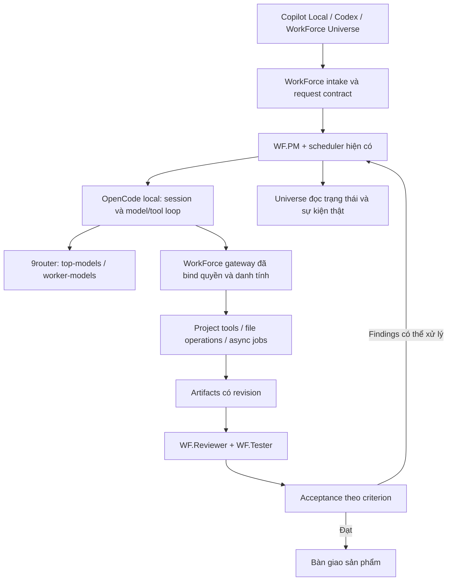

# WorkForce — kế hoạch tổng hợp cho đợt refactor và phát hành

Ngày 28/10/2026. **Đây là nguồn quyết định triển khai duy nhất cho đợt WorkForce này**, hợp nhất khảo sát hạ tầng, yêu cầu frontend/agents/backend, chính sách đầu ra/nâng model và nghiên cứu thực hành bên ngoài. Thay thế các kế hoạch NeoMind/WorkForce trước trong cuộc trao đổi. **Chưa triển khai, chưa nghiệm thu, chưa phát hành.**

## 0. Phạm vi hợp nhất và cách đọc

| Nhóm yêu cầu đã chốt | Phần triển khai trong kế hoạch |
| --- | --- |
| Rebrand NeoMind thành WorkForce, branch và GitHub release | Mục 1, 7, 9 |
| Universe V-model, bỏ Workflow/communications/journal khỏi UX | Mục 3 |
| WF.PM + năm chuyên gia, linh hoạt cho mọi dự án | Mục 4 |
| Local + Allow all, custom endpoint/9router | Mục 2, 3, 7 |
| Backend tạo requests hợp lệ và giữ trạng thái | Mục 2, 4, 5, 7 |
| Mỗi request có sản phẩm; tự nâng worker lên strong | Mục 1, 3, 4 |
| Tự sửa/chuyển chiến lược, tránh tiêu quota vô ích | Mục 5 |
| Công việc cũ/tools/manifests/SQLite-FTS5/maturity | Mục 6 |
| Cornell nhất quán, output destination, tests thực | Mục 6, 8 |
| Records chia theo request và migration giữ lịch sử | Mục 6 |
| Chạy được từ phía người dùng, Windows/Linux và installed release | Mục 8, 9 |

Tài liệu nghiên cứu nguồn gốc: [Các thực hành workflow tự động](../research/2026-10-28-autonomous-workflow-practices.md). Tài liệu đó cung cấp dẫn chứng và suy luận, không phải một kế hoạch triển khai cạnh tranh với bản này.

Tái sử dụng trước: MCP SDK/gateway, records và SQLite/FTS5, scoped CAS writes, async runner, procedure manifests/runs/reviews và các script project phù hợp. Thay model/tool loop bằng OpenCode và thu gọn orchestration hiện có. Không thêm LangGraph/MetaGPT/Temporal hay orchestrator thứ hai chỉ vì các nguồn nghiên cứu nhắc tới chúng.

Đợt này bảo toàn các chức năng đã có như plug-in/MCP controls, Focus Space, âm nhạc và calendar, đồng thời cập nhật namespace cần thiết. Không thêm công cụ ô tô thực tế, tính năng clone/sync GitHub mới, cloud worker service, Marketplace hoặc npm-registry publication. Giữ GitHub repo hiện tại theo lựa chọn của người dùng.

## 1. Mục tiêu và điều kiện trách nhiệm

Người dùng cài WorkForce, mở project, vào Copilot Local/WF.PM hoặc Universe, viết yêu cầu thông thường và nhận sản phẩm mở được, dùng được, có kiểm chứng. Không yêu cầu prompt giao thức, token/ID nội bộ, sửa JSON/database hoặc tự xử lý recovery.

**Mỗi request phải có đầu ra hữu ích đúng mục tiêu, không chỉ trạng thái/report nội bộ.** Backend lưu deliverable checkpoints ngay khi có nội dung thực; người dùng có thể mở đầu ra trong lúc hệ thống tiếp tục hoàn thiện. SWSD xác định minimum useful deliverable theo loại yêu cầu: code/patch có ý nghĩa, note có nội dung thực, kết quả nghiên cứu có nguồn hoặc output của tool. Thư mục rỗng, scaffold, ID/receipt hay lời hứa không được tính là sản phẩm. Mục tiêu mặc định vẫn là đủ toàn bộ yêu cầu; checkpoint chưa kiểm chứng không được gọi là completed.

Nếu model worker chưa giải quyết được nội dung chuyên môn, WorkForce **tự chuyển lên `top-models`** theo policy đã được người dùng yêu cầu, không hỏi tăng limit và không lặp nhiều lượt cùng model yếu. Giữ các đầu ra hữu ích đã tạo để model mạnh tiếp tục, không bắt đầu lại toàn bộ.

`needs_input` chỉ được dùng khi thật sự thiếu dữ liệu, quyết định nghiệp vụ hoặc quyền do người dùng nắm giữ. Mỗi câu hỏi cần có: thiếu gì, đã tìm ở đâu, vì sao không thể suy ra hợp lý, ảnh hưởng criterion nào và câu trả lời nào cho phép tiếp tục. WF.PM xác nhận và backend kiểm tra nguyên nhân trước khi đưa câu hỏi ra.

Lỗi backend/tool/schema/session, hết bộ đếm sửa/chẩn đoán, checker lỗi hoặc runtime timeout **không được giả thành thiếu input của người dùng**. Không hỏi người dùng tăng repair limit, đoán credential, sửa gate, thay prompt hoặc nhấn retry để chữa giao thức.

WorkForce chịu trách nhiệm tự phục hồi trong phạm vi đã cấp, đổi chiến lược khi có cơ sở, chờ dependency thực sự phục hồi và tiếp tục đúng checkpoint. Không retry vô hạn để giữ vẻ ngoài đang hoạt động.

Ranh giới trung thực: không thể bảo đảm provider/máy chủ luôn hoạt động hoặc mọi lỗi chưa biết đều tự sửa được. Sự cố không thể tự phục hồi là **sự cố WorkForce chưa hoàn thành**, thuộc bên duy trì hệ thống; không phải input thiếu và không được nhận completed. Đổi nhãn blocked không được tính là sửa. Ca bắt buộc còn lỗi kỹ thuật thì release chưa đạt.

### Quyết định đã chốt

- Nhánh triển khai: `codex/workforce-vmodel`, từ baseline hiện tại `76344c673d536212c8c9b5de1605f839392b3c5c`. Giữ repository `NeoTech-vietnam/NeoMind` và releases cũ.
- Tên chủ động mới: WorkForce; CLI/package/MCP namespace `workforce`; storage `.workforce`; extension `workforce.workforce-model-bridge`.
- WF.PM điều phối ngoài năm agents chuyên môn. Dùng cho mọi dự án; tên công cụ ô tô trong hình chỉ là ví dụ.
- Copilot Local + Allow all là mặc định workspace khi nền tảng cho phép. Hai alias vẫn là `top-models` và `worker-models` qua 9router.
- OpenCode là engine worker mục tiêu của release mới, không chỉ tham khảo ý tưởng. Không giữ vòng lặp model/tools tự viết của NeoMind làm fallback âm thầm.
- Giữ lifecycle v1: đóng chat vẫn chạy khi VS Code còn mở; đóng VS Code dừng dispatch/model/owned processes, lưu checkpoint và đối soát khi mở lại.

## 2. Kiến trúc và backend bên ngoài



### Pin và proof bắt buộc đầu tiên

Registry npm đã trả cùng version `1.19.4` cho `@opencode-ai/sdk` và `opencode-ai`. Đây là **pin ứng viên để kiểm chứng**, không phải kết quả tương thích.

- SDK integrity: `sha512-3Wuc4t8gEuWKHbX1Na9oDK6PgOveid70l4Ks5RCjRIo2RcP8FQN3NS6Mg3XWc2+WiUfpfrmvBWlh5u1zeQfDQw==`.
- CLI integrity: `sha512-O3rTc9OCd6CeeJohCAjFYD3MX5U0weKzKnySfsJ9sw9uAbNZZK4meIcjd+7k3inmZB5G2qONSen3yA45yECiFA==`.
- Các optional platform packages, gồm `opencode-windows-x64` và `opencode-linux-x64`, cùng pin `1.19.4`; thu integrity từng binary vào lock/build manifest khi chuẩn bị proof.

Proof chạy Windows native với hai alias, streaming/tool calls thật, hai workers tách gateway, scope enforcement, cancellation và restart. Pin SDK/CLI/binary được khóa cùng protocol và integrity sau proof. Nếu proof không đạt, dừng phát hành và giải quyết compatibility; không thay bằng custom loop cũ rồi gọi là đã dùng OpenCode.

### Phân quyền sở hữu

- OpenCode sở hữu conversation, message/tool-call IDs, request model và model/tool loop.
- WorkForce sở hữu request/work package/attempt/operation IDs, scope, engineering checkpoints, V-model, findings, repair strategy và acceptance.
- Một work package chỉ có một active owner. Dùng scheduler hiện có sau khi thu gọn; không thêm orchestrator/queue framework/đồng hồ trạng thái thứ hai.
- Chặn OpenCode tự tạo subagents hoặc dùng built-in write/edit/bash/task để vượt gateway. Chỉ cho semantic tools đã bind của assignment; optional MCP providers được truy cập theo policy hiện có.
- OpenCode gọi 9router bằng endpoint và credential hợp lệ cho engine. Không giả định quyền của Copilot tự chuyển thành credential cho OpenCode; secrets không vào repo/log/report.
- Receipts mới có issuer/provenance WorkForce–OpenCode đúng thực tế. Requested alias, engine-observed model/provider và upstream chưa attested được phân biệt.
- Events/SSE phục vụ quan sát. Reconnect đối soát session/messages và operation ledger; không giả định event stream có replay bền vững.

## 3. Frontend và trải nghiệm sử dụng

### Thiết lập một nơi

WorkForce Universe có thẻ thiết lập kiểm tra exact project, runtime/binary đang nạp, fingerprints, connection, profiles, aliases và prerequisite tools. Một hành động kết nối/khởi tạo dùng chung backend, thay cho nhiều commands/JSON instructions rải rác.

Chỉ hiển thị sẵn sàng sau handshake và kiểm tra kết nối/tool capability thật. Kết quả probe gắn build/config hash được cache, không gọi model lại trước mọi request.

Mở chat bằng Local command và chọn WF.PM. Đặt `chat.permissions.default: "autoApprove"` ở workspace, read back effective state và xác nhận trong chat thật. Không bật global auto-approve. Trust/first-use warnings/model access/enterprise policy của VS Code vẫn được tôn trọng.

Quyền khởi chạy engine lưu theo exact trusted project và runtime. Reload cùng build/config tự đối soát; revoke, đổi project hoặc thay trusted runtime phải xử lý theo consent tương ứng. Không mở nhiều engine owners sau reload.

### Universe dạng V-model

Thay hành tinh bằng SVG/CSS nguyên bản theo bố cục đã cung cấp; không dùng ảnh stock có watermark làm asset.

- Trái: Requirement Gathering, System Analysis, Software Design, Module Design.
- Đáy: Coding.
- Phải: Unit Testing, Integration Testing, System Testing, Acceptance Testing.
- Đường ngang thể hiện cặp đặc tả/thiết kế–kiểm chứng.
- WF.PM ở phần điều phối; WF.Reviewer là milestone độc lập trước chuỗi kiểm thử.

Mỗi request có sơ đồ riêng. Hiển thị current stage, agent/action, products, review/test findings, model controls và pause/resume/cancel. Animation chỉ dựa trên actual dispatch/job/result; configured, queued, running, repairing và not-applicable khác nhau. Hỗ trợ keyboard, theme VS Code, responsive layout và reduced motion.

Bỏ trang Workflows, Recorded communications, report-history/raw-record lists và Runtime journal khỏi giao diện thông thường. Giữ operational diagnostics nội bộ để xử lý sự cố. Giữ đường truy cập các chức năng hiện có như Focus Space, âm thanh và plug-in controls.

### Giao việc và bàn giao

Copilot Local/WF.PM và ô yêu cầu Universe dùng cùng intake. Prompt gốc và context attachment được giữ; resolve file/folder thật, không dùng literal `#attachment` như đường dẫn. Client/host cấp intake identity; mất response phải đối soát receipt. Không tự tạo side effect mới khi chưa phân biệt được retry với request mới.

WF.PM ở cửa chat chỉ nộp/theo dõi yêu cầu và chuyển câu trả lời; WF.PM do runtime quản lý mới lập kế hoạch/điều phối. Không để chat và runtime đồng thời triển khai cùng request. Profile/tool discovery của bản cài thật phải khớp contract hiện hành, không hướng model sang claim/recovery/CRUD cũ.

Bàn giao gồm file links mở được, cách chạy ngắn, kết quả kiểm chứng đúng files/revision và limitations thực. Chỉ accepted/completed khi acceptance đạt; không suy ra từ đủ file hoặc agent nói done.

Deliverable checkpoints hiển thị rõ draft/partially-verified/verified từ bằng chứng backend; nguồn nội dung đầy đủ luôn được bảo toàn. Escalation hiện ngắn gọn như “WF.FnD đang dùng top-models để xử lý findings”, không hiển thị như workflow bị chặn. Đầu ra trung gian có ý nghĩa không bị giấu cho tới khi hoàn tất toàn bộ paperwork.

## 4. Agents và V-model/ASPICE

| Agent | Trách nhiệm | Model mặc định |
| --- | --- | --- |
| WF.PM | Intake, reuse discovery, WBS, điều phối, quyết định chuyên môn, recovery strategy và bàn giao | top-models |
| WF.SWSD | Scope, yêu cầu, acceptance criteria, expected outcomes và verification strategy | top-models |
| WF.P-RES | Kiến trúc/interfaces/module design, risks và applicability | top-models |
| WF.FnD | Implementation, producer tools, self-check và product repair | worker-models; tự nâng top-models khi cần |
| WF.Reviewer | Review độc lập specification/design/code/standards | top-models |
| WF.Tester | Independent checker/oracle, unit/integration/system/acceptance checks và evidence | top-models |

Giữ lựa chọn model cụ thể mà project đã cấu hình. Thay model chỉ tác động invocation kế tiếp; không thay receipt lịch sử. Không mở thêm các agents cũ như Explorer/Planner/Debugger/Curator dưới dạng phiên ẩn.

### Routing theo năng lực và chất lượng

- Backend chọn ba đường: **exact reuse → tool/procedure có tham số**, **adapt → chỉ reasoning phần khác biệt**, **new/unknown → strong-first để có baseline sản phẩm**. Rủi ro cao dùng strong ngay. Không mặc định mọi request bắt đầu bằng model nhỏ.
- Với task family mới chưa có dữ liệu chất lượng, WF.PM/FnD dùng `top-models` để chứng minh cách làm và phép kiểm trước. Chỉ phân công `worker-models` cho phần đơn giản/ràng buộc rõ hoặc family mà representative evals/checked runs đã chứng minh đạt; so cùng inputs/criteria và tính cả repair/review time. Không âm thầm chạy nhiều shadow jobs bằng quota của người dùng chỉ để tạo maturity.
- Với work package bắt đầu bằng worker, nâng tier sau lần đầu có finding chuyên môn thực: tự báo không giải quyết được kèm finding cụ thể, hoặc Reviewer/Tester xác nhận lỗi sản phẩm thuộc FnD. Không dùng confidence score hoặc lỗi checker/backend làm lý do nâng model.
- Backend compile sẵn quyền `worker-models → top-models` cho role FnD. Escalation tạo invocation mới, giữ role/scope/criteria và ghi from/to alias, nguồn finding, checkpoint và rationale. Không sửa `routing.json` toàn cục để lách policy, không đổi receipt cũ, không giả quality escalation thành availability fallback của NeoMind.
- Một repair lineage đã nâng tier không hạ về worker khi đổi attempt/task con/reload. Lượt strong phải được thử khi route đó khả dụng trước khi guard không tiến triển kết thúc nhánh chuyên môn; ledger giữ nguyên, không reset lượt cũ. Không gọi inference khi endpoint/quyền thật sự chưa dùng được.
- Tester và Reviewer vẫn là các invocations độc lập sau sửa. Yêu cầu thiếu quyền, toolchain, checker hỏng, protocol sai hoặc provider outage đi đúng nhánh kỹ thuật; tăng năng lực model không thay thế sửa các lỗi đó.
- `top-models` là alias mạnh do người dùng cấu hình trong 9router, không hardcode Claude/GPT hoặc tự mua route khác. Ghi trung thực requested/observed identifiers; không khẳng định tier alias chứng minh upstream model thực tế.

Luồng software mới: PM → SWSD → P-RES → FnD → Reviewer → Tester → bàn giao. Vai trò/stage được tailor có lý do; thay đổi phần mềm vẫn có Reviewer và Tester độc lập với producer. Rủi ro cao có review thiết kế trước implementation.

Một contract backend quản lý: criterion → specification/design áp dụng → output → verification method → revision → evidence → review disposition. Freeze expected outcomes/oracle assumptions trước implementation. Cho phép Verifier triển khai checker độc lập trong scope; thay expected result cần change/impact record.

Giữ basic/software/embedded và các trách nhiệm QA/configuration/change/problem/risk/measurement. Không coi nhiều agents/báo cáo là bằng chứng ASPICE. Cornell chỉ là deliverable khi được yêu cầu hoặc project contract áp dụng; không áp đặt Cornell cho mọi thao tác.

Tool result chuyên môn được lưu một lần, backend tự điền ownership/IDs và tự chuyển giai đoạn. Reviewer không sửa implementation; Tester chỉ sửa checker của mình. Product repair phải có review/test mới trên phần bị ảnh hưởng.

## 5. Contract hỏi người dùng, recovery và hiệu quả

### Hai loại trách nhiệm tách biệt

| Tình huống | Cách xử lý |
| --- | --- |
| Thiếu mục tiêu, nguồn không có, yêu cầu mâu thuẫn hoặc quyết định người dùng giữ | Một câu hỏi cụ thể qua `needs_input`; tiếp tục cùng request sau câu trả lời. |
| Thiếu quyền/tài khoản thật sự chưa cấp | Yêu cầu đúng quyền/dữ liệu qua cơ chế nền tảng; không hỏi sửa protocol. |
| Sai payload/identity/ownership/session/schema | Backend reconcile binding và tool request; không chuyển cho người dùng. |
| Implementation hoặc note sai | FnD sửa theo findings đầy đủ, rồi review và kiểm chứng mới. |
| Checker/oracle sai | Tester sửa; negative controls phải tiếp tục phát hiện sản phẩm sai. |
| Tool/runtime/network/provider tạm thời không sẵn sàng | Remediation có postcondition hoặc checkpoint chờ dependency; không model polling. |
| Lỗi kỹ thuật không tự khắc phục được | Operational incident thuộc WorkForce; báo đúng phần chưa hoàn thành, bảo toàn artifacts. Không `needs_input`, không giả completed hoặc quay vòng vô hạn. |

Frontend phân biệt rõ tiến độ sản phẩm và sức khỏe thực thi. Chờ dependency có dependency/owner/điều kiện đánh thức cụ thể; sự cố không có phương án tiếp tục không được hiện là đang làm việc.

### Thay cơ chế hết lượt là dừng

Với request WorkForce mới, các bộ đếm NeoMind cũ không còn là acceptance gate. Guard áp dụng cho operation/attempt và ngăn hành động lặp; khi một chiến lược thất bại, WF.PM phải chọn chiến lược khác đã được cấp quyền và ghi rationale/postcondition: sửa cách gọi, đổi operation/tool adapter tương đương đã qualification trong cùng engine OpenCode, chia nhỏ công việc, phân tích bằng model mạnh hoặc trở lại checkpoint an toàn. Không đổi về vòng lặp model NeoMind cũ.

- Không chạy lại cùng operation/error/input/semantic state. Fingerprint không dùng timestamp, wording hoặc attempt ID để giả tiến triển.
- Catalogue cố định gồm reconcile_session, reconcile_operation, refresh_inputs, repair_product, repair_checker, alternate_tool, replan_work_package và diagnose; ledger xuyên request liên kết các failure lineage. Mỗi chiến lược thất bại ở một semantic checkpoint chỉ được thử một lần; diagnosis mạnh một lần cho checkpoint chưa rõ. Không tạo chiến lược đồng nghĩa để reset ledger.
- Sau hai strategy executions liên tiếp không có tiến triển chuyên môn được quan sát, ngừng inference và ghi incident, **sau khi đã dành đúng một lượt strong escalation bắt buộc cho worker-originated capability/quality failure nếu route khả dụng**. Lượt strong được lưu trước dispatch, không reset ledger hoặc lặp lại qua task con/restart. Tiến triển phải là criterion/finding được giải quyết hoặc bằng chứng/điều kiện mới xác thực làm thay đổi hướng xử lý; chỉ đổi bytes, agent/model, attempt, task con hoặc wording không tạo tiến triển. Chờ dependency chỉ tiếp tục sau điều kiện đánh thức thật.
- Công việc chỉ tiếp tục inference khi có đầu vào, phương án hoặc điều kiện mới thật sự. Hết phương án hợp lệ tạo incident do WorkForce chịu trách nhiệm, không câu hỏi tăng limit.
- Không tự cấp quyền, thay credential, đổi trusted runtime hoặc sửa runtime executable trong lúc xử lý request để vượt một lỗi.
- Timeout/output/concurrency guards vẫn bảo vệ tài nguyên; không xóa chúng để giả đạt yêu cầu. Giữ max_workers project hiện có và fair scheduling.
- Chi phí/tokens chỉ báo khi quan sát được; không hứa xóa quota do provider/tài khoản áp đặt. Khi provider hết quota, tắt inference, chờ reset/restoration có cơ sở rồi tiếp tục; không gọi model liên tục để thăm dò.

### Jobs, context và evidence

Giữ runner async/CAS hiện có. Build/test/simulation dài dùng durable job receipt, timeout đúng loại operation và cancellation/process-tree handling; không bị giới hạn bởi thời gian chờ của một MCP roundtrip. Deadline của job độc lập với model turn; user không phải tăng timeout để chữa coupling.

Lưu intent trước side effect và completion sau effect. Callback trùng trả receipt cũ; mất response phải inspect job/output trước dispatch lại. Repair revision hợp lệ tạo operation mới; user edit phải được bảo toàn và invalidate evidence liên quan.

Logs đầy đủ vào artifact, tool response là summary có đường đọc tiếp; source/evidence không bị cắt ngầm. Gửi context theo task/criterion/revision đang xử lý. Không nạp lại toàn bộ record history hoặc gọi model để cập nhật progress. Tester thu đầy đủ findings quan sát được để sửa cùng đợt.

### Tách đường giao sản phẩm khỏi tác vụ phụ

Identity/authorization/scope, durable side-effect ledger, integrity của artifacts, canonical contract/check/evidence/review records cần để nghiệm thu và independent verification là phần bắt buộc của execution; không được bỏ qua để tạo trạng thái xanh. Scope guards của file/tool gateway không được mô tả là OS sandbox cho mọi subprocess script.

SQLite-derived indexes/caches, telemetry/UI transport, optional procedure registration/knowledge promotion và báo cáo phụ không được là điều kiện bắt đầu hoặc tiếp tục implementation. Dùng canonical files/catalog để đọc khi index hỏng, rebuild được thì rebuild; lỗi index không được giả là “không có tool phù hợp”. Nếu tác vụ phụ chưa xong, sản phẩm đủ điều kiện vẫn được bàn giao, kèm trạng thái tác vụ phụ đúng thực tế. Nội dung/tài liệu người dùng thực sự yêu cầu vẫn là deliverable bắt buộc, không được đổi thành “báo cáo phụ” để bỏ qua.

## 6. Công cụ tái sử dụng và hồ sơ

Dùng compiler/test runner/scripts/validators sẵn có đã phù hợp; không sinh wrapper chỉ để thỏa schema. Custom checker mới/thay đổi cần qualification và negative controls. Không để producer tạo expected oracle rồi dùng chính nó làm bằng chứng độc lập.

FTS tìm ứng viên; applicability kiểm tra family/params/version/hash/environment/scope/effects. Exact match dùng lại, partial match chỉ làm phần khác biệt, no match triển khai bình thường. Registration là bước qualification khi hữu ích, không chặn request thường. Procedure unsafe/revoked không được chạy vòng qua direct runner.

### Reuse pipeline và manifest

Nối `procedures.ts`, `procedure-reuse.ts` và `work-runtime.ts` hiện có vào WF.PM/request contract/engine-bound operations; không xây registry hay database thứ hai.

Luồng chuẩn: giữ request gốc và negations → bind task family/typed parameters/outputs/environment/policy → FTS/BM25 và tags → đọc manifest/script/review/run canonical → xác định exact/adapt/new/unavailable → operation đã bind → kiểm chứng hiện tại → engineering acceptance.

- Normalize tiếng Việt/Anh để tìm kiếm nhưng không normalize case/path/argv. Text similarity không cấp quyền chạy code hoặc chọn thuật toán chỉ vì cùng từ “linked list”.
- Manifest giữ immutable version, script/dependency hashes, parameter schema, generated outputs, environment, effects, independent verification và provenance. Phân biệt tooling files được bàn giao với generated outputs của các lần chạy sau.
- Backend tạo `ProcedureInputPacket` từ constructor hiện có, truyền metadata và `parameters` đúng định dạng cho generator/checker. Agents chỉ cung cấp semantic parameters; không tự xây envelope/ID/token hoặc chép placeholder từ ví dụ.
- Exact reuse bỏ việc lập lại toàn bộ kế hoạch và không gọi model chỉ để bookkeeping; vẫn kiểm chứng instance mới và thực hiện review cần thiết theo contract.
- `work run` thành công chỉ chứng minh mechanical execution. Adapter phải nối kết quả vào criteria/review/evidence trước khi đóng request.
- Không hợp lệ/không eligible thì giải thích nội bộ rõ nguyên nhân và chọn implementation/tool khác hợp lệ nếu có. Không lách một procedure bị từ chối an toàn bằng cách gọi thẳng cùng script qua runner.

### Maturity sau công việc đầu tiên

Giữ states hiện có `candidate / reviewed / eligible / suspended` và qualification đang thực thi: passing independent review, negative-case evidence, **3 checked real local-process runs trên ít nhất 2 bộ tham số có ý nghĩa**. Fixture không tính là run thật; chỉ đổi destination không tạo parameter variant.

WF.PM lưu một reuse disposition ngắn khi bàn giao: `reused`, `candidate` hoặc `not_suitable`, kèm tool/version hoặc lý do. Nếu công việc đã tạo chuỗi mechanical repeatable hữu ích, FnD parameterize từ implementation thật, Tester giữ checker/expected outcomes độc lập, Reviewer đánh giá applicability/effects. Không sinh script trùng chỉ để có manifest và không buộc request nào cũng tạo tool mới.

Candidate tham chiếu artifacts/evidence đã lưu, không sửa closed history. Qualification có thể tích lũy từ các request thực tiếp theo hoặc các intended-use validation runs được cấp quyền; không ép người dùng chờ đủ ba lượt trước khi nhận sản phẩm đầu. Thay script/dependencies/contract tạo version mới và qualification tương ứng. Không tự nâng eligible vì một request vừa completed.

Registry compatibility và model-routing evidence là hai dữ liệu khác nhau: tool đủ qualification không tự chứng minh worker model xử lý tốt mọi input; model từng thành công cũng không cấp quyền chạy một script chưa qualified.

Cornell giữ một nguồn semantic có version cho note, strategies, examples, diagrams, practice và answers; renderer theo destination. Default mới `00_note/WorkForce`, tôn trọng destination tùy chỉnh. Reviewer/Tester kiểm tra nội dung thực, không chỉ Markdown/Mermaid parse.

```text
.workforce/
  requests/WF-R0001--ten-request/
    README.md
    request.json
    records/{requirements,design,tasks,checks,evidence,reviews,knowledge}/
  shared/records/
  legacy-unassigned/records/
  procedures/
  cache/
  migrations/
```

Tên thư mục ổn định sau intake. Product files giữ đúng destination dự án. README/Universe lấy cùng acceptance projection. Records dùng chung có một bản gốc; không duplicate IDs.

Migration staging/backup và khóa writers: giữ nguyên bytes, IDs, signatures, links và archives; có exact relocation resolver cho đường dẫn cũ, rebuild index và verify historical evidence/restore. Unknown membership không bị đoán. Rollback trước new writes; sau new writes dùng forward recovery có bảo toàn dữ liệu.

Migration bao gồm procedure manifests, reviews, real runs, failures, request receipts và derived procedure index (`cache/procedures.sqlite`), không chỉ engineering records. Shared catalog có một bản gốc; từng request tham chiếu selected version, context differences và run mới. Đổi engine/assurance cần compatibility decision trên dữ liệu thực; không suy eligibility lịch sử thành assurance mới mạnh hơn.

Request cũ cần tiếp tục sẽ có execution WorkForce kế tiếp liên kết lịch sử, kế thừa scope/criteria/required review và ghi rõ process/transport migration. Không sửa/reset bộ đếm hay receipts cũ; không giả assurance của OpenCode giống issuer cũ.

## 7. Interface và cài đặt

Public operations của server `workforce`:

- `request_submit(requirement, context)` → durable receipt và request identity do backend cấp.
- `request_status(request_id?)` → danh sách có phân trang hoặc projection chi tiết: progress, runtime health, artifacts, criteria và user question nếu thực sự cần.
- `request_control(request_id, pause|resume|cancel, answer?)` → cùng request và checkpoint. `answer` chỉ áp dụng với resume của pending user question; có nội dung trả lời và nguồn/attachments bổ sung khi có.

Client bind answer với pending question đã hiển thị bằng context backend/host giữ riêng; không yêu cầu người dùng/model tạo question token. Lưu answer như bổ sung của user, giữ nguyên request gốc; duplicate answer/response loss idempotent. Câu trả lời đến muộn được gắn đúng question đã nhận, không áp vào câu hỏi/request khác. Nếu answer thay đổi scope/criteria thì ghi change/impact và invalidate evidence liên quan trước khi tiếp tục; không tạo một request mới chỉ để tiếp tục việc đang chờ.

Credentials, operation/job IDs và internal execution tokens không thuộc payload model phải tự xây. Release/publication approval ghi actor người dùng thực; model không tự phê duyệt thay.

Branded package/commands/profiles/MCP/settings đều chuyển WorkForce; giữ legacy readers và redirects cần thiết. Một project chỉ có một runtime owner. Preserve external MCP/configs, user routing/settings và dirty state ngoài phạm vi.

Runtime distribution kèm SDK, platform binary và dependencies cần thiết đã pin/integrity để người dùng không phải tự cài OpenCode hoặc giải quyết dependency trong request đầu. Prerequisites như Node được kiểm tra trong setup trước khi nhận việc. `init --local`/`update --local` giữ `.gitignore`, dùng `.git/info/exclude` và bảo toàn exclusions có sẵn.

## 8. Thứ tự triển khai và nghiệm thu

1. **Proof backend thật:** OpenCode pin 1.19.4 + Windows + 9router aliases + bound tools + cancellation/restart; pin verified lock. Chưa đạt thì chưa làm hàng loạt branding/UI hoặc công bố ready.
2. **Một luồng dọc chạy được:** contract, six profiles, intake, tool execution, review/test, recovery và product handoff trong Copilot Local mới.
3. **Frontend/storage/migration:** Universe V-model, setup, request folders, legacy paths và packaged installation.
4. **Reuse và routing:** request A tạo tool có ích, qualification đúng điều kiện, request B dùng lại; chứng minh output/evidence mới và bớt reasoning. So strong-first baseline với worker trên representative inputs trước khi tối ưu routing.
5. **Fault/regression suite:** deterministic trước; client/model acceptance sau; đo elapsed và calls trên sản phẩm accepted.
6. **Candidate từ release assets:** clean project và upgrade NeoLearning trên VS Code thật; người dùng tự nhập một requirement không chỉnh prompt/giao thức. Chỉ release sau khi đạt.

Sau khi khóa contract/interfaces, frontend và storage có thể triển khai song song ở các phạm vi file độc lập; không thay public contract liên tục trong lúc các phần tích hợp. Không mở rộng tính năng ngoài phạm vi để chữa lỗi test. Mỗi mốc có evidence nhỏ trước khi dùng model cho full workflow tiếp theo.

### Use cases thực tế

- Prompt LeetCode nguyên bản của người dùng, tự chọn bài chưa có; C11/C++17, Cornell/practice/answers, oracle/boundaries và preservation.
- Bug fix dùng project test suite; feature/interface có review/test; refactor giữ hành vi.
- Note-only/source research theo nguồn và quyền thật; không ép tạo software checker không liên quan.
- Reuse tool phù hợp và no-match/suspended-automatic-reuse fallback hợp lệ.
- Request A sinh công cụ → review/negative controls → 3 actual checked runs/2 parameter variants → request B exact reuse ra artifact mới. So actual model calls/time, không ghi savings bằng ước đoán cấu hình. Test changed hash, ambiguous match, corrupted index, unsafe/suspended và engine/assurance differences.
- Rủi ro cao, workflow lịch sử và request tự diễn đạt chưa dùng để chuẩn bị demo.
- Embedded/HDL cần actual compile/simulation, configuration/interface phù hợp trước khi công bố family đã nghiệm thu; không nhận simulation là bench evidence.

### Fault cases bắt buộc

- Wrong/missing internal identity, malformed payload, stale owner/context: tự xử lý kỹ thuật, không hỏi người dùng sửa credentials.
- Tool error, producer revision, checker lỗi, code pass nhưng Cornell sai: đúng owner, fresh evidence, không hạ criterion.
- Hết guard/recovery lượt của chiến lược đầu: đổi chiến lược hợp lệ, không `needs_input` và không reset history.
- Worker chưa giải quyết được bài → tự nâng FnD lên top-models → giữ/checkpoint output → sửa theo findings → Reviewer/Tester độc lập → bàn giao. Kiểm tra cả chọn strong ngay, escalation sau failure, reload giữa escalation, child-task không hạ tier và lỗi protocol không gây quality escalation giả.
- Mỗi request có useful deliverable đúng mục tiêu và trạng thái kiểm chứng rõ; không đếm empty scaffold/record/receipt như sản phẩm, không lấy checkpoint draft thay cho final acceptance.
- Source/FTS/procedure index hoặc telemetry bị lỗi: tiếp tục được bằng canonical data khi đủ điều kiện; registration/metrics lỗi không chặn artifact generation, nhưng evidence an toàn và deliverables đã hứa vẫn bắt buộc.
- Duplicate/lost/late callbacks, hai requests đồng thời, user edit, closing/reloading VS Code và engine crash: không side effect trùng hoặc mất sản phẩm.
- Long job có tiến triển, provider outage/quota, log/context lớn: không model polling; trạng thái và điều kiện tiếp tục trung thực.
- Genuine missing user data/decision: đúng một câu hỏi actionable, tiếp tục cùng request sau câu trả lời.
- Pending question nhận answer qua chat/Universe rồi resume cùng checkpoint; duplicate/late answer không tạo request mới, lẫn question hoặc chạy lại side effects.
- Fault injection cố ý không thể phục hồi: test đạt khi ngừng inference, bảo toàn checkpoint, ghi incident đúng owner và đối soát đúng; incident-handling passed không phải product completed. Nếu journey sản phẩm bình thường vẫn tái hiện lỗi backend và không bàn giao được thì journey chưa đạt và release bị từ chối. Không đòi hệ thống chữa được provider outage để test xử lý outage pass.

### Nghiệm thu từ phía người dùng

Trên clean install và upgrade: user mở chat Local/WF.PM, Allow all effective, gửi prompt của mình, quan sát đúng request trong V-model, mở/dùng sản phẩm và tiếp tục sau reload. Nếu cần developer sửa JSON/database, thêm protocol prompt, tự ghi output ngoài flow hoặc hạ gate để đạt thì journey chưa pass.

Mục tiêu receipt warm ≤3 giây. Đo model requests, tool calls, retry causes, context/output size, user interventions và thời gian model/runner/orchestration riêng. Không quan sát được token/cost thì unavailable; fail nhanh không tính là hiệu năng tốt.

Giữ benchmark theo task family: tỷ lệ accepted không cần developer can thiệp, tổng thời gian tới usable output/final acceptance, tổng model/tool usage trên cả failed attempts, số lần escalation, reopen/rework và chi phí quan sát được trên mỗi sản phẩm accepted. Quality và preservation phải đạt trước khi kết luận worker/fast path tiết kiệm.

## 9. Phát hành và giới hạn bằng chứng

Runtime `workforce@0.2.0-alpha.1`, VSIX `0.12.0`, GitHub prerelease `workforce-v0.2.0-alpha.1` trong repo hiện tại. Có runtime/platform assets cần thiết, VSIX, checksums, validation report và upgrade/rollback instructions.

Đối chiếu commit, source/build/package/installed/loaded fingerprints, engine version và exact project. Không có hai host nhận một request. Windows client acceptance và Windows/Ubuntu core regression bắt buộc; Linux desktop chỉ xác nhận sau actual VS Code test.

Release ghi rõ task families/clients/platforms đã test, engine/aliases, limitations và remaining incidents. Bản có failure tái hiện trong mandatory journeys chưa được phát hành như ready. Không overwrite releases/tags cũ.

## Nguồn và trạng thái khảo sát

- Source hiện tại: `D:\workspace\NeoMind`, `codex/controlled-workflows`, commit `76344c673d536212c8c9b5de1605f839392b3c5c`.
- Đã đọc infrastructure/contracts/roles/storage/Bridge/runner và các lỗi thực tế trước đây; các proposed tests ở đây chưa chạy.
- Đã tra npm metadata version/integrity, chưa cài OpenCode hay gọi model trong lượt lập kế hoạch.
- [OpenCode SDK](https://opencode.ai/docs/sdk/), [server](https://opencode.ai/docs/server/), [providers](https://opencode.ai/docs/providers/), [permissions](https://opencode.ai/docs/permissions/), [MCP](https://opencode.ai/docs/mcp-servers/).
- [VS Code AI settings](https://code.visualstudio.com/docs/agents/reference/ai-settings#approvals-and-permissions), [permissions](https://code.visualstudio.com/docs/agents/run/approvals).
- [VDA QMC publications](https://vda-qmc.de/en/automotive-spice/automotive-spice-veroeffentlichungen/): ASPICE mapping là hướng dẫn quy trình, không phải chứng nhận capability level của WorkForce.
- [Nghiên cứu thực hành tự động hóa agents](../research/2026-10-28-autonomous-workflow-practices.md): nguồn Anthropic/Cursor/OpenAI/MetaGPT và phân biệt documented practice với suy luận cho WorkForce. Không cài các framework đó chỉ vì được nhắc trong báo cáo.
