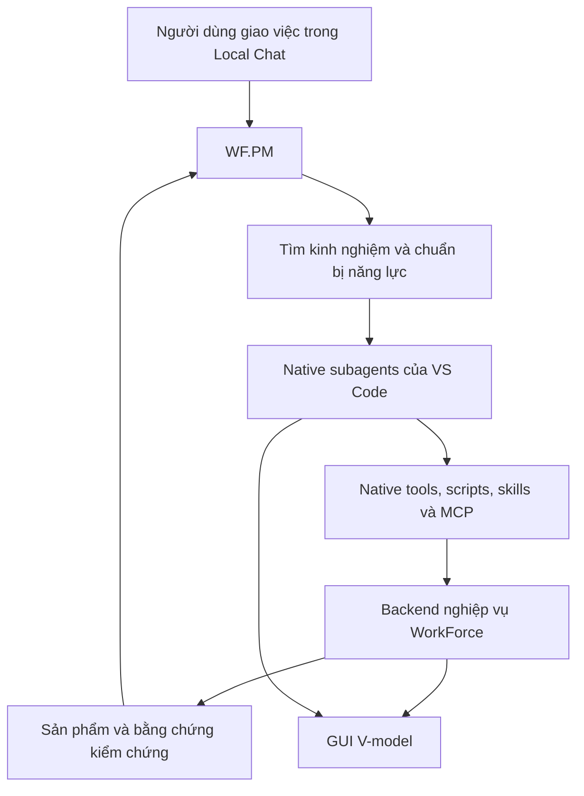

# Kế hoạch cuối WorkForce Local, tái sử dụng kinh nghiệm và đồng bộ V-model

Ngày chốt: **08/11/2026**, múi giờ Asia/Saigon. Trạng thái: **đang triển khai; request phần mềm nhỏ native Local đã đạt M3, toàn bộ kế hoạch và gói phát hành chưa nghiệm thu**. Tiến độ và phần chưa đạt được ghi trong [checklist milestones](2026-11-08-workforce-local-milestones.md).

Đây là nguồn quyết định triển khai của đợt refactor này, thay thế các kế hoạch trước về execution ownership, GUI, model routing và acceptance. Các tài liệu cũ được giữ làm lịch sử. [Milestones và checklist nghiệm thu](2026-11-08-workforce-local-milestones.md) quy định thứ tự thực hiện; không thay đổi phạm vi trong tài liệu này.

Nhánh triển khai: `codex/workforce-vscode-native`. Lưu tài liệu và chia milestones không đồng nghĩa với triển khai phần mềm hoặc phát hành.

## 1. Kiến trúc và phạm vi đã chốt

### Nguyên tắc vận hành

- **VS Code Local là mặc định và môi trường nghiệm thu duy nhất.**
- Native Local quản lý model calls, tool loop, chat và subagents.
- WorkForce quản lý yêu cầu, V-model/ASPICE, kinh nghiệm, công cụ tái sử dụng và nghiệm thu.
- **Loại OpenCode khỏi đường thực thi và gói phân phối mới.** Không giữ workers hoặc fallback OpenCode ngầm.
- Giữ WF.PM và năm specialists: WF.SWSD, WF.P-RES, WF.FnD, WF.Reviewer, WF.Tester.
- GUI riêng cho agents được thu gọn thành **WorkForce V-model**, đồng bộ với hoạt động trong native chat.



### Đối chiếu năm yêu cầu gốc

| Yêu cầu | Phần triển khai bắt buộc | Milestones và bằng chứng chính |
| --- | --- | --- |
| Manager biết công việc cũ và giao tái sử dụng | Request Experience + Procedure Reuse, mục 2.1 | M5: request mới rồi chat sạch tự nhận diện và chạy lại công cụ |
| Quan sát agents, scripts, models/providers | Native chat + V-model đồng bộ, mục 2.2 | M1/M2/M4: GUI, native delegation và correlation thật |
| Models linh hoạt trên từng máy | ModelInventory + chính sách theo role, mục 2.3 | M2/M4: inventory thực và model A chuyển sang B ở lượt tiếp theo |
| Tích hợp REA và các năng lực 9router | Managed Provider Gateway, mục 2.4 | M7a/M7b: REA analysis và gateway chạy thật từ Local |
| Khảo sát marketplace, cài và phân bổ năng lực | Capability Resolver + role capability plans, mục 2.5 | M6: discovery, cài/nạp và sử dụng thật theo role |

Không được hoàn thành một phần UI rồi coi là đã hoàn thành cả kế hoạch.

## 2. Triển khai đầy đủ năm yêu cầu

### 2.1. Manager tự tìm và sử dụng lại kinh nghiệm

Tra cứu là bước thực thi mặc định trước delegation, không chỉ là instructions khuyên agent tìm công cụ.

**Nhận yêu cầu → truy hồi kinh nghiệm/công cụ → kiểm tra phù hợp → giao việc → kiểm chứng mới → tự lưu kinh nghiệm.**

Mở rộng SQLite/FTS5 hiện có để truy hồi:

- Request đã hoàn thành, task family và yêu cầu đã chuẩn hóa.
- Tham số, môi trường, toolchain, phạm vi và quyền thực thi.
- Scripts, templates, manifests, phiên bản và hashes.
- Capability plans và cách phân công đã thành công.
- Commands kiểm chứng, kết quả nghiệm thu và vấn đề đã xử lý.
- Thời gian, model calls và token khi quan sát được.

FTS5 tìm ứng viên; backend kiểm tra applicability, version/hash, environment, scope và qualification.

| Kết quả | Cách thực hiện |
| --- | --- |
| **Exact** | Dùng procedure phù hợp, tham số mới và kiểm chứng mới; bỏ khảo sát/thiết kế lặp lại |
| **Adapt** | Dùng nền đã đạt; chỉ triển khai phần khác biệt và checks liên quan |
| **New** | Khảo sát phần chưa biết, triển khai, kiểm chứng và tạo công cụ ứng viên khi có ích |

Developer nhận execution brief cụ thể: script nào, tham số gì, đầu ra ở đâu và kiểm chứng thế nào. Không phải tự khám phá lại toàn bộ.

Backend tự lưu experience sau nghiệm thu; không bắt agent nhớ gọi thêm thủ tục đăng ký. Kinh nghiệm riêng giữ trong project; kho dùng chung chỉ nhận tài sản đã tổng quát hóa và được duyệt.

**Giữ qualification hiện có.** Công cụ mới không tự đủ điều kiện chỉ vì request đầu hoàn tất. Phải có runs, inputs, checks và review thực; không tạo lịch sử giả hoặc hạ tiêu chuẩn để trình diễn reuse.

### 2.2. Native agents trong chat và GUI V-model

#### Trong Local Chat

- WF.PM thực sự gọi named specialists bằng `agent/runSubagent`.
- Bỏ instructions hiện tại cấm client-side specialists và chỉ trả receipt.
- Thấy nhiệm vụ, native subagent cards, tool calls, commands/scripts và kết quả.
- Scripts chạy qua terminal hoặc execution tool phải có command, exit code và evidence rõ ràng.
- Hiện model/provider theo mức dữ liệu thực sự quan sát được; phân biệt requested model với resolved model khi dùng gateway/combo.

Không dựng lại transcript hoặc subagent cards bằng UI giả.

#### GUI V-model

Tái sử dụng renderer SVG hiện có, giữ:

- Request selector và khả năng ghim request.
- Chín bước V-model cùng các đường đối chiếu đặc tả–kiểm thử.
- WF.PM, active roles và mốc Independent Review riêng.
- Stage đang chạy, đường đã đi và đường quay lại khi sửa lỗi.
- Chi tiết nhiệm vụ, artifacts, findings, checks và revision.
- Liên kết mở file/diff bằng editor native.
- Thời điểm đồng bộ và trạng thái quan sát.

| Role | Trách nhiệm trên V-model |
| --- | --- |
| WF.SWSD | Requirements và System Analysis |
| WF.P-RES | Software Design và Module Design |
| WF.FnD | Coding và sửa sản phẩm |
| WF.Reviewer | Review độc lập đối với yêu cầu, thiết kế và sản phẩm |
| WF.Tester | Các mức kiểm thử áp dụng cho request |
| WF.PM | Điều phối và tổng hợp toàn request |

Nhiều stages có thể cùng chạy. Tester chạy unit test không làm tất cả testing levels cùng sáng.

#### Nguồn đồng bộ

- Domain operations cung cấp milestone, sản phẩm, revision và evidence.
- Local hooks cung cấp lifecycle/tool observations khi có correlation rõ ràng.
- Không đoán theo request mới nhất, tên role hoặc timestamp gần nhau.
- Không phụ thuộc cấu trúc transcript/storage nội bộ của VS Code.
- GUI cập nhật qua thông báo thay đổi; không gọi model hoặc bắt agents gọi progress.

**Agent dừng không đồng nghĩa stage đạt.** Stage chỉ hoàn tất khi kết quả và evidence hiện hành đủ điều kiện. Mất telemetry không chặn workflow và không được tiếp tục giả animation.

### 2.3. Models linh hoạt và chọn theo role

Tạo `ModelInventory` từ models thực sự khả dụng trong VS Code, cập nhật khi inventory thay đổi.

Chính sách mặc định:

1. Giữ explicit model người dùng đã chọn.
2. Theo native Auto khi người dùng chọn Auto và Local hỗ trợ.
3. Role chưa có preference dùng hành vi kế thừa của native.
4. Có economy/strong preferences hợp lệ thì WF.PM phân công theo độ khó.
5. Worker không đạt thì dùng model mạnh hơn trong tập được phép, theo giới hạn native.

Không bắt buộc aliases, 9router hoặc catalog JSON riêng. Không hỏi người dùng liệt kê model đã có trên máy.

Không suy luận chất lượng model chỉ từ tên/context size; không benchmark toàn bộ catalog. Chỉ xác minh model được chọn khi cần, với cache có invalidation.

#### Chọn model bằng GUI

Bấm role trên V-model → mở **Quick Pick native**:

- Theo chat/Auto native.
- Model cụ thể từ inventory thực tế.

Lưu một policy theo workspace/role. Adapter Local áp dụng policy vào lần delegation tiếp theo bằng input hợp lệ của native tool. Profile defaults và adapter cùng đọc một nguồn cấu hình.

GUI phân biệt:

- **Preferred:** cấu hình đã lưu.
- **Requested:** model gửi vào delegation.
- **Observed:** model/provider được runtime xác nhận.

Invocation đang chạy giữ model đã chọn; thay đổi áp dụng lượt sau.

**Model WF.PM và chat trực tiếp vẫn chọn bằng native chat picker.** Không dùng private API để ép picker của chat cha thay đổi. Đổi model FnD không đổi model của WF.PM. Tham khảo [native model precedence](https://code.visualstudio.com/docs/agents/run/subagents).

### 2.4. Tích hợp năng lực 9router và sử dụng REA thực tế

Đóng gói gateway upstream được pin thành **module/service do WorkForce quản lý**, đăng ký models/combos qua Language Model Chat Provider API.

- Không yêu cầu cài 9router riêng.
- Không yêu cầu hai alias `top-models`/`worker-models`.
- Models native đã có tiếp tục chạy trực tiếp.
- Gateway chỉ khởi động khi được sử dụng.
- Không fork lại toàn bộ dashboard; dùng native model/settings UI và tái sử dụng màn hình upstream khi cần.

**Phạm vi bắt buộc:**

| Năng lực | Hành vi |
| --- | --- |
| Provider connections | Kết nối các adapters phù hợp, gồm Codex, GitHub Copilot và Claude; giữ đúng flow đăng nhập/quyền của provider |
| Quota trackers | Quota/reset có nguồn và timestamp; không có dữ liệu thì ghi chưa xác định |
| Usage | Requests, tokens, errors và chi phí ước tính khi có dữ liệu |
| Token savers/RTK | Nén có chọn lọc, giữ raw evidence và thông tin cần kiểm chứng |
| Combos/fallback | Chỉ chuyển trong tập provider/model đã được phép |
| Vision adapter | Dùng route đủ khả năng; không âm thầm bỏ ảnh hoặc che việc đổi model |

GitHub Copilot ở đây là **nguồn model**, không thay quyết định dùng Local harness.

Credentials không được copy từ extension khác, đưa vào prompts hoặc repository. Gateway chỉ thống kê requests thật sự đi qua nó; không nhận usage toàn VS Code.

**REA có công việc cụ thể:** WF.P-RES dùng MCP/skills phù hợp để lập feature/dependency map, khảo sát các điểm tích hợp và đối chiếu source với hành vi runtime của 9router. Báo cáo phải có compatibility evidence; không chỉ đánh dấu “REA enabled”.

Pin upstream sau kiểm chứng; theo dõi thay đổi, chạy regression trước khi kích hoạt và có rollback. Không đổi package đang phục vụ invocation giữa chừng. Nguồn: [9router](https://github.com/decolua/9router), [REA](https://github.com/morluto/rea).

### 2.5. Manager khảo sát plugins rộng và phân bổ theo role

Thay catalog providers cố định bằng registry mở rộng.

Manager thực hiện:

1. Xác định capabilities cần cho request và từng role.
2. Tra công cụ đã có, kinh nghiệm và capability plans đã thành công.
3. Khảo sát marketplaces/GitHub khi thiếu năng lực, đổi lĩnh vực hoặc cache đã cũ.
4. So sánh nội dung thực, Local compatibility, maintenance, license, dependencies, permissions và context cost.
5. Chọn package/version và phân bổ cho từng role.
6. Backend chuẩn bị/cài package đã duyệt, nạp skill và kết nối tools thật.
7. Đánh giá kết quả rồi lưu để tái sử dụng.

Humanizer/Ponytail chỉ là ví dụ, không phải giới hạn kiến trúc. Stars là tín hiệu khám phá, không phải chứng nhận chất lượng.

Mỗi capability plan ghi:

**Role → năng lực cần → package/version → skill/tool/script → mục đích → cách kiểm tra đầu ra.**

Giữ chính sách đã chọn: nghiên cứu rộng; tự cài/chạy trong danh mục đã duyệt. Dùng cơ chế cài đặt được host hỗ trợ; không sửa installation cache hoặc tự đổi global security settings.

Phân biệt rõ:

**Đã chọn → đã cài → đã nạp → đã sử dụng → đầu ra đã kiểm chứng.**

Không nạp tất cả plugins cho mọi role; không nhập nguyên orchestrator/model rules của framework khác. Công cụ tùy chọn không khả dụng thì chọn phương án hợp lệ khác, không biến thành gate chặn sản phẩm.

## 3. Backend, dữ liệu và trải nghiệm sử dụng

### Giữ cấu trúc .workforce

Giữ layout hiện tại:

```text
.workforce/
  requests/
    WF-Rxxxx--ten-request/
      request.json
      README.md
      records/
        requirements/
        design/
        tasks/
        checks/
        evidence/
        reviews/
        changes/
        problems/
        knowledge/
```

- Giữ IDs, counters, request mapping, liên kết records và artifact destinations.
- Prefix lịch sử như `NM-...` không bị đổi.
- Giữ signed receipts và relocation mapping.
- Bổ sung native execution metadata, observations và derived indexes.
- Không sửa receipts cũ thành bằng chứng native mới.

Backend thực thi thay đổi; cấu trúc hồ sơ và lịch sử được bảo toàn.

### Contract mới

Dùng `vscode-native/v1` với:

- `request_open`, `request_plan`, `request_result`, `request_finish`.
- Tái sử dụng/mở rộng `work_prepare`, `procedure_run`, `check_run`, capability resolver.

Backend tạo IDs và liên kết trạng thái. Agent gửi nội dung chuyên môn và tham chiếu hồ sơ backend đã trả về; không quản lý claim/token, generic record CRUD hoặc recovery protocol.

Schema tools, instructions, profiles và acceptance cùng phát sinh từ contract chung. Không để các tài liệu hướng dẫn những đường thực thi cạnh tranh nhau.

### V-model và chất lượng đầu ra

Giữ traceability:

**Yêu cầu → thiết kế áp dụng → sản phẩm → phép kiểm tra → evidence đúng revision → review → acceptance.**

- Dùng compiler/test runner hiện có trước khi tạo checker mới.
- Reviewer và Tester độc lập với implementation.
- Lỗi implementation giao FnD; lỗi checker giao Tester, giữ bằng chứng checker vẫn phát hiện sản phẩm sai.
- Bằng chứng cũ mất hiệu lực khi file liên quan thay đổi.
- Không dùng lời model tự khai làm bằng chứng danh tính hoặc kiểm thử.
- Lỗi backend/tool không được giả thành thiếu input của người dùng hoặc completed.
- Không lặp cùng lỗi, payload và trạng thái chỉ để tiếp tục tiêu quota.

Trạng thái record như `draft`, `submitted`, `verified`, `accepted` phải chuyển theo loại hồ sơ và bằng chứng. Không đổi toàn bộ records thành accepted để làm đẹp trạng thái.

Giữ Cornell renderer/validator, nội dung hướng người đọc, nguồn tham khảo, ví dụ, thực hành và đáp án riêng. Ưu tiên destination người dùng chỉ định; export mặc định vẫn `00_note/NeoMind`.

### Giao việc trực tiếp cho roles

Cả sáu profiles đều `user-invocable`.

- Chọn WF.PM: full engineering workflow.
- Chọn specialist: nhiệm vụ chuyên môn độc lập, có hồ sơ và phạm vi riêng.
- Hoàn tất role job không đồng nghĩa full software acceptance.
- FnD không tự xác nhận independent verification; sơ đồ chỉ hoàn tất phần thực sự đạt.

### UI và các tính năng VS Code

UI riêng cho agents chỉ còn V-model với role controls và artifact/evidence links. Focus Space giữ tùy chọn ngoài luồng agents.

Tận dụng instructions, skills, MCP/plugins, prompt files, handoffs, hooks, Model API, extension tools, context/search, memory/compaction, browser, testing/debugging, diffs/checkpoints, permissions/sandbox và diagnostics khi Local hỗ trợ.

Không cam kết Agents window, native Canvases, Compare Models hoặc Agent Host schedules trong Local; không xây bản sao để bù. Git worktrees vẫn có thể mở trong editor windows riêng. **Đóng cửa sổ Local dừng công việc đang chạy.**

Giữ `init/update --local` và exclusions trong `.git/info/exclude`, bảo toàn exclusions cũ, không sửa `.gitignore`.

## 4. Bộ nghiệm thu bắt buộc chỉ VS Code Local

| Ca | Điều kiện đạt |
| --- | --- |
| **A. Requirement hoàn toàn mới** | Không có experience phù hợp; Manager xác định `new`, ra sản phẩm, kiểm chứng độc lập, đóng hồ sơ và tự lưu kinh nghiệm |
| **B. Tự nhận diện và tái sử dụng** | Chat Local mới, prompt khác cách diễn đạt, không nhắc request/script cũ; Manager tự tìm và thực sự chạy đúng công cụ với input/output mới |
| **C. Adapt** | Chỉ triển khai delta và checks bị ảnh hưởng |
| **D. Mismatch** | Từ khóa giống nhưng khác mục tiêu không làm chạy nhầm procedure |
| **E. Công cụ đã thay đổi** | Version/hash/environment/scope không phù hợp làm mất eligibility/evidence cũ |
| **F. Prompt LeetCode gốc** | Tự chọn bài phù hợp, Cornell note, C/C++, compile, kiểm chứng độc lập và đóng thật |
| **G. Các loại sản phẩm khác** | Sửa bug có test sẵn, nghiên cứu/tài liệu và project mới chạy trọn theo tiêu chí tương ứng |
| **H. Model discovery** | Không có aliases/9router vẫn chạy bằng models đang có; thử inheritance, Auto và custom endpoint |
| **I. Model theo role** | Đổi FnD A→B: lượt A giữ nguyên, lượt sau yêu cầu/chạy B; không nhận applied giả |
| **J. Direct roles** | Mỗi role nhận việc trực tiếp đúng scope; không tự cấp full acceptance |
| **K. Native chat và V-model** | Named specialists, commands, stages và evidence khớp; hỗ trợ song song, rework, N/A và mất quan sát |
| **L. Managed gateway** | Streaming/tool calls, cancellation, auth/quota errors, authorized fallback, combos và vision hoạt động đúng |
| **M. Token saving** | Có phép đo trước/sau, giữ raw evidence và không mất thông tin nghiệm thu |
| **N. Marketplace capabilities** | Request khác lĩnh vực chọn bộ năng lực khác; chứng minh nạp và sử dụng thực |
| **O. Recovery và dữ liệu** | Cancel/reload, callback trùng/đến muộn, mất response và user sửa file không tạo side effect trùng hoặc pass giả |
| **P. Cài/gỡ và hiệu năng** | Giữ dữ liệu; mở/đóng GUI không gọi model hoặc chạy lại checks; không dispatch OpenCode |

### Chuỗi nghiệm thu reuse quan trọng nhất

1. Hoàn thành request mới và tạo công cụ tái sử dụng có ích.
2. Qualification bằng inputs/checks/review thật theo tiêu chuẩn hiện có.
3. Mở chat Local sạch.
4. Giao yêu cầu tương đương với tham số mới, không chỉ dẫn reuse.
5. Quan sát Manager tự tìm, giao và chạy lại đúng script.
6. Kiểm chứng đầu ra mới và đóng request thứ hai.

Đo model calls, tool executions, thời gian và token khi có dữ liệu. Không hứa trước phần trăm tiết kiệm hoặc tạo runs giả để đạt qualification.

Bằng chứng nghiệm thu gồm native tool inputs/results, role observations, commands, exit codes, hashes và acceptance; screenshot hoặc CI xanh riêng lẻ chưa đủ.

## 5. Triển khai, cập nhật và phát hành

Nhánh triển khai: **`codex/workforce-vscode-native`**, từ baseline hiện tại; bảo toàn phần sửa không liên quan.

Theo yêu cầu triển khai phần dễ thấy và đơn giản trước, [milestones](2026-11-08-workforce-local-milestones.md) bắt đầu bằng việc thu gọn GUI V-model từ SVG có sẵn. Mốc đó chỉ xác nhận giao diện; proof Local thật phải đạt trước khi thay engine/backend, và mỗi milestone phải được kiểm tra ngay khi hoàn tất.

Thứ tự nghiệp vụ sau mốc GUI:

1. **Proof Local trước:** native delegation, models thực trên máy, role model override và correlation với request.
2. Tách backend nghiệp vụ khỏi OpenCode/authentication cũ; bảo toàn storage và đóng được một request đơn giản trọn vẹn.
3. Hoàn thiện model controls, direct-role jobs và đồng bộ native chat với V-model.
4. Hoàn thiện request experience/reuse và capability resolver trước delegation.
5. Tích hợp managed 9router và REA analysis; hoàn thiện connections, quota/usage, RTK, combos và vision.
6. Chạy toàn bộ bộ nghiệm thu trên gói cài thật, sau đó phát hành.

GitHub Actions kiểm tra regression Windows/Ubuntu, package compatibility và qualification fixtures. Bổ sung job theo dõi metadata/upstream định kỳ để tạo đề xuất cập nhật; package đang hoạt động chỉ đổi sau kiểm thử. Linux self-hosted runner có thể chạy các checks này; không coi nó tự cung cấp native Local agents khi VS Code không chạy.

Phát hành **runtime + VSIX + Agent Plugin** với compatibility manifest chung, migration/rollback và hướng dẫn cài trên máy khác. Ghi rõ:

- Build/runtime và phiên bản VS Code đã thử.
- Local models/providers đã kiểm chứng.
- Connector nào đã chạy thật, connector nào chưa có credentials để thử.
- Tính năng Preview/Experimental đang sử dụng.
- Phạm vi Windows/Linux thực sự được xác nhận.

**Chỉ báo hoàn tất khi năm yêu cầu gốc cùng các điều chỉnh về Local, GUI, model từng role, direct roles và reuse đều có bằng chứng nghiệm thu tương ứng.**
