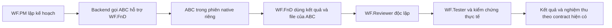

# WorkForce: tương thích VS Code mới và gọi agent từ plug-in

Ngày chốt feature: **10/11/2026**. Cập nhật kế hoạch: **12/11/2026**, sau đối chiếu VS Code 1.146. Trạng thái: **đã lưu kế hoạch; H0–H3 chưa triển khai hoặc nghiệm thu**.

Tài liệu bàn giao này lưu các quyết định đã chốt trong chat. Bản lưu nằm trên nhánh `codex/workforce-vscode-native`; baseline source của lượt cập nhật là `70f2c4ccd4a1ca661d4cf554d1f682d02099319f` (bản kế hoạch đầu tiên dùng baseline `a256a27e1b342ebc24eb58214d47ea5eba9f8a80`). Nhánh triển khai dự kiến khi bắt đầu viết code: `codex/plugin-agent-helpers`; chưa tạo nhánh đó trong lượt cập nhật tài liệu.

## 0. Thứ tự tiếp tục và phạm vi cập nhật

**H0 → H1 → H2 → H3**: tương thích VS Code → gọi agent plug-in tối thiểu → tích hợp → nghiệm thu bản cài và phát hành. H là nhãn nhóm milestones cho feature helpers; không thêm gate nghiệp vụ hoặc bước khai báo cho model.

| Mốc | Kết quả cần có | Trạng thái |
| --- | --- | --- |
| H0 | Chứng minh và chốt kết nối harness/model/dispatch trên VS Code 1.146, chạy trên máy người dùng qua custom endpoint | Chưa triển khai |
| H1 | Gọi nguyên agent ABC thật, lưu kết quả và chứng minh WF role dùng kết quả | Chưa triển khai |
| H2 | Nối catalog, permissions, model, leases, baselines và V-model vào controller hiện có | Chưa triển khai |
| H3 | Kiểm thử requests mới/tái sử dụng/helpers và lifecycle trên bản cài, rồi phát hành | Chưa nghiệm thu |

Native-core M0–M6 và M8 đã phát hành trong phạm vi release hiện có; không coi là nghiệm thu Agent Host hoặc foreign-agent helpers. M7/REA và gateway tích hợp tiếp tục hoãn. [Đối chiếu VS Code 1.146](../research/2026-11-11-vscode-1-146-workforce-compatibility.md) là nguồn kỹ thuật hỗ trợ; tài liệu này là nguồn thứ tự triển khai và tiêu chí nghiệm thu hiện hành của H0–H3.

Đích mới là **Copilot harness qua Agent Host, chạy trên máy người dùng**, giữ provider/custom endpoint đang cấu hình. Đây không phải lựa chọn Cloud. Giữ đường Local harness hiện đang hoạt động trong giai đoạn chuyển tiếp; chỉ thay lựa chọn mặc định sau nghiệm thu và không tự chuyển phiên đang chạy.

Tận dụng chat, agent cards, model picker, tools và quyền của VS Code. Giữ panel V-model và dữ liệu `.workforce`; chưa thay panel bằng Canvas, chưa bật thêm model-comparison/Fusion hoặc Skills over MCP cho mọi request. Các khả năng Preview/Experimental được đánh giá riêng sau đường chạy cốt lõi.

## 1. Mục tiêu và các quyết định đã chốt

WF.PM có thể chọn agent **ABC** được đóng gói trong một Agent Plugin, giao ABC hỗ trợ một WF role, rồi để role đó tiếp tục bằng kết quả thực tế của ABC. ABC chạy trong ngữ cảnh native riêng, có thẻ gọi agent thật trong VS Code desktop qua harness đã đạt H0.



| Quyết định | Hành vi đã chọn |
| --- | --- |
| Cách gọi | Backend gọi helper theo luồng phẳng, cùng cấp với WF worker; WF worker không tự tạo tầng subagent lồng nhau. |
| Danh tính ABC | Gọi nguyên tên và cấu hình native của ABC. Không đổi tên, tạo helper profile thay thế hoặc chép instructions ABC vào WF worker. |
| Model | Lựa chọn model tường minh cho WF role ưu tiên hơn model ABC khai báo. Nếu role chưa chọn model, giữ cấu hình/default native của ABC. |
| Quyền ghi | Helper của WF.FnD được sửa sản phẩm trong scope đã giao. Helper của SWSD, P-RES, Reviewer và Tester chỉ đọc. |
| Nguồn plug-in | Bản đầu chỉ dùng package do WorkForce quản lý, đã đăng ký và pin. |
| Workflow | Giữ năm WF roles, V-model, review/test độc lập và các nghĩa vụ nghiệm thu đã cam kết. ABC là chuyên gia hỗ trợ, không thay thế các bước đó. |

M7/REA, embedded 9router gateway và dashboard mới nằm ngoài feature này. Không thay Workspace Trust, approval mode hoặc quyền native của người dùng để làm helper chạy được.

### Ranh giới kiến trúc

| Tầng | Trách nhiệm trong WorkForce |
| --- | --- |
| Model | Suy luận và nội dung chuyên môn từ model/provider người dùng lựa chọn. |
| Harness | VS Code/Agent Host quản lý phiên native, context, tools và permissions; adapter WorkForce nối đúng contract được hỗ trợ. |
| Loop | Backend lưu kết quả, chạy checker và điều phối sửa theo findings trên revision thực tế. |
| Graph | WF.PM đưa quyết định chuyên môn; backend giữ IDs, ownership, quan hệ tasks và tiến độ V-model. |
| Software Factory | Tái sử dụng procedures đã qualified và quy trình CI/release hiện có; chưa mở rộng thành hệ thống vận hành toàn tổ chức. |

Đây là cách phân chia trách nhiệm, không yêu cầu tạo năm dịch vụ hoặc thêm orchestration framework. Giữ một nguồn instructions/tool contract và giới hạn logic trùng giữa harness với backend.

## 2. Điểm xuất phát và giới hạn kỹ thuật

Native-core đã phát hành tại [workforce-v0.3.0-alpha.1](https://github.com/NeoTech-vietnam/NeoMind/releases/tag/workforce-v0.3.0-alpha.1): runtime `0.3.0-alpha.1`, VSIX `0.13.0`, Agent Plugin `0.2.0-alpha.1`. Source executable của release là `f552a54cde5762804cb267ae2999c896e9d03c68`; baseline tài liệu phía trên có thêm cập nhật acceptance và cleanup test. Xem [báo cáo release](../validation/2026-11-10-native-core-release-acceptance.md).

Hiện package inventory đã lưu `components.agents`, nhưng native capability guidance mới đưa skills vào role. Delegator chỉ gọi năm WF workers cố định; workers khai báo `agents: []`. Acceptance M6 đã chứng minh skills, MCP và lifecycle package, **chưa chứng minh gọi agent ABC từ plug-in**.

**Baseline Local đã khảo sát:** public native `runSubagent` nhận tên agent, prompt, mô tả và model; không có source/package selector hoặc bộ lọc tools/path riêng cho từng invocation. Khảo sát này chưa xác lập API công khai để liệt kê/định danh mọi custom agent. H0 phải kiểm tra lại khả năng tương đương trên harness đích. Vì người dùng chọn gọi nguyên tên ABC:

- Chỉ chấp nhận exact native name, phân biệt hoa/thường; chặn tên trùng đã biết trong managed catalog hoặc định nghĩa workspace công khai.
- Không tự tạo alias để né xung đột. Tên không mơ hồ trong inventory của WorkForce vẫn chưa chứng minh không có user/org agent trùng tên ngoài inventory.
- Tách nguồn package đã pin mà backend kỳ vọng khỏi nguồn native thực sự quan sát được. Không quan sát được nguồn thì ghi `unknown`; marker hành vi không phải xác thực nguồn.
- Tool permissions phải được xét trên cấu hình gốc. Không dùng lời nhắc “read-only” để coi agent có quyền edit/execute là chỉ đọc.
- Scope và hash checks phát hiện thay đổi file; không mô tả chúng là OS sandbox cho mọi script/native tool.

Baseline native-core được khảo sát trên VS Code `1.145.2`, source commit `c4453f8ea430795f941c1b2ff6c9321135a74a02`. VS Code [1.146 đã deprecated Local harness, dự kiến bỏ tháng 2/2027](https://code.visualstudio.com/updates/v1_146#copilot-harness-and-deprecation-of-the-local-harness); đường triển khai mới phải được chứng minh theo H0. Không dùng proof 1.145.2 để nhận tương thích 1.146.

## 3. Catalog và interface

### Catalog helper

Mở rộng agent inventory hiện có với native name, mô tả, đường dẫn và nguồn package, version/hash đã pin, model/tools khai báo, WF roles phù hợp, trạng thái sẵn sàng và lý do không đủ điều kiện. Giữ khai báo và kết quả quan sát thực tế là hai loại dữ liệu riêng.

WF.PM gọi `work_prepare` và tìm procedure/tool đã qualified trước. Nếu script hiện có giải quyết đủ yêu cầu, dùng lại script; không gọi helper chỉ vì package có agent.

### Các trường bổ sung

- Full software request: thêm trường tùy chọn `plan.role_helpers` cho `WF.FnD`, `WF.Reviewer`, `WF.Tester`; mỗi role chọn danh sách helpers theo thứ tự.
- Direct-role job: thêm trường tùy chọn `helpers`, áp dụng cho cả năm WF roles.
- Mỗi lựa chọn có cùng nội dung chuyên môn tối thiểu:

```json
{
  "package": "plugin-name",
  "agent": "ABC",
  "brief": "Nhiệm vụ cụ thể và kết quả cần trả",
  "required": false
}
```

Backend tự resolve package, pin, native name, ownership, scope, model, leases và đường dẫn lưu kết quả. Model không tự điền credentials hoặc quan hệ lifecycle nội bộ.

Helpers do PM chọn mặc định là optional. Khi người dùng yêu cầu bắt buộc dùng ABC, đánh dấu required. Helpers của cùng một role chạy tuần tự và dùng chung giới hạn `max_workers` hiện có. Request không chọn helper phải có **zero model calls bổ sung**.

### Contract và hướng dẫn

Sinh schemas, role instructions và handoff guidance từ cùng contract; tên tools, model IDs, frontmatter và hooks được resolve theo harness đã nghiệm thu. Giữ contract helpers dự kiến `vscode-native/helpers-v1`; lưu harness/adapter và phiên bản tương thích trong execution binding để runtime cũ hoặc adapter khác không tự tiếp tục sai execution mới. Giữ lịch sử `vscode-native/v1`; không yêu cầu model tự chọn transport hoặc điền danh tính nội bộ.

## 4. Dispatch, quyền và lưu trạng thái

### Admission trước khi gọi model

Thêm đường helper invocation riêng; giữ nguyên allowlist của delegator năm WF workers. Dùng execution context hợp lệ, do host cấp và backend sở hữu. Adapter Local tiếp tục dùng root-owned invocation token; H0 phải chứng minh execution context của Agent Host thay vì giả định token/API Local tương đương. Không mượn context của worker để vượt giới hạn nested calls.

Helper phải được native harness hiện tại cho phép gọi và giữ authored opt-out. Kiểm tra model/tool availability, pin, registration, MCP bindings và cấu hình gốc trước paid call:

- Helper ngoài WF.FnD: explicit read/search và các MCP tools chỉ đọc đã được duyệt; không edit, execute hoặc orchestration.
- Helper WF.FnD: tool grants tương thích với role và scope hiện có; MCP vẫn phải được binding đúng.
- Thiếu tools, wildcard tools, orchestration lồng nhau, hoặc hooks không tương thích/chưa được duyệt: ineligible. Không âm thầm sửa cấu hình ABC để làm nó eligible.
- Kiểm tra frontmatter và tool grants theo đúng harness đã chọn; không nhận fields bị harness bỏ qua là đã hỗ trợ. Đặc biệt, không dùng `agents: []` của Local như bằng chứng chặn recursion trên Copilot.

Model được chốt tại admission của invocation. Thay đổi lựa chọn trên GUI chỉ áp dụng invocation kế tiếp. Resolve model ID từ inventory/capabilities thật của harness; không tái dùng qualified display name Local làm ID Copilot. Giữ default/inherit hoặc Auto khi native thực sự hỗ trợ; không bắt buộc alias `top-models`/`worker-models` và không đoán độ mạnh chỉ theo tên model. Lưu model yêu cầu và model/vendor native quan sát được; alias không chứng minh upstream model. Không tự đổi model của các chat độc lập.

### Kết quả và baseline

Backend tạo helper invocation record gắn request/role/package, lưu kết quả bền vững và cấp tham chiếu cho WF worker tiếp theo. ABC có thể trả Markdown chuyên môn bình thường; không ép ABC biết JSON nội bộ của WF worker. Chỉ ra phần chưa trả được hoặc chưa xác minh, không biến văn bản “completed” thành whole-request acceptance.

Với helper WF.FnD:

1. Ghi baseline ngay trước helper.
2. Sau helper, đối soát file và scope thực tế, giữ side effects/evidence theo revision.
3. Cấp handoff WF.FnD từ baseline sau helper để worker dùng được file ABC vừa tạo.
4. Giữ baseline bảo toàn file ngoài sản phẩm ban đầu; user sửa đồng thời phải được phát hiện.
5. Review/test độc lập kiểm tra revision cuối, không tái dùng acceptance evidence trên baseline cũ.

Helper của Reviewer/Tester không được tự thay review/test độc lập. Verdict của helper là đầu vào chuyên môn cho role, không tự mở gate nghiệm thu.

### Lifecycle và phục hồi

- Helper optional không sẵn sàng: ghi lý do một lần, tiếp tục ordinary WF work; không quay vòng cùng lỗi.
- Helper required chưa thực hiện được: giữ và cung cấp sản phẩm thực tế đã có, báo nghĩa vụ còn thiếu; không giả accepted hoặc đổ lỗi tool thành thiếu input người dùng.
- Callback trùng, mất response và restart: đối soát record/effects; không chạy lại helper đã hoàn tất trên revision còn hiệu lực. Kết quả chưa biết giữ uncertain đến khi đối soát.
- Acquire helper lease lúc dispatch thực tế. Disable/unregister chặn admission mới; invocation đang chạy giữ resource đến khi kết quả được biết rồi drain.
- Cập nhật package không đổi pin của invocation đang chạy. Invocation tiếp theo dùng lựa chọn đã đối soát mới.
- Helper failure không dùng product-repair budget. Không thêm progress polling bằng model, claim/recovery calls do model đoán hoặc retry vô hạn.

## 5. Chat, GUI và tương thích

Trong chat native của harness đã nghiệm thu, hiện actual ABC subagent card, sau đó WF worker tiếp tục từ kết quả ABC. Đây là các lời gọi cùng cấp do backend sở hữu, không phải worker tự gọi subagent sâu hơn. Đồng bộ stage/request/role từ kết quả và sự kiện thực tế được hỗ trợ, không đọc private chat storage hoặc suy diễn tiến độ từ văn bản model.

V-model vẫn thể hiện stage thuộc WF role đang sở hữu công việc; khi helper chạy, hiển thị hoạt động hỗ trợ của ABC trong stage đó. Helper xong không có nghĩa WF role hoặc request đã hoàn tất.

Tận dụng panel, catalog và QuickPick sẵn có để xem helper, pin, eligibility và model override. Không tạo dashboard mới. Nhãn chọn model phải phân biệt rõ WF worker kế thừa parent với helper giữ authored/native default khi role chưa chọn model.

Giữ cấu trúc request folders, IDs và lịch sử hiện có. Runtime/VSIX/Agent Plugin phải đồng bộ contract mới; không ghi lại historical evidence thành acceptance của feature mới.

Agent Host có thể giữ session khi client đóng, nhưng extension tools vẫn phụ thuộc client đang kết nối. Chỉ cam kết vòng đời WorkForce đã kiểm chứng; không nhận toàn bộ workflow vẫn chạy nếu editor cung cấp tools đã mất. [Agent Host lifecycle](https://code.visualstudio.com/docs/agents/concepts/agent-host#session-lifetime-and-client-dependencies).

## 6. Milestones và nghiệm thu

### H0 — tương thích harness/model/dispatch trước khi mở rộng helpers

- [ ] Ghi phiên bản VS Code/Chat/runtime, harness, host và public tool inventory trong workspace nghiệm thu riêng. Dùng Copilot harness trên máy người dùng, không Cloud; giữ Local và cấu hình đang chạy làm baseline.
- [ ] Kiểm tra BYOK/custom endpoint hiện có. Agent Host BYOK cần `chat.agentHost.byokModels.enabled`, hiện Experimental; đăng ký model không thay proof tool-call. Không thay credentials, auth, approval mode hoặc chính sách doanh nghiệp. [BYOK](https://code.visualstudio.com/docs/agent-customization/language-models#bring-your-own-language-model-key).
- [ ] Chứng minh backend gọi specialist qua public integration được hỗ trợ, đúng identity/context, nhận kết quả bền vững và cancellation. Copilot dùng native `task`; chưa chứng minh SDK tool này gọi được bằng `vscode.lm.invokeTool`. Không chỉ thay chuỗi `runSubagent` thành `task`, dùng private API hoặc âm thầm chuyển ownership sang model. [Subagent migration](https://code.visualstudio.com/docs/agents/run/subagents#subagents-by-harness).
- [ ] Resolve explicit role model và default/inherit theo inventory thật của harness, chốt đúng per-invocation và phân biệt requested/observed. Kiểm tra một tool round-trip, không chỉ tin metadata `toolCalling`.
- [ ] Sinh và kiểm tra role configs đúng harness, gồm tool allowlists, read-only và chặn delegation ngoài scope. Fields schema hợp lệ nhưng không được SDK chuyển tiếp không chứng minh quyền đã có hiệu lực; giữ nguyên năm WF roles và independent acceptance.
- [ ] Đối chiếu hook events, payload/output, timeout và failure semantics; bảo toàn disabled state và tránh chạy cả bản Local lẫn bản migrated hai lần. Kiểm thử hook thật trên harness đích. [Hook migration](https://code.visualstudio.com/docs/agent-customization/migrate-customizations#migrate-hooks).
- [ ] Đối chiếu MCP forwarding/native config và auth. `${input:...}`/`${command:...}` và editor secrets không tự chuyển; không chép credential vào repo hoặc bật lại server đã tắt. Native MCP hiện chỉ có status/prepare, không tự thành đường dispatch. [MCP migration](https://code.visualstudio.com/docs/agent-customization/migrate-customizations#migrate-mcp-servers).
- [ ] Nghiệm thu một request phần mềm nhỏ qua đúng đường đích: specialist thật, review/test độc lập, checker thực thi và đóng thật; cancel/reload phải giữ request và effects. Lưu source/API binding của adapter để H1 dùng lại.

**Hoàn tất H0:** có đường thực thi public, backend-owned, model/tool/permissions và vòng đời đã chứng minh trên client thật. Nếu chưa có API đáp ứng, lưu findings và kết quả thử, giữ bản Local hiện hành, dừng refactor mở rộng; không tuyên bố tương thích hoặc tự thay các lựa chọn ABC đã chốt. H0 là tiêu chí công việc triển khai, không thêm gate cho mỗi request sản phẩm.

### H1 — chứng minh đường gọi native tối thiểu trước

- [ ] Dùng lại adapter đã đạt H0, không viết thêm vòng điều phối model riêng.
- [ ] Dùng workspace riêng và managed fixture package có agent ABC cấu hình gốc đủ điều kiện.
- [ ] Backend gọi ABC nguyên tên, native context riêng; ABC đọc được relative assets của package.
- [ ] Lưu kết quả ABC, rồi WF role thực sự dùng kết quả đó trong lần gọi tiếp theo.
- [ ] Kiểm tra model override tường minh của role và trường hợp chưa chọn model giữ default native của ABC.
- [ ] Ghi rõ model/source quan sát được và phần unknown; không dùng mock hoặc marker thay bằng chứng native.

**Hoàn tất H1:** có actual native agent cards trên harness đích đã đạt H0, kết quả lưu theo request và evidence role tiêu thụ kết quả. Nếu public API không thực hiện được nguyên danh tính/cấu hình đã chọn, dừng mở rộng implementation và báo đúng giới hạn; không âm thầm chuyển sang alias hoặc copied instructions.

### H2 — nối catalog, điều phối và lifecycle

- [ ] Catalog, eligibility và optional fields dùng chung contract.
- [ ] Helper dispatch riêng, model freeze, leases, durable results và baselines nối với controller hiện có.
- [ ] Optional fallback, required obligation, uncertain effects và replay/restart được xử lý ở backend.
- [ ] Instructions, chat, V-model và model picker dùng cùng semantics.
- [ ] Adapter và cấu hình Agent Host dùng đúng model/tool/hook/MCP contract đã thử ở H0; public native UI được tận dụng, không nhân đôi hệ thống sessions hoặc thêm dashboard.
- [ ] Không chọn helper giữ đường chạy cũ và không phát sinh model call.

**Hoàn tất H2:** deterministic regressions chứng minh đúng identity/scope/state trên các đường positive và negative bên dưới, không thay independent acceptance.

### H3 — regression, nghiệm thu bản cài trên máy local và phát hành

| Tình huống | Bằng chứng phải có |
| --- | --- |
| Product mới có FnD helper ghi file | ABC tạo/sửa đúng scope; WF.FnD tiếp tục; review/test độc lập trên revision cuối; request đóng accepted khi đủ contract. |
| Yêu cầu tương tự đã có procedure | Manager phát hiện và dùng lại script; không thêm helper/model call khi không cần. |
| Direct-role jobs | Cả năm roles resolve đúng helper; bốn role ngoài FnD chỉ đọc; ineligible bị loại trước paid call. |
| Output tự do hoặc thiếu | Markdown được lưu; thiếu/khẳng định completed sai không biến thành protocol blocker hoặc false acceptance. |
| Identity và cấu hình | Known duplicate names, authored opt-out, wildcard/thiếu tools, hooks và MCP không phù hợp có lý do cụ thể; không đổi agent gốc. |
| Model/provider | Override và default đúng; model/quota/MCP unavailable được phân loại; không lặp cùng failure. |
| Harness và permissions | Copilot harness trên máy người dùng qua custom endpoint; explicit/default models, tools, read-only và hook payload đúng native runtime, không chỉ schema hợp lệ. |
| Package đang chạy | Disable/enable/unregister và cập nhật pin giữ active resources đến đúng thời điểm rồi drain; admissions mới tuân trạng thái mới. |
| Delivery và lifecycle | Callback trùng/đến muộn, lost response, cancel, reload và concurrent requests không tạo effects trùng hoặc nhầm actor/request. |
| User sửa file ngoài luồng | Phát hiện baseline đổi; giữ file ngoài scope; không dùng evidence cũ để accept revision mới. |
| Tương thích | Request thường và records cũ giữ nguyên đường chạy; runtime cũ không nhận execution helper mới. |

- [ ] Regression suite trên Windows và Ubuntu.
- [ ] Bản cài runtime + VSIX + Agent Plugin khớp CI, thử trong workspace riêng trên Windows VS Code 1.146/Copilot harness chạy trên máy người dùng và custom endpoint đang dùng được. Đối chiếu regression đường Local chuyển tiếp; không dùng việc chọn model thành công làm proof cả workflow.
- [ ] Chạy request có helper từ đầu đến sản phẩm/kiểm chứng/đóng thật, không chỉ profile generation hoặc fixture protocol smoke.
- [ ] Dùng nguyên prompt người dùng cho request mới có Cornell note/C/C++, cùng một request tương tự để chứng minh Manager tự tìm script qualified và tránh model calls thừa. Đóng workflow từ artifact/evidence đúng revision.
- [ ] Cập nhật checklist bằng evidence đúng build/client/model; Linux core CI không được gọi là Linux desktop acceptance.

Chỉ phát hành bộ runtime, VSIX và Agent Plugin sau H3. Release notes ghi contract, agent/plugin thực sự đã thử, requested/observed model và giới hạn public API. Không chọn version phát hành trong lượt lưu kế hoạch này.

## 7. Bắt đầu trên máy khác

Lấy nhánh `codex/workforce-vscode-native` từ [NeoMind trên GitHub](https://github.com/NeoTech-vietnam/NeoMind), đọc tài liệu này trước khi triển khai. Bảo toàn local changes trước khi chuyển nhánh hoặc pull. Tạo nhánh `codex/plugin-agent-helpers` từ baseline đã cập nhật khi bắt đầu code.

Các điểm vào cần đọc theo milestone: native contract và package inventory trong `src`; helper/delegation seam, request controller, capability sessions và role-model preferences trong `extensions/vscode-model-bridge`. Tái sử dụng registry, bindings, leases và request storage hiện có.

Thứ tự tiếp tục: **H0 → H1 → H2 → H3**. Bắt đầu H0 trong workspace riêng và giữ nguyên năm lựa chọn ABC trong bảng quyết định. Không mở M7/REA hoặc làm lại native-core đã phát hành; chỉ thay adapter/config cần cho tương thích và sửa regression có bằng chứng. Toàn bộ checkbox ở đây còn mở vì lượt hiện tại chỉ cập nhật/push kế hoạch.

## Nguồn kỹ thuật để đối chiếu khi triển khai

- [VS Code subagents](https://code.visualstudio.com/docs/agents/run/subagents).
- [Custom-agent file reference](https://code.visualstudio.com/docs/agents/reference/custom-agent-file-reference).
- [VS Code 1.146 và Local deprecation](https://code.visualstudio.com/updates/v1_146#copilot-harness-and-deprecation-of-the-local-harness).
- [Local-to-Copilot migration](https://code.visualstudio.com/docs/agents/run/move-to-copilot) và [BYOK models](https://code.visualstudio.com/docs/agent-customization/language-models#bring-your-own-language-model-key).
- [Đối chiếu WorkForce/VS Code đã lưu](../research/2026-11-11-vscode-1-146-workforce-compatibility.md); đây là nghiên cứu, chưa là native acceptance.
- [Agent Plugins](https://code.visualstudio.com/docs/agent-customization/agent-plugins) và [plugin reference](https://code.visualstudio.com/docs/agents/reference/agent-plugin-reference).
- [Native runSubagent source tại commit đã khảo sát](https://github.com/microsoft/vscode/blob/c4453f8ea430795f941c1b2ff6c9321135a74a02/src/vs/workbench/contrib/chat/common/tools/builtinTools/runSubagentTool.ts).
- [Native prompt/agent name resolution tại commit đã khảo sát](https://github.com/microsoft/vscode/blob/c4453f8ea430795f941c1b2ff6c9321135a74a02/src/vs/workbench/contrib/chat/common/promptSyntax/service/promptsServiceImpl.ts).
