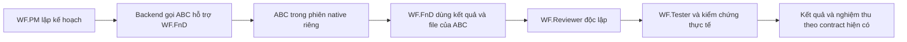

# WorkForce: gọi agent từ plug-in trong workflow

Ngày chốt: **10/11/2026**. Trạng thái: **kế hoạch đã được người dùng duyệt, chưa triển khai feature**.

Tài liệu bàn giao này lưu các quyết định đã chốt trong chat. Bản lưu nằm trên nhánh `codex/workforce-vscode-native`, baseline `a256a27e1b342ebc24eb58214d47ea5eba9f8a80`. Nhánh triển khai dự kiến khi bắt đầu viết code: `codex/plugin-agent-helpers`; chưa tạo nhánh đó trong lượt lưu kế hoạch.

## 1. Mục tiêu và các quyết định đã chốt

WF.PM có thể chọn agent **ABC** được đóng gói trong một Agent Plugin, giao ABC hỗ trợ một WF role, rồi để role đó tiếp tục bằng kết quả thực tế của ABC. ABC chạy trong ngữ cảnh native riêng, có thẻ gọi agent thật trong VS Code Local.



| Quyết định | Hành vi đã chọn |
| --- | --- |
| Cách gọi | Backend gọi helper theo luồng phẳng, cùng cấp với WF worker; WF worker không tự tạo tầng subagent lồng nhau. |
| Danh tính ABC | Gọi nguyên tên và cấu hình native của ABC. Không đổi tên, tạo helper profile thay thế hoặc chép instructions ABC vào WF worker. |
| Model | Lựa chọn model tường minh cho WF role ưu tiên hơn model ABC khai báo. Nếu role chưa chọn model, giữ cấu hình/default native của ABC. |
| Quyền ghi | Helper của WF.FnD được sửa sản phẩm trong scope đã giao. Helper của SWSD, P-RES, Reviewer và Tester chỉ đọc. |
| Nguồn plug-in | Bản đầu chỉ dùng package do WorkForce quản lý, đã đăng ký và pin. |
| Workflow | Giữ năm WF roles, V-model, review/test độc lập và các nghĩa vụ nghiệm thu đã cam kết. ABC là chuyên gia hỗ trợ, không thay thế các bước đó. |

M7/REA, embedded 9router gateway và dashboard mới nằm ngoài feature này. Không thay Workspace Trust, approval mode hoặc quyền native của người dùng để làm helper chạy được.

## 2. Điểm xuất phát và giới hạn kỹ thuật

Native-core đã phát hành tại [workforce-v0.3.0-alpha.1](https://github.com/NeoTech-vietnam/NeoMind/releases/tag/workforce-v0.3.0-alpha.1): runtime `0.3.0-alpha.1`, VSIX `0.13.0`, Agent Plugin `0.2.0-alpha.1`. Source executable của release là `f552a54cde5762804cb267ae2999c896e9d03c68`; baseline tài liệu phía trên có thêm cập nhật acceptance và cleanup test. Xem [báo cáo release](../validation/2026-11-10-native-core-release-acceptance.md).

Hiện package inventory đã lưu `components.agents`, nhưng native capability guidance mới đưa skills vào role. Delegator chỉ gọi năm WF workers cố định; workers khai báo `agents: []`. Acceptance M6 đã chứng minh skills, MCP và lifecycle package, **chưa chứng minh gọi agent ABC từ plug-in**.

Public native `runSubagent` nhận tên agent, prompt, mô tả và model; không có source/package selector hoặc bộ lọc tools/path riêng cho từng invocation. API công khai hiện tại cũng không cung cấp inventory đầy đủ của mọi custom agent. Vì người dùng chọn gọi nguyên tên ABC:

- Chỉ chấp nhận exact native name, phân biệt hoa/thường; chặn tên trùng đã biết trong managed catalog hoặc định nghĩa workspace công khai.
- Không tự tạo alias để né xung đột. Tên không mơ hồ trong inventory của WorkForce vẫn chưa chứng minh không có user/org agent trùng tên ngoài inventory.
- Tách nguồn package đã pin mà backend kỳ vọng khỏi nguồn native thực sự quan sát được. Không quan sát được nguồn thì ghi `unknown`; marker hành vi không phải xác thực nguồn.
- Tool permissions phải được xét trên cấu hình gốc. Không dùng lời nhắc “read-only” để coi agent có quyền edit/execute là chỉ đọc.
- Scope và hash checks phát hiện thay đổi file; không mô tả chúng là OS sandbox cho mọi script/native tool.

Đối chiếu lại public schema và hành vi trên phiên bản VS Code dùng để triển khai. Bằng chứng hiện tại được khảo sát trên VS Code `1.145.2`, source commit `c4453f8ea430795f941c1b2ff6c9321135a74a02`.

## 3. Catalog và interface

### Catalog helper

Mở rộng agent inventory hiện có với native name, mô tả, đường dẫn và nguồn package, version/hash đã pin, model/tools khai báo, WF roles phù hợp, trạng thái sẵn sàng và lý do không đủ điều kiện. Giữ khai báo và kết quả quan sát thực tế là hai loại dữ liệu riêng.

WF.PM gọi `work_prepare` và tìm procedure/tool đã qualified trước. Nếu script hiện có giải quyết đủ yêu cầu, dùng lại script; không gọi helper chỉ vì package có agent.

### Các trường bổ sung

- Full software request: thêm trường tùy chọn `plan.role_helpers` cho `WF.FnD`, `WF.Reviewer`, `WF.Tester`; mỗi role chọn danh sách helpers theo thứ tự.
- Direct-role job: thêm trường tùy chọn `helpers`, áp dụng cho cả năm WF roles.
- Mỗi lựa chọn có cùng nội dung chuyên môn tối thiểu:

```json
{
  "package": "plugin-name",
  "agent": "ABC",
  "brief": "Nhiệm vụ cụ thể và kết quả cần trả",
  "required": false
}
```

Backend tự resolve package, pin, native name, ownership, scope, model, leases và đường dẫn lưu kết quả. Model không tự điền credentials hoặc quan hệ lifecycle nội bộ.

Helpers do PM chọn mặc định là optional. Khi người dùng yêu cầu bắt buộc dùng ABC, đánh dấu required. Helpers của cùng một role chạy tuần tự và dùng chung giới hạn `max_workers` hiện có. Request không chọn helper phải có **zero model calls bổ sung**.

### Contract và hướng dẫn

Sinh schemas, role instructions và handoff guidance từ cùng contract. Dùng contract mới `vscode-native/helpers-v1` cho executions có helper để runtime cũ không tiếp tục sai execution mới; giữ đường `vscode-native/v1` cho request không dùng helper và lịch sử tương thích.

## 4. Dispatch, quyền và lưu trạng thái

### Admission trước khi gọi model

Thêm đường helper invocation riêng; giữ nguyên allowlist của delegator năm WF workers. Chỉ dùng native root-owned invocation token hợp lệ, không mượn token của worker để vượt giới hạn nested calls.

Helper phải được native harness hiện tại cho phép gọi và giữ authored opt-out. Kiểm tra model/tool availability, pin, registration, MCP bindings và cấu hình gốc trước paid call:

- Helper ngoài WF.FnD: explicit read/search và các MCP tools chỉ đọc đã được duyệt; không edit, execute hoặc orchestration.
- Helper WF.FnD: tool grants tương thích với role và scope hiện có; MCP vẫn phải được binding đúng.
- Thiếu tools, wildcard tools, orchestration lồng nhau, hoặc hooks không tương thích/chưa được duyệt: ineligible. Không âm thầm sửa cấu hình ABC để làm nó eligible.
- Kiểm tra frontmatter theo đúng Local harness; không nhận fields bị harness bỏ qua là đã hỗ trợ.

Model được chốt tại admission của invocation. Thay đổi lựa chọn trên GUI chỉ áp dụng invocation kế tiếp. Lưu model yêu cầu và model/vendor native quan sát được; alias không chứng minh upstream model.

### Kết quả và baseline

Backend tạo helper invocation record gắn request/role/package, lưu kết quả bền vững và cấp tham chiếu cho WF worker tiếp theo. ABC có thể trả Markdown chuyên môn bình thường; không ép ABC biết JSON nội bộ của WF worker. Chỉ ra phần chưa trả được hoặc chưa xác minh, không biến văn bản “completed” thành whole-request acceptance.

Với helper WF.FnD:

1. Ghi baseline ngay trước helper.
2. Sau helper, đối soát file và scope thực tế, giữ side effects/evidence theo revision.
3. Cấp handoff WF.FnD từ baseline sau helper để worker dùng được file ABC vừa tạo.
4. Giữ baseline bảo toàn file ngoài sản phẩm ban đầu; user sửa đồng thời phải được phát hiện.
5. Review/test độc lập kiểm tra revision cuối, không tái dùng acceptance evidence trên baseline cũ.

Helper của Reviewer/Tester không được tự thay review/test độc lập. Verdict của helper là đầu vào chuyên môn cho role, không tự mở gate nghiệm thu.

### Lifecycle và phục hồi

- Helper optional không sẵn sàng: ghi lý do một lần, tiếp tục ordinary WF work; không quay vòng cùng lỗi.
- Helper required chưa thực hiện được: giữ và cung cấp sản phẩm thực tế đã có, báo nghĩa vụ còn thiếu; không giả accepted hoặc đổ lỗi tool thành thiếu input người dùng.
- Callback trùng, mất response và restart: đối soát record/effects; không chạy lại helper đã hoàn tất trên revision còn hiệu lực. Kết quả chưa biết giữ uncertain đến khi đối soát.
- Acquire helper lease lúc dispatch thực tế. Disable/unregister chặn admission mới; invocation đang chạy giữ resource đến khi kết quả được biết rồi drain.
- Cập nhật package không đổi pin của invocation đang chạy. Invocation tiếp theo dùng lựa chọn đã đối soát mới.
- Helper failure không dùng product-repair budget. Không thêm progress polling bằng model, claim/recovery calls do model đoán hoặc retry vô hạn.

## 5. Chat, GUI và tương thích

Trong chat Local, hiện actual ABC subagent card, sau đó WF worker tiếp tục từ kết quả ABC. Đây là các lời gọi cùng cấp do backend sở hữu, không phải worker tự gọi subagent sâu hơn.

V-model vẫn thể hiện stage thuộc WF role đang sở hữu công việc; khi helper chạy, hiển thị hoạt động hỗ trợ của ABC trong stage đó. Helper xong không có nghĩa WF role hoặc request đã hoàn tất.

Tận dụng panel, catalog và QuickPick sẵn có để xem helper, pin, eligibility và model override. Không tạo dashboard mới. Nhãn chọn model phải phân biệt rõ WF worker kế thừa parent với helper giữ authored/native default khi role chưa chọn model.

Giữ cấu trúc request folders, IDs và lịch sử hiện có. Runtime/VSIX/Agent Plugin phải đồng bộ contract mới; không ghi lại historical evidence thành acceptance của feature mới.

## 6. Milestones và nghiệm thu

### H1 — chứng minh đường gọi native tối thiểu trước

- [ ] Dùng workspace riêng và managed fixture package có agent ABC cấu hình gốc đủ điều kiện.
- [ ] Backend gọi ABC nguyên tên, native context riêng; ABC đọc được relative assets của package.
- [ ] Lưu kết quả ABC, rồi WF role thực sự dùng kết quả đó trong lần gọi tiếp theo.
- [ ] Kiểm tra model override tường minh của role và trường hợp chưa chọn model giữ default native của ABC.
- [ ] Ghi rõ model/source quan sát được và phần unknown; không dùng mock hoặc marker thay bằng chứng native.

**Hoàn tất H1:** có actual Local agent cards, kết quả lưu theo request và evidence role tiêu thụ kết quả. Nếu public API không thực hiện được nguyên danh tính/cấu hình đã chọn, dừng mở rộng implementation và báo đúng giới hạn; không âm thầm chuyển sang alias hoặc copied instructions.

### H2 — nối catalog, điều phối và lifecycle

- [ ] Catalog, eligibility và optional fields dùng chung contract.
- [ ] Helper dispatch riêng, model freeze, leases, durable results và baselines nối với controller hiện có.
- [ ] Optional fallback, required obligation, uncertain effects và replay/restart được xử lý ở backend.
- [ ] Instructions, chat, V-model và model picker dùng cùng semantics.
- [ ] Không chọn helper giữ đường chạy cũ và không phát sinh model call.

**Hoàn tất H2:** deterministic regressions chứng minh đúng identity/scope/state trên các đường positive và negative bên dưới, không thay independent acceptance.

### H3 — regression và nghiệm thu bản cài Local

| Tình huống | Bằng chứng phải có |
| --- | --- |
| Product mới có FnD helper ghi file | ABC tạo/sửa đúng scope; WF.FnD tiếp tục; review/test độc lập trên revision cuối; request đóng accepted khi đủ contract. |
| Yêu cầu tương tự đã có procedure | Manager phát hiện và dùng lại script; không thêm helper/model call khi không cần. |
| Direct-role jobs | Cả năm roles resolve đúng helper; bốn role ngoài FnD chỉ đọc; ineligible bị loại trước paid call. |
| Output tự do hoặc thiếu | Markdown được lưu; thiếu/khẳng định completed sai không biến thành protocol blocker hoặc false acceptance. |
| Identity và cấu hình | Known duplicate names, authored opt-out, wildcard/thiếu tools, hooks và MCP không phù hợp có lý do cụ thể; không đổi agent gốc. |
| Model/provider | Override và default đúng; model/quota/MCP unavailable được phân loại; không lặp cùng failure. |
| Package đang chạy | Disable/enable/unregister và cập nhật pin giữ active resources đến đúng thời điểm rồi drain; admissions mới tuân trạng thái mới. |
| Delivery và lifecycle | Callback trùng/đến muộn, lost response, cancel, reload và concurrent requests không tạo effects trùng hoặc nhầm actor/request. |
| User sửa file ngoài luồng | Phát hiện baseline đổi; giữ file ngoài scope; không dùng evidence cũ để accept revision mới. |
| Tương thích | Request thường và records cũ giữ nguyên đường chạy; runtime cũ không nhận execution helper mới. |

- [ ] Regression suite trên Windows và Ubuntu.
- [ ] Bản cài runtime + VSIX + Agent Plugin khớp CI, thử trong workspace riêng trên Windows VS Code Local và custom endpoint đang dùng được.
- [ ] Chạy request có helper từ đầu đến sản phẩm/kiểm chứng/đóng thật, không chỉ profile generation hoặc fixture protocol smoke.
- [ ] Cập nhật checklist bằng evidence đúng build/client/model; Linux core CI không được gọi là Linux desktop acceptance.

Chỉ phát hành bộ runtime, VSIX và Agent Plugin sau H3. Release notes ghi contract, agent/plugin thực sự đã thử, requested/observed model và giới hạn public API. Không chọn version phát hành trong lượt lưu kế hoạch này.

## 7. Bắt đầu trên máy khác

Lấy nhánh `codex/workforce-vscode-native` từ [NeoMind trên GitHub](https://github.com/NeoTech-vietnam/NeoMind), đọc tài liệu này trước khi triển khai. Bảo toàn local changes trước khi chuyển nhánh hoặc pull. Tạo nhánh `codex/plugin-agent-helpers` từ baseline đã cập nhật khi bắt đầu code.

Các điểm vào cần đọc theo milestone: native contract và package inventory trong `src`; helper/delegation seam, request controller, capability sessions và role-model preferences trong `extensions/vscode-model-bridge`. Tái sử dụng registry, bindings, leases và request storage hiện có.

Thứ tự tiếp tục: **H1 → H2 → H3**. Không mở M7/REA hoặc sửa lại native-core đã phát hành nếu chưa có regression cụ thể do feature này gây ra. Toàn bộ checkbox ở đây còn mở vì lượt hiện tại chỉ lưu/push kế hoạch.

## Nguồn kỹ thuật để đối chiếu khi triển khai

- [VS Code subagents](https://code.visualstudio.com/docs/agents/run/subagents).
- [Custom-agent file reference](https://code.visualstudio.com/docs/agents/reference/custom-agent-file-reference).
- [Agent Plugins](https://code.visualstudio.com/docs/agent-customization/agent-plugins) và [plugin reference](https://code.visualstudio.com/docs/agents/reference/agent-plugin-reference).
- [Native runSubagent source tại commit đã khảo sát](https://github.com/microsoft/vscode/blob/c4453f8ea430795f941c1b2ff6c9321135a74a02/src/vs/workbench/contrib/chat/common/tools/builtinTools/runSubagentTool.ts).
- [Native prompt/agent name resolution tại commit đã khảo sát](https://github.com/microsoft/vscode/blob/c4453f8ea430795f941c1b2ff6c9321135a74a02/src/vs/workbench/contrib/chat/common/promptSyntax/service/promptsServiceImpl.ts).
