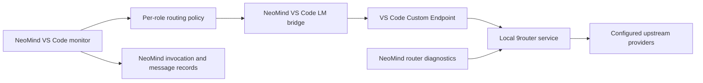

# 9router integration research and delivery boundary

Reviewed on **2026-10-23** against official repository `decolua/9router`, default branch `master`, commit **87a74e1bda3677193c6f71a7e2100c90311f0689** (commit date 2026-10-15). GitHub's API reported **31,252 stars** at inspection; popularity is a changing discovery signal. The inspected app and CLI manifests declare **0.5.104**. No upstream code, skills, provider credentials, or server binary were installed by this investigation. [Repository metadata](https://api.github.com/repos/decolua/9router), [pinned app manifest](https://github.com/decolua/9router/blob/87a74e1bda3677193c6f71a7e2100c90311f0689/package.json), [CLI manifest](https://github.com/decolua/9router/blob/87a74e1bda3677193c6f71a7e2100c90311f0689/cli/package.json).

## Recommendation

Keep NeoMind responsible for roles, tool authorization, assignments, execution receipts, and review. Use 9router as a separate local inference gateway. The smallest usable integration is a VS Code Custom Endpoint registered with 9router, selected through the existing NeoMind language-model bridge. A managed sidecar can later make the gateway feel embedded without importing its server into the orchestrator process.

The external service recommendation follows the inspected packaging: a private Next/React web application, a CLI that distributes the built application, and a standalone server build. Neither inspected package declares a supported library `exports` interface. This is an architectural inference from source, not an upstream promise about embedding support. [App package](https://github.com/decolua/9router/blob/87a74e1bda3677193c6f71a7e2100c90311f0689/package.json), [standalone build configuration](https://github.com/decolua/9router/blob/87a74e1bda3677193c6f71a7e2100c90311f0689/next.config.mjs).

## Verified HTTP contract

| Operation | Verified endpoint | Meaning for NeoMind |
| --- | --- | --- |
| Readiness | `GET /api/health` returns `{ "ok": true }` | Check service availability; this does not prove provider access. |
| Model discovery | `GET /v1/models` returns `{ "object": "list", "data": [...] }` | Read model IDs; catalog visibility does not prove inference succeeds. |
| Chat diagnostic | `POST /v1/chat/completions` | Send one bounded diagnostic request; record requested and returned model separately. |
| Responses format | `POST /v1/responses` | Available upstream; NeoMind has not implemented a direct Responses executor. |
| Anthropic format | `POST /v1/messages` | Available upstream; NeoMind has not implemented a direct Messages executor. |
| Usage stream | `GET /api/usage/stream` sends SSE `data:` payloads and keepalive comments | Optional future gateway telemetry; it uses dashboard authorization. |

The public `/v1/*` URLs rewrite to Next route handlers under `/api/v1/*`. The correct health path in this snapshot is `/api/health`; no `/health` handler was established. Chat, Responses, and Messages handlers initialize translators and delegate to `handleChat`. [Rewrites](https://github.com/decolua/9router/blob/87a74e1bda3677193c6f71a7e2100c90311f0689/next.config.mjs), [health](https://github.com/decolua/9router/blob/87a74e1bda3677193c6f71a7e2100c90311f0689/src/app/api/health/route.js), [models](https://github.com/decolua/9router/blob/87a74e1bda3677193c6f71a7e2100c90311f0689/src/app/api/v1/models/route.js), [Chat](https://github.com/decolua/9router/blob/87a74e1bda3677193c6f71a7e2100c90311f0689/src/app/api/v1/chat/completions/route.js), [Responses](https://github.com/decolua/9router/blob/87a74e1bda3677193c6f71a7e2100c90311f0689/src/app/api/v1/responses/route.js), [Messages](https://github.com/decolua/9router/blob/87a74e1bda3677193c6f71a7e2100c90311f0689/src/app/api/v1/messages/route.js), [usage stream](https://github.com/decolua/9router/blob/87a74e1bda3677193c6f71a7e2100c90311f0689/src/app/api/usage/stream/route.js).

The model list combines active connections, static and live model information, custom models, and combo targets, then filters by the requesting key. Preserve each returned ID verbatim. Provider aliases and named combos are gateway routing identities; a combo can represent multiple backends. NeoMind's VS Code catalog provider group such as `9Router`, catalog vendor such as `customendpoint`, gateway model ID such as `cc/model-id`, and actual responding backend are separate fields. [Model list construction](https://github.com/decolua/9router/blob/87a74e1bda3677193c6f71a7e2100c90311f0689/src/app/api/v1/models/route.js), [gateway model resolution](https://github.com/decolua/9router/blob/87a74e1bda3677193c6f71a7e2100c90311f0689/src/sse/services/model.js).

A gateway can expand combos, choose fallback strategies, augment a request with capability-adapter models, and retry another provider account. A requested model label alone therefore cannot establish an exact backend. NeoMind should use exact non-combo IDs for assignments that require fixed model selection and retain gateway transformations as part of its execution configuration. A provider response's `model` field is an observation; it is not independent proof of identity, reasoning effort, or tool isolation. [Routing and transformations](https://github.com/decolua/9router/blob/87a74e1bda3677193c6f71a7e2100c90311f0689/src/sse/handlers/chat.js).

## Authentication and state

Use a dedicated inference key via `Authorization: Bearer <key>`. The inspected middleware requires a valid key for remote inference access and permits local requests through to handlers; chat handlers additionally enforce the saved `requireApiKey` setting. The environment example defaults `REQUIRE_API_KEY=false`, so explicitly enable key enforcement for the managed setup. Restricted keys can allow exact resolved models or named combos; allowing a combo grants its members through that combo. [Middleware](https://github.com/decolua/9router/blob/87a74e1bda3677193c6f71a7e2100c90311f0689/src/dashboardGuard.js), [chat authentication](https://github.com/decolua/9router/blob/87a74e1bda3677193c6f71a7e2100c90311f0689/src/sse/handlers/chat.js), [per-key restrictions](https://github.com/decolua/9router/blob/87a74e1bda3677193c6f71a7e2100c90311f0689/src/sse/services/keyAccess.js), [environment contract](https://github.com/decolua/9router/blob/87a74e1bda3677193c6f71a7e2100c90311f0689/.env.example).

Dashboard APIs under `/api/providers`, `/api/keys`, `/api/settings`, `/api/combos`, and `/api/usage` use a different authorization boundary from inference routes. Do not assume an inference Bearer key can read administrative telemetry. Initially open the local dashboard for provider/account administration; implement any later administrative connection with explicit dashboard authentication and narrow read-only access. [Dashboard guard](https://github.com/decolua/9router/blob/87a74e1bda3677193c6f71a7e2100c90311f0689/src/dashboardGuard.js).

NeoMind stores only a loopback URL, a key environment-variable name, and a catalog provider label. Keys stay in process memory or the editor's secret store. VS Code's Custom Endpoint configuration owns endpoint credentials for bridge execution; NeoMind's catalog resolver extracts metadata only. A future extension-owned direct client should use `ExtensionContext.secrets`, which VS Code documents as encrypted secret storage. [VS Code Custom Endpoints](https://code.visualstudio.com/docs/agent-customization/language-models), [extension storage capabilities](https://code.visualstudio.com/api/extension-capabilities/common-capabilities), [Language Model API](https://code.visualstudio.com/api/extension-guides/ai/language-model).

## Deploy versus embed

| Option | Fit | Cost and limitations |
| --- | --- | --- |
| User-managed local service | First delivery | Reuse the upstream dashboard and updates; user starts and configures it. |
| NeoMind-managed sidecar | Planned next phase | Pin a release and artifact digest, own process lifecycle, retain separate credential/data directory, expose health and restart controls. |
| Vendor application source into NeoMind | Defer | Imports the Next/React build, database/runtime choices, provider adapters, and update conflicts into NeoMind. |

The upstream Docker example uses port 20128, persists `/app/data`, and includes a Headroom companion service. Do not copy that example's `latest` image tags or broad published interfaces as a reproducible NeoMind deployment contract; choose pinned artifacts and loopback binding in the sidecar design. The CLI has installation hooks and separate runtime dependency handling, so installation belongs in an explicit managed installer phase. [Docker example](https://github.com/decolua/9router/blob/87a74e1bda3677193c6f71a7e2100c90311f0689/docker-compose.yml), [CLI packaging and hooks](https://github.com/decolua/9router/blob/87a74e1bda3677193c6f71a7e2100c90311f0689/cli/package.json).

Upstream is MIT licensed. Any future copied or redistributed substantial upstream content must retain its copyright and permission notice. This change implements a client protocol and configuration; it does not redistribute 9router. [Pinned license](https://github.com/decolua/9router/blob/87a74e1bda3677193c6f71a7e2100c90311f0689/LICENSE).

## Delivery phases and local seams

1. **Implemented client foundation:** `src/model-control.ts` stores router metadata, selects one role's model, and rejects edits while signed invocations are active. `src/routing.ts` retains tier defaults plus optional per-role model/provider/effort overrides. `src/vscode-policy.ts` resolves those selections to exact VS Code vendor/ID pairs. `src/router-probe.ts` performs local authenticated health/model/probe diagnostics with bounded responses, cancellation, and sanitized errors.
2. **VS Code delivery:** the workspace monitor can display NeoMind's own role/invocation/message state, select a role, and call the same model-control functions. Register the router with VS Code Custom Endpoint so the existing `src/vscode-host.ts` / `src/vscode-session.ts` bridge executes through the editor's model API. Regenerate managed agents after a routing edit. Editor controls and source-level tests require separate Extension Host verification.
3. **Planned sidecar:** add a pinned service lock, opt-in installer/process ownership, loopback bind verification, independent persistent data, health/readiness, shutdown, and upgrade rollback. No background installation or scheduled update job is created by these client functions.
4. **Planned optional direct execution transport:** add a separate tool-call and streaming executor behind the orchestration boundary only if bypassing the editor is needed. Give it its own receipt issuer and honest gateway provenance. Do not manufacture existing VS Code or native receipts from an HTTP completion.

The client tests use local mock HTTP servers to validate actual paths, Bearer authentication, payload filtering, and refusals. They do not demonstrate a running 9router server, configured provider quota, real inference, extension interaction, or an embedded runtime. Those checks remain explicit integration work.
